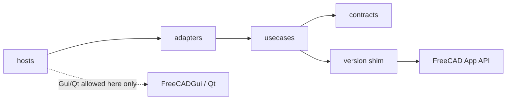
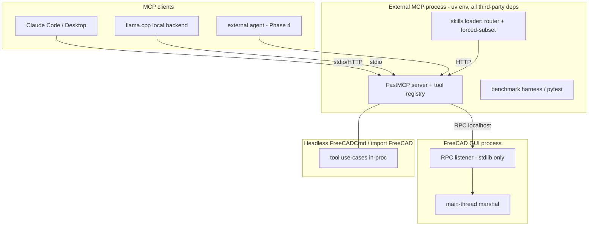

# Architecture Spine — freecad-buddy

## Design Paradigm

> Detailed design: [Component Design](design/component-design.md) (ring inventory, interfaces, flows) · [Project Structure Design](design/project-structure.md) (repo tree, packaging).

**Clean Architecture.** Dependencies point inward only. FreeCAD's App-layer Python API is treated as the domain kernel; `FreeCADGui`/Qt are outer-ring drivers.

| Ring | Directory | Contains | May import |
| --- | --- | --- | --- |
| Contracts | `src/freecad_buddy/contracts/` | Tool schemas, result envelopes, diff/report/status types, assertion vocabulary | stdlib only |
| Use cases | `src/freecad_buddy/usecases/` | Tool implementations (`query_*`, `verify_*`, `sketch_*`, `feature_*`, `export_*`, `preview_*`), mutation protocol, TNP guard, fingerprint | contracts, FreeCAD **App** modules (via version shim) |
| Adapters | `src/freecad_buddy/adapters/` | MCP server (FastMCP), in-FreeCAD RPC listener, main-thread marshal, skills loader, harness runner | usecases, contracts |
| Hosts | `src/freecad_buddy/hosts/` | GUI addon (`InitGui.py`), headless entry, Phase 4 supervisor | adapters |



## Invariants & Rules

### AD-1 — Clean Architecture dependency rule [ADOPTED]

- **Binds:** all
- **Prevents:** GUI-coupled core that silently kills headless CI; adapters reaching into FreeCAD directly
- **Rule:** Imports cross ring boundaries inward only. `FreeCADGui`, Qt widgets, and Coin are importable **only** in `hosts/` — with two named `adapters/` exemptions: the render capability probe, and the main-thread marshal (QtCore primitives only, no widgets/`FreeCADGui`). `contracts/` imports stdlib only. CI enforces a no-`Gui`-import check on `contracts/`, `usecases/`, and the RPC listener.

### AD-2 — Process topology & main-thread marshaling [ADOPTED]

> Detailed design: [Integration Design — MCP ↔ FreeCAD](design/integration-mcp-freecad.md).

- **Binds:** adapters, hosts
- **Prevents:** background-thread FreeCAD/Qt calls (the documented crash mode); in-process asyncio-in-Qt fragility
- **Rule:** GUI mode = external MCP server process + thin in-FreeCAD RPC listener; the listener accepts off-thread and marshals every FreeCAD call to the Qt main thread (Mod/Web `postEvent` pattern); addon start is deferred until `FreeCAD.GuiUp` via `QTimer.singleShot`. Headless mode = single process, tool core called inline (no Qt loop exists); where the external interpreter cannot `import FreeCAD`, the documented fallback is the GUI topology minus Qt — `FreeCADCmd`-hosted RPC listener with inline dispatch. Same use-case implementations in all modes. The RPC wire contract (stdlib-encodable JSON-RPC frames + versioned handshake) is defined in `contracts/` — both sides import it; neither invents framing. *Deliberate amendment of intent.md Phase 0 wording ("MCP server starts inside FreeCAD"): the addon starts the RPC listener AND **auto-spawns the external MCP protocol server** as a child process — using the project venv interpreter **auto-discovered from the addon's own install path** (no env vars; it never imports `mcp`, AD-12) — so opening FreeCAD is the only operator step to reach the bridge over MCP. The internal `serve --mode rpc` CLI that runs that server is a debug/troubleshoot fallback for when auto-start is disabled or unresolvable — never the normal path.*

### AD-3 — Transport policy [ADOPTED]

> Detailed design: [Integration Design — MCP ↔ FreeCAD](design/integration-mcp-freecad.md) (RPC wire, bind/token) · [MCP Client Integration Design](design/integration-mcp-clients.md) (per-client transport).

- **Binds:** adapters
- **Prevents:** transport lock-in; deprecated-SSE adoption; stdout protocol corruption
- **Rule:** stdio for headless/dev/CI; streamable HTTP for in-GUI long-lived serving and the Phase 4 service; SSE never. Transport is a run flag on one FastMCP server object. On the stdio path, logging goes to stderr only — `print()` to stdout is banned in server code. RPC listener and HTTP endpoint bind localhost by default; the RPC channel carries a per-session token generated at addon start; any remote bind is an explicit operator opt-in.

### AD-4 — Typed tools are the only AI mutation path [ADOPTED]

> Detailed design: [Security and Phase 4 Service Design](design/security-and-service-design.md) (§1 `debug_exec` gating) · [MCP Tool Catalog Design](design/mcp-tools-design.md) (§5 registration rules).

- **Binds:** all
- **Prevents:** LLM free-form `exec` becoming the mutation path (host RCE + unverifiable ops)
- **Rule:** AI-visible mutations exist only as typed `sketch_*`/`feature_*`/`document_*` tools. `debug_exec` is operator-only: disabled by default, enabled by human-set env flag, unregistered from the MCP tool list when off, append-only audit-logged, disabled permanently in the Phase 4 service. In-process Python restriction (RestrictedPython, audit hooks, blacklists) is never called a security boundary; isolation is OS-level (AD-18).

### AD-5 — Uniform mutation transaction protocol [ADOPTED]

> Detailed design: [Verification Subsystem Design](design/verification-design.md) (§1 `run_mutation` wrapper).

- **Binds:** every mutation tool
- **Prevents:** per-tool divergent safety handling; trusting undo (FreeCAD bug #6031); silent partial rollback
- **Rule:** Every mutation runs: geohash snapshot → `openTransaction` → typed op → `recompute()` → post-verify (recompute clean, `Shape.isValid()`, `FullyConstrained` where sketches involved, TNP audit) → `commitTransaction`. Any failure: `abortTransaction` → `recompute()` → **re-hash and compare to prove rollback**; on mismatch, restore from the pre-mutation `saveCopy` snapshot and re-verify. Rollback success is measured, never assumed. Undo history is bridge-owned — no mutation outside a bridge transaction.

### AD-6 — Geometry fingerprint definition [ADOPTED]

> Detailed design: [Verification Subsystem Design](design/verification-design.md) (§2 `fingerprint()`) · [Data Contracts Design](design/data-contracts-design.md) (§10 `FingerprintRecord`).

- **Binds:** mutation protocol, undo verification, revision diffs
- **Prevents:** two incompatible "geometry hash" implementations; nondeterministic oracles
- **Rule:** Document fingerprint = SHA-256 over per-object shape bytes, objects sorted by immutable `Name`, plus a quantized mass-property tuple (volume, area, bbox, COM, principal moments @1e-6) as independent cross-oracle. Exactly one `fingerprint()` implementation exists (usecases); the serializer is shim-probed (`exportBinary`, else `exportBrep` stream) and every hash is tagged with its serializer id — comparing hashes across serializer tags is banned. Document-XML/FCStd hashing and tessellation hashing are banned as identity oracles.

### AD-7 — TNP reference audit [ADOPTED]

> Detailed design: [Verification Subsystem Design](design/verification-design.md) (§3 TNP guard, layers 0–2).

- **Binds:** every mutation tool; verification reports
- **Prevents:** silent reference re-point/drop passing as success; false-clean verdicts on unsupported versions
- **Rule:** `snapshot_references` before mutation, `audit_references` after recompute. Layer 0: sweep `isValid()` + `getStatusString()`. Layer 1: diff mapped names — flag `?`-markers, silent re-points, and count drops (the `FeatureDressUp` silent-drop trap). Layer 2 (`getElementHistory`) only where Layer 1 is ambiguous. Capability-gated: no element map → report `UNSUPPORTED`, never clean. Every report records `ElementMapVersion`; a version bump re-baselines, it does not fail.

### AD-8 — Sketch pass signal [ADOPTED]

> Detailed design: [Verification Subsystem Design](design/verification-design.md) (§4 `verify_sketch`).

- **Binds:** verify tools, benchmark graders, repair loops
- **Prevents:** grader and verifier disagreeing on "fully constrained"; inferring DoF from `solve() == 0`
- **Rule:** PASS ⇔ `sketch.FullyConstrained == True`, read after `doc.recompute()`. Hard fail on conflicting/malformed/over-/under-constrained or degenerate geometry; redundant constraints warn, never fail. `solve()` return codes are logging only.

### AD-9 — Export/verify pairing [ADOPTED]

> Detailed design: [Verification Subsystem Design](design/verification-design.md) (§6 `verify_export_*`).

- **Binds:** all export tools
- **Prevents:** "bytes were written" counted as success; STL/3MF silently diverging; format-specific writer bugs shipping
- **Rule:** Every `export_*` completes only through its paired `verify_export_*` re-import check. STEP is the canonical round-trip (AP214/AP242, `write.step.unit=MM` pinned per call, ±0.1 %). One tessellation source — `MeshPart.meshFromShape` with linear **and** angular deflection — feeds both STL and 3MF. Oracles: trimesh primary + one independent second checker (admesh where available — dormant upstream, Linux-leaning; fallback second oracle chosen at the Phase 0 gate) for STL; lib3mf + trimesh + FreeCAD self-read for 3MF. `verify_export_*` is orchestrated on the external-process side (that's where the oracles live); the FreeCAD self-read leg runs in-FreeCAD via RPC. Independent-oracle disagreement = fail. Mesh volume tolerance derives from deflection, never ±0.1 %.

### AD-10 — Preview/confirmation channel [ADOPTED]

> Detailed design: [MCP Client Integration Design](design/integration-mcp-clients.md) (§4 confirmation matrix, §5 image rules) · [Data Contracts Design](design/data-contracts-design.md) (§8 `GeometryDiff`).

- **Binds:** Phase 2+ mutation UX, all three client contexts (GUI panel, MCP client, headless)
- **Prevents:** preview design that assumes a GUI; confirmation gated on pixels; image token blow-ups
- **Rule:** `preview_dry_run` executes on a `copyObject` TempDoc and returns a structured diff (Δvolume/area/bbox/COM, face/edge/solid counts, touched/new/deleted nodes, validity, TNP pre-check) validated by its `outputSchema` — the mandatory payload. Renders are optional and capability-gated (GUI `saveImage` / offscreen-Xvfb / omit), ≤1024 px, `audience:["user"]`, `resource_link` preferred over inline base64. Confirmation: MCP elicitation (`accept`/`decline`/`cancel`) with client-confirm fallback; headless is fail-closed unless an explicit `autoApprove` flag, and every auto-approval is audit-logged. Apply re-runs the op on the live document under AD-5.

### AD-11 — Version matrix & shim [ADOPTED]

> Detailed design: [Integration Design — MCP ↔ FreeCAD](design/integration-mcp-freecad.md) (§5 `shim.py`) · [Project Structure Design](design/project-structure.md) (§3 version legs).

- **Binds:** all FreeCAD-touching code; CI
- **Prevents:** version-sensitive calls scattered through use cases; incomparable TNP metrics across legs
- **Rule:** Supported: FreeCAD 1.0.x (floor, blocking CI) and 1.1.x (primary, blocking); 1.2-dev weekly is an allowed-to-fail canary; 0.21 unsupported. All version-sensitive calls live in one shim module: `AttachmentSupport`/`Support` accessor, `element_map_available()` probe (hard-gates AD-7), `addObject` type-string table, VarSet-with-Spreadsheet-fallback driving-dimension façade. Capability probes, never version-string comparisons, gate behavior. Round-trip fixtures are authored on 1.0.

### AD-12 — In-FreeCAD code is dependency-free [ADOPTED]

> Detailed design: [Project Structure Design](design/project-structure.md) (§2.3 one package, two runtimes).

- **Binds:** usecases, RPC listener, GUI addon
- **Prevents:** bundled-Python dependency hell; broken Addon Manager installs
- **Rule:** Code that runs inside the FreeCAD process imports stdlib + FreeCAD API only. All third-party dependencies (mcp/FastMCP, trimesh, admesh, lib3mf, pytest…) live in the external MCP/harness process, uv-managed.

### AD-13 — Harness independence & assertion style [ADOPTED]

> Detailed design: [Validation & Benchmark Harness Design](design/validation-harness-design.md) (independence, fault-injection, grader) · [Verification Subsystem Design](design/verification-design.md) (§7 assertion vocabulary).

- **Binds:** benchmarks, graders, Phase 3 spec assertions
- **Prevents:** actor grading itself; feature-tree reading validating intent instead of artifact; TNP-fragile selectors
- **Rule:** Pass/fail is decided by deterministic `verify_*` code or an independent grader — never by the producing agent. Spec assertions measure geometry (`Face.Surface` typing, axis/radius/spacing, bbox/volume) in an explicit anchor frame — declared per spec from a closed derivation set (named datum | base sketch plane | largest planar face fallback), resolved by one shared implementation; feature metadata (e.g. `PartDesign::Hole.Diameter`) is diagnostic hint only; sub-element index selectors are banned in specs. Every validator ships a ≥10-case fault-injection suite and reports sensitivity ≥95 % / false-alarm ≤5 % before its scores are citable. Benchmarks split dev/held-out; held-out is sealed until phase exit. Whole-shape similarity (Chamfer/IoU) is never a primary metric.

### AD-14 — Benchmark statistics rules [ADOPTED]

> Detailed design: [Validation & Benchmark Harness Design](design/validation-harness-design.md) (§4 stats module).

- **Binds:** every phase gate and ablation claim
- **Prevents:** noise reported as wins; the +15pp-at-n=20 undecidable criterion
- **Rule:** "Measurable margin" = exact McNemar two-sided p<0.05 **and** 95 % Wilson CI on the paired difference excluding 0. Repeats: R=5 default, R=3 Phase 1 answer eval, R≥10 for sealed held-out runs and any pp-threshold claim; a case scores pass on **majority-of-R**, and the per-repeat distribution is reported alongside the rate. Every reported pass rate carries its Wilson 95 % CI. Any specific pp-threshold claim (e.g. `design-decomposition` +15pp) runs on a dedicated n≥40 paired set. Below-detection effects are reported as "below detection at this n", not as failures. A dev/held-out gap >15pp = overfitting — the phase does not exit.

### AD-15 — Skills loading architecture [ADOPTED]

> Detailed design: [Skills Library Structure Design](design/skills-structure-design.md) (store, loader, routing, budgets).

- **Binds:** skills library, agent harnesses, ablation runner
- **Prevents:** context-rot from all-12 resident loading; nondeterministic ablation A/Bs; cross-skill coupling polluting deltas
- **Rule:** One skill store (`SKILL.md` body ≤1,500 words, CI-enforced; long tail in `references/`; no runtime code-level cross-skill dependency — a body never imports or `references/`-links into another skill's directory). Every skill body carries the same four sections: scope statement, decision rules, worked examples, anti-patterns. A body **may name a sibling skill in prose** to route the reader (all 12 skills are installed together), so long as the two skills' scopes stay disjoint; such a mention is a routing pointer, not a content dependency. *(Amended: the earlier "no Level-2 cross-skill dependencies" wording forbade any sibling mention in a body to keep ablation deltas perfectly attributable; the all-installed runtime makes in-body routing pointers worth their cost. Trade-off accepted: a body that leans on a sibling's content is not cleanly ablatable in isolation — such coupling is minimized and noted so the ablation campaign accounts for it.)* Two loader modes over the store: production = metadata-first router (descriptions resident, 2–5 bodies routed per task, ≤~10K token skill budget, routed subset logged); ablation = forced explicit-subset injection with auto-activation disabled. The injection path is the portable second-harness mechanism. *(Catalog: the 12 Track A+B parametric-CAD skills, plus a Phase-5 robot-description/sourcing group — `urdf-export`, `sdf-export`, `part-sourcing` — added when Phase-5 lands, AD-22/AD-23. New skills join the same store and shape contract; the resident-description count grows with the catalog.)*

### AD-16 — Benchmark provenance policy [ADOPTED]

> Detailed design: [Validation & Benchmark Harness Design](design/validation-harness-design.md) (§1.2 provenance manifest).

- **Binds:** all shipped benchmark/golden-model artifacts
- **Prevents:** Onshape-lineage copyright and non-commercial terms contaminating the repo
- **Rule:** Shipped artifacts come only from commercial-clean sources: FreeCAD Parts Library (CC-BY, attribution retained), FreeCAD wiki tutorials, hand-authored specs, verified-permissive HF datasets. Hand-authored specs must derive from documented real-world parts or user requests — never reverse-engineered to fit what the agent already does well. DeepCAD/ABC/Text2CAD lineage and Fusion 360 Gallery are methodology references and import-only geometry oracles — never shipped. Every benchmark documents provenance; community models are license-checked per item.

### AD-17 — Job status & report integrity [ADOPTED]

> Detailed design: [Data Contracts Design](design/data-contracts-design.md) (envelope, status, report, job, audit) · [Security and Phase 4 Service Design](design/security-and-service-design.md) (§6.4 supervisor re-checks).

- **Binds:** all tool results, validation reports, Phase 4 job API (schema binds from Phase 0)
- **Prevents:** "HTTP 200 for a bad part"; silent failures; schema rework at Phase 4
- **Rule:** Terminal outcomes use the closed set `OK | SPEC_FAILED | RECOMPUTE_ERROR | TIMEOUT | OOM_KILLED | WORKER_CRASHED | INVALID_INPUT` plus machine-readable detail. The `ResultEnvelope`, `ValidationReport`, `JobStatus`, and audit-record types are owned by `contracts/` from Phase 0 — every surface (tool results, harness reports, Phase 4 job API, audit log) reuses them; no surface defines its own variant. Validation-report fields are backed by re-executed deterministic checks — supervisor/harness re-runs them; agent claims are never echoed as results. An append-only audit log of every mutation and exec exists from Phase 0.

### AD-18 — Service isolation posture [ADOPTED]

> Detailed design: [Security and Phase 4 Service Design](design/security-and-service-design.md) (§5–§6 service architecture, sandbox).

- **Binds:** Phase 4 service; constrains earlier phases only via AD-17 schemas
- **Prevents:** in-process "sandboxing" theater; leak-accumulating long-lived workers
- **Rule:** The unit of memory reclamation and crash containment is the worker **process** (supervisor never imports FreeCAD; `spawn` start method; recycle default `maxtasksperchild=1`; whole-tree kill via Job Object / process-group). Security boundary is OS-level (Linux: nsjail/bubblewrap or hardened `--network none` container; Windows: WSL2-hosted Linux stack preferred, else AppContainer + Job Object); workers are network-free (egress deny-by-default) and GPU-none. Concrete profiles are set at the Phase 4 gate.

### AD-19 — Validation Design Gate ordering

> Detailed design: [Validation & Benchmark Harness Design](design/validation-harness-design.md) (gate runner, §6 fault-injection, §7 human tokens).

- **Binds:** every phase; benchmarks, validators, phase implementation code
- **Prevents:** phase code written before its validators exist; flattering self-graded metrics; overfit exits
- **Rule:** Phase *N* implementation may not begin until its Validation Design Gate lands: threat list, benchmark + assertions runnable (against a stub, failing honestly), ≥10-case fault-injection suite passing the AD-13 sensitivity bar, written grading rubric, and a reuse survey. Phase exit additionally requires a human spot-audit of ≥20 % of passing results — any audit-found false pass invalidates the run (fix validator, re-run, re-audit).

### AD-20 — Document lifecycle & targeting

> Detailed design: [MCP Tool Catalog Design](design/mcp-tools-design.md) (§1.1 handles, `document_*` tools) · [Data Contracts Design](design/data-contracts-design.md) (§9 `DocHandle`, selectors).

- **Binds:** all tool callers (AI, harness, supervisor, preview)
- **Prevents:** implicit-`ActiveDocument` ambiguity; interleaved mutations mid-transaction; TempDoc leaks and cross-cleanup
- **Rule:** Documents are opened/closed only through the `document_*` use cases — the harness and supervisor included, never raw `App.openDocument` alongside the bridge. Every tool call carries an explicit document handle; `ActiveDocument` is never an implicit target. Mutations on one document are serialized (single writer; AD-5 transactions never interleave). Preview TempDocs use a reserved name prefix, are flagged transient, and are cleaned by their creator — nothing else touches them.

### AD-21 — Visual verification leg (dual-channel done)

> Detailed design: [Verification Subsystem Design](design/verification-design.md) (§7a `verify_visual`) · [Validation & Benchmark Harness Design](design/validation-harness-design.md) (§8 visual judge wiring).

- **Binds:** Phase 3 loop convergence, gates G3/G4, Phase 4 job delivery
- **Prevents:** geometrically-passing but visually/semantically wrong parts shipping; the actor grading its own renders
- **Rule:** A generated **part** is done only when both channels pass: (a) all geometry assertions (AD-13) and (b) an **independent visual judge** — a vision-capable model that is never the acting agent (separate model id or separate context, same separation rule as the Phase 1 grader) — judging the standard visual set against the spec via a structured checklist, temperature 0, structured verdict. Standard visual set: 3D iso render + focus views **+ dimensioned TechDraw projections (front/top/right)** auto-generated from the part's driving parameters on a TempDoc copy (part document never polluted). The judge is conjunctive, never overriding: it cannot pass a part that geometry failed. Judge findings feed the repair loop as diagnostics. Capability-gated fail-closed: render or judge unavailable → part is NOT done; an explicit operator waiver (audit-logged) is the only bypass. The judge is itself a validator under AD-13/AD-19: fault-injected (planted visually-wrong parts) to sensitivity ≥95 % / false-alarm ≤5 % before its verdicts are citable. Per-operation verification (AD-5) stays geometry-only — the visual leg runs per part, not per mutation.

### AD-22 — Robot-description export (URDF/SDF)

> Scope: Phase 5 capability (Epic 7). Detailed design: [Robot-Description Export & Part Sourcing Design](design/robot-description-and-sourcing-design.md). Empirically-gated items land at the G5-robot gate.

- **Binds:** Phase-5 URDF/SDF export tools and their skills
- **Prevents:** an unverified XML dump counted as success; silent unit/frame errors crossing the CAD→robot boundary
- **Rule:** URDF/SDF are **emitted by our code** from the native Assembly kinematic tree (`AssemblyObject`/`AssemblyLink`/joints) + native solid inertials (`TopoShapeSolidPy` mass-property surface) + mesh export — the in-tree FreeCAD `Robot` workbench is a trajectory/simulation tool, not a URDF exporter, so nothing exports these for us; the external **CROSS** addon is evaluated first per the reuse rule and wrapped, not forked, if it fits. Every `export_urdf`/`export_sdf` completes **only** through its paired `verify_export_*` (re-parse the written file, schema-valid, single-root **acyclic** kinematic tree, joint axes finite and normalized in the joint frame, inertials positive and physically plausible, every mesh reference resolves) — mirroring AD-9's export/verify pairing; "bytes were written" is never success. The internal-mm/deg → **URDF/SDF-native metre/kg/radian** conversion is an explicit, pinned boundary, never an ambient default. Every link, joint, and inertial origin records the reference frame it is expressed in (frame-semantics rigor). Reuses AD-9 (pairing), AD-17 (envelopes/status), AD-20 (document lifecycle), AD-11 (shim owns version-sensitive Assembly/inertial calls), AD-12 (in-FreeCAD code stays stdlib + FreeCAD; XML emit and any schema libs live external).

### AD-23 — Off-the-shelf part sourcing & import

> Scope: Phase 5 capability (Epic 7). Detailed design: [Robot-Description Export & Part Sourcing Design](design/robot-description-and-sourcing-design.md). Empirically-gated items land at the G5-robot gate.

- **Binds:** Phase-5 part-sourcing/import tools and their skill
- **Prevents:** raw imports bypassing the bridge; trusting an imported part's origin/orientation; unlicensed shipped fixtures
- **Rule:** Off-the-shelf parts enter a document **only** through the `document_*`/import use cases (native STEP import via `ImportOCAF`/`ReaderStep`), never a raw `App.open` alongside the bridge (AD-20). Catalog **search** is an external concern; **placement** is standard bridge flow. An imported part's geometry is **measured** (`query_mass_properties`/`query_placement`) before its mating frames are trusted — its origin and orientation are never assumed. Any shipped catalog fixture records provenance and license per AD-16.

## Consistency Conventions

> Detailed design: [MCP Tool Catalog Design](design/mcp-tools-design.md) (tool names, envelopes, selectors) · [Data Contracts Design](design/data-contracts-design.md) (wire types, versioning).

| Concern | Convention |
| --- | --- |
| Tool names (wire) | Underscore + namespace prefix: `query_`, `document_`, `export_`, `verify_`, `sketch_`, `feature_`, `preview_`, `debug_`. Dot form (`verify.shape`) is docs shorthand only — dots are illegal in MCP tool names. |
| FreeCAD object identity | Script against immutable `Name`, display `Label`. Generated features get intent-bearing names (tree reads like a build plan). |
| Units | Internal mm/deg; tool params/results carry explicit units; export calls pin units per call (never rely on ambient defaults). |
| Tool results | `structuredContent` validated by per-tool `outputSchema` + text mirror; images per AD-10 budget rules. |
| Errors | Closed status set (AD-17) + human-readable explanation + machine detail; constraint diagnostics map 1-based solver IDs to `Constraints[id-1]` names. |
| Reports | Every verification/benchmark report carries a banner: FreeCAD version, `ElementMapVersion`, validator sensitivity, Wilson CI (where a rate is claimed). |
| Config | Capability flags via env vars set by the human operator (`FREECAD_BUDDY_ALLOW_EXEC`, `autoApprove`); capability probes at runtime, never version sniffing. |
| Logging | stderr-only in server code (stdio safety); audit log append-only JSON-lines per job/session. |
| Numeric tolerance | Assertions default absolute + relative bands, fault-injection-calibrated; never tighter than `Shape.getTolerance`; fingerprint quantization 1e-6. |
| Tests under FreeCADCmd | stdlib `unittest` only (AD-12 posture); pytest orchestrates from the external process. |
| Sub-element addressing (tool inputs) | Selector objects: geometric query or TNP mapped name. Bare indexed names (`Face6`) are resolved to mapped names at call time and never stored. |
| Reuse before invention | Survey first; adopted components are wrapped, not forked; anything built from scratch records why nothing existing fit (phase reuse survey, AD-19). |

## Stack

| Name | Version |
| --- | --- |
| Python | matches the bundled interpreter per FreeCAD leg: 3.11 (1.0.x) / 3.12 (1.1.x); external process pins per CI leg |
| FreeCAD | 1.0.x floor / 1.1.x primary (latest patch **available on conda-forge** — feedstock lags point releases) / 1.2-dev canary (conda-forge if published, else weekly AppImage) |
| MCP Python SDK | official `mcp` python-sdk, spec ≥2025-06-18 (elicitation + structured output; AD-10 depends on it), targeting 2025-11-25. SDK v2 (`FastMCP`→`MCPServer` rename) lands ~2026-07-27 — pin exact at Phase 0 after v2 stabilizes. PrefectHQ `fastmcp` is a distinct project; the choice between the two is a Phase 0 call |
| trimesh, lib3mf | current at Phase 0 pin — export oracles |
| admesh | optional secondary STL oracle (dormant upstream, no Windows wheels); fallback second oracle chosen at Phase 0 gate |
| pytest | current — harness runner (external process only) |
| uv | dependency management, external process only |
| GitHub Actions + micromamba | CI, cached conda env per pinned FreeCAD version |
| FreeCAD Assembly workbench | native (1.0+); supplies the kinematic link/joint tree for AD-22 — Phase 5 |
| CROSS addon | optional URDF/SDF export addon — evaluate-first reuse candidate for AD-22 (else emit XML ourselves); version pinned at the Phase-5 gate |
| URDF/SDF schema/parse lib | external-process only, for the AD-22 verify leg (re-parse + schema-valid); pinned at the Phase-5 gate |

## Structural Seed

> Detailed design: [Project Structure Design](design/project-structure.md) (repo tree, packaging, CI) · [Component Design](design/component-design.md) (per-ring components).



```text
freecad-buddy/
  src/freecad_buddy/
    contracts/     # schemas, envelopes, status set, assertion vocabulary (stdlib only)
    usecases/      # tool impls, mutation protocol, TNP guard, fingerprint, shim.py
    adapters/      # mcp_server, rpc_listener, marshal, skills_loader, harness glue
    hosts/         # InitGui.py (addon), headless entry, phase4 supervisor
  skills/          # Track A/B (+ Phase-5 robot-description/sourcing) skill dirs: SKILL.md + references/
  benchmarks/      # specs + assertions; dev/ and heldout/ splits; fault-injection/
  tests/           # unit + golden-model suites (run via FreeCADCmd in CI)
  .github/workflows/  # ci.yml: matrix {1.0.x, 1.1.x} blocking + 1.2-dev canary
```

**Environments:** dev = GUI addon + external server (HTTP) on Windows/Linux desktop; CI = `ubuntu-latest`, micromamba conda-forge FreeCAD, `FreeCADCmd run_tests.py`, xvfb + software-GL leg for render tests (isolated, non-blocking); Phase 4 service = supervisor + sandboxed worker pool, single-tenant local-first.

## Capability → Architecture Map

| Capability (intent.md) | Lives in | Governed by |
| --- | --- | --- |
| Phase 0 bridge & tools | usecases + adapters | AD-1..3, AD-9, AD-11, AD-12, AD-20 |
| Phase 0 test harness/CI | tests + harness | AD-13, AD-11, AD-19 |
| Phase 1 assistant (read-only) | query tools + skills loader | AD-4 (zero mutation), AD-15 |
| Phase 2 copilot mutations | mutation tools | AD-4..8, AD-10 |
| Phase 3 designer loop | plan/execute over Phase 2 tools | AD-5, AD-13, AD-14, AD-21 |
| Phase 4 service | hosts/phase4 supervisor | AD-17, AD-18, AD-21 |
| Phase 4 DFM / design-rule checks | verify tools (rule layer) + slicer CLI oracle | AD-9, AD-13; deferred detail |
| Phase 5 robot-description export (URDF/SDF) | Phase-5 export tools over the Assembly tree + inertials | AD-22, AD-9, AD-17, AD-20; deferred detail |
| Phase 5 off-the-shelf part sourcing/import | document_*/import + measurement | AD-23, AD-20, AD-16; deferred detail |
| Skills track | skills/ + ablation runner | AD-14, AD-15 |
| Benchmarks/golden models | benchmarks/ | AD-13, AD-14, AD-16 |

## Deferred

| Decision | Why it can wait |
| --- | --- |
| Local LLM backend pin (lean: llama.cpp + Qwen3-30B-A3B, constrained decoding) | Phase 1 gate; research pinned, no code shaped by it |
| Preview diff `outputSchema` field list | Locked once at Phase 2 UX design; must reuse the contracts-owned audit-record vocabulary that exists from Phase 0 (AD-17) |
| Skill router rules (task→subset map) | Tuned from ablation data; forced-subset mode unaffected |
| Concrete sandbox profiles (nsjail config, AppContainer caps, seccomp allowlist) | Phase 4 gate; posture fixed by AD-18 |
| Worker pool tuning (K warm workers, recycle N) | Soak test at Phase 4 sets empirically; N=1 safe default stands |
| Slicer-acceptance CI job for 3MF; lib3mf as fallback writer | Phase 4 realism gate; triggered by slicer rejects |
| DFM/design-rule layer (min wall, hole-edge distance; slicer CLI mapping) | Phase 4 gate; composes existing verify primitives |
| Phase 1 doc-citation channel (skills `references/` vs doc-retrieval tooling over local wiki clone) | Phase 1 gate; read-only capability, no schema impact |
| Assembly `JointObject.py` wrapper design | Phase 5; native Assembly WB exists (1.0+), Python-exposure of joints is the gap — prerequisite for AD-22 URDF/SDF export |
| URDF/SDF export detail (CROSS-addon-vs-hand-rolled-XML; the verify leg's schema/parse lib; URDF vs SDF tool split) | Phase-5 gate; posture fixed by AD-22, empirical CROSS-fit + Assembly-Python-exposure spikes decide the build path |
| Part-sourcing catalog integration (which catalog/API; search surface) | Phase-5 gate; posture fixed by AD-23 (import path + measured frames); search is external and swappable |
| SRDF (MoveIt planning semantics) | Deferred — no native FreeCAD path; derives from an exported URDF + external MoveIt Setup Assistant. Revisit after URDF (AD-22) lands and a MoveIt integration is wanted |
| Implicit CAD — **rejected, not deferred** | OCCT B-rep vs F-rep/SDF kernel mismatch; the verify stack (AD-6 fingerprint, AD-9 pairing) assumes B-rep solids. Recorded so it is not re-litigated |
| Exact tolerance defaults per assertion | Fault-injection calibration during each phase's Validation Design Gate |
| Phase 0 spike items: `exportBinary` Python exposure (fallback `exportBrep`), `renderToImage` w/o GUI-document vs Xvfb, VarSet exposure on 1.1 runtime, conda `FreeCADCmd` path edge | Empirical checks, first week of Phase 0 |
