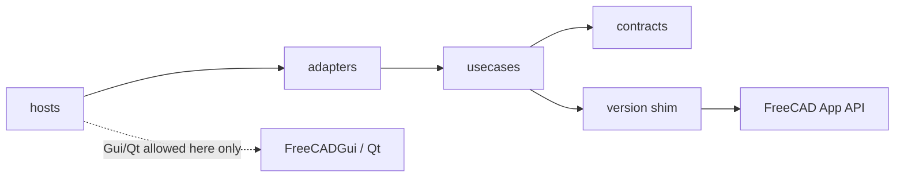
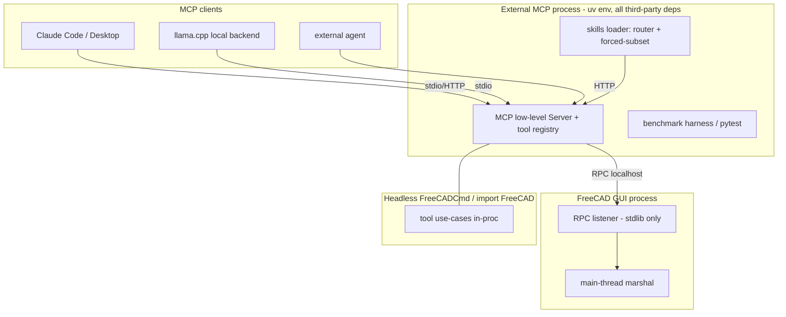

# Architecture Spine — freecad-buddy

## Design Paradigm

> Detailed design: [Component Design](design/component-design.md) (ring inventory, interfaces, flows) · [Project Structure Design](design/project-structure.md) (repo tree, packaging).

**Clean Architecture.** Dependencies point inward only. FreeCAD's App-layer Python API is treated as the domain kernel; `FreeCADGui`/Qt are outer-ring drivers.

| Ring | Directory | Contains | May import |
| --- | --- | --- | --- |
| Contracts | `src/freecad_buddy/contracts/` | Tool schemas, result envelopes, diff/report/status types, assertion vocabulary | stdlib only |
| Use cases | `src/freecad_buddy/usecases/` | Tool implementations (`query_*`, `verify_*`, `sketch_*`, `feature_*`, `export_*`, `preview_*`), mutation protocol, TNP guard, fingerprint, capabilities, confirm, screenshot, `stats` (stdlib-only rate statistics, importable from both sides) | contracts, FreeCAD **App** modules (via version shim) |
| Adapters | `src/freecad_buddy/adapters/` | MCP server, RPC client/listener/dispatch, main-thread marshal, render probe, audit log, export oracle + verdict | usecases, contracts |
| Hosts | `src/freecad_buddy/hosts/` | GUI addon (`gui_addon/`), external GUI host, headless entry, `main.py`, `tool_catalog.py` (shared tool surface — schemas, timeouts, mutating flags) | adapters |



## Invariants & Rules

### AD-1 — Clean Architecture dependency rule [ADOPTED]

- **Binds:** all
- **Prevents:** GUI-coupled core that silently kills headless CI; adapters reaching into FreeCAD directly
- **Rule:** Imports cross ring boundaries inward only. `FreeCADGui`, Qt widgets, and Coin are importable **only** in `hosts/` — with one named `adapters/` exemption: the render capability probe (`adapters/render_probe.py`). The main-thread marshal (`adapters/marshal.py`) holds no Qt import at all; the Qt event pump lives in `hosts/gui_addon/pump.py`, where it needs no exemption. `contracts/` imports stdlib only. CI enforces a no-`Gui`-import check on `contracts/`, `usecases/`, and the RPC listener.

### AD-2 — Process topology & main-thread marshaling [ADOPTED]

> Detailed design: [Integration Design — MCP ↔ FreeCAD](design/integration-mcp-freecad.md).

- **Binds:** adapters, hosts
- **Prevents:** background-thread FreeCAD/Qt calls (the documented crash mode); in-process asyncio-in-Qt fragility
- **Rule:** GUI mode = external MCP server process + thin in-FreeCAD RPC listener; the listener accepts off-thread and marshals every FreeCAD call to the Qt main thread (Mod/Web `postEvent` pattern); addon start is deferred until `FreeCAD.GuiUp` via `QTimer.singleShot`. Headless mode = single process, tool core called inline (no Qt loop exists); where the external interpreter cannot `import FreeCAD`, the documented fallback is the GUI topology minus Qt — `FreeCADCmd`-hosted RPC listener with inline dispatch. Same use-case implementations in all modes. The RPC wire contract (stdlib-encodable JSON-RPC frames + versioned handshake) is defined in `contracts/` — both sides import it; neither invents framing; its compatibility rule is AD-28. The connection file records the session token **and the addon PID**: the proxy validates both on every reconnect and exits once the PID it was spawned for is gone, and the addon's already-served check on `:8765` must confirm the listener is its own live proxy (probe `/healthz` for the session id) — a foreign or stale listener is an error surfaced to the operator, never a silent reuse. Without that check, a fast FreeCAD restart leaves an orphan proxy owning the port and wired to a dead listener, which the client sees as a hang rather than a status. The addon starts the RPC listener AND **auto-spawns the external MCP protocol server** as a child process — using the project venv interpreter **auto-discovered from the addon's own install path** (no env vars; it never imports `mcp`, AD-12) — so opening FreeCAD is the only operator step to reach the bridge over MCP. The internal `serve --mode rpc` CLI that runs that server is a debug/troubleshoot fallback for when auto-start is disabled or unresolvable — never the normal path.

### AD-3 — Transport policy [ADOPTED]

> Detailed design: [Integration Design — MCP ↔ FreeCAD](design/integration-mcp-freecad.md) (RPC wire, bind/token) · [MCP Client Integration Design](design/integration-mcp-clients.md) (per-client transport).

- **Binds:** adapters
- **Prevents:** transport lock-in; deprecated-SSE adoption; stdout protocol corruption
- **Rule:** stdio for headless/dev/CI; streamable HTTP for in-GUI long-lived serving; SSE never. Transport is a run flag on one MCP python-sdk low-level `Server` object. On the stdio path, logging goes to stderr only — `print()` to stdout is banned in server code. RPC listener and HTTP endpoint bind localhost by default; any remote bind is an explicit operator opt-in. **Both hops authenticate, in every phase.** The RPC channel carries a per-session token generated at addon start. The HTTP endpoint carries a bearer token on the same lifecycle — generated at addon start, written to the connection file, required on every request; a request without it gets 401, and `Origin` is validated against a localhost allowlist (DNS-rebinding defense). Localhost bind is not by itself an access control: the HTTP port is the complete mutation surface, so an unauthenticated `:8765` would let any local process drive the live document. Client configs read the token from the connection file.

### AD-4 — Typed tools are the only AI mutation path [ADOPTED]

> Detailed design: [MCP Tool Catalog Design](design/mcp-tools-design.md) (§5 registration rules).

- **Binds:** all
- **Prevents:** LLM free-form `exec` becoming the mutation path (host RCE + unverifiable ops)
- **Rule:** AI-visible mutations exist only as typed `sketch_*`/`feature_*`/`document_*` tools. `debug_exec` is operator-only: disabled by default, enabled by human-set env flag, unregistered from the MCP tool list when off, append-only audit-logged, and never enabled in an unattended run — the flag is a human act, and no agent may set it. In-process Python restriction (RestrictedPython, audit hooks, blacklists) is never called a security boundary; this repo ships no isolation boundary of its own, so the operator's environment is the only one — which is why the default-off posture is load-bearing.

### AD-5 — Uniform mutation transaction protocol [ADOPTED]

> Detailed design: [Verification Subsystem Design](design/verification-design.md) (§1 `run_mutation` wrapper).

- **Binds:** every mutation tool
- **Prevents:** per-tool divergent safety handling; trusting undo (FreeCAD bug #6031); silent partial rollback
- **Rule:** Every mutation runs: geohash snapshot → `openTransaction` → typed op → `recompute()` → post-verify (recompute clean, `Shape.isValid()`, `FullyConstrained` where sketches involved, TNP audit) → `commitTransaction`. Any failure: `abortTransaction` → `recompute()` → **re-hash and compare to prove rollback**; on mismatch, restore from the pre-mutation `saveCopy` snapshot and re-verify. Rollback success is measured, never assumed. Undo history is bridge-owned — no mutation outside a bridge transaction. The snapshot's location, naming, and deletion are fixed by AD-25 — a restore that cannot find its snapshot is a failed rollback, never a silent pass.

### AD-6 — Geometry fingerprint definition [ADOPTED]

> Detailed design: [Verification Subsystem Design](design/verification-design.md) (§2 `fingerprint()`) · [Data Contracts Design](design/data-contracts-design.md) (§10 `FingerprintRecord`).

- **Binds:** mutation protocol, undo verification, revision diffs
- **Prevents:** two incompatible "geometry hash" implementations; nondeterministic oracles
- **Rule:** Document fingerprint = SHA-256 over per-object shape bytes, objects sorted by immutable `Name`, plus a quantized mass-property tuple (volume, area, bbox, COM, principal moments @1e-6) as independent cross-oracle. Exactly one `fingerprint()` implementation exists (usecases); the serializer is shim-probed (`exportBinary`, else `exportBrep` stream) and every hash is tagged with its serializer id — comparing hashes across serializer tags is banned. Document-XML/FCStd hashing and tessellation hashing are banned as identity oracles.

### AD-7 — TNP reference audit [ADOPTED]

> Detailed design: [Verification Subsystem Design](design/verification-design.md) (§3 TNP guard, layers 0–2).

- **Binds:** every mutation tool; verification reports
- **Prevents:** silent reference re-point/drop passing as success; false-clean verdicts on unsupported versions
- **Rule:** `snapshot_references` before mutation, `audit_references` after recompute. Layer 0: sweep `isValid()` + `getStatusString()`. Layer 1: diff mapped names — flag `?`-markers, silent re-points, and count drops (the `FeatureDressUp` silent-drop trap). Layer 2 (`getElementHistory`) only where Layer 1 is ambiguous. Capability-gated: no element map → report `UNSUPPORTED`, never clean. Every report records `ElementMapVersion`; a version bump re-baselines, it does not fail.

### AD-8 — Sketch pass signal [ADOPTED]

> Detailed design: [Verification Subsystem Design](design/verification-design.md) (§4 `verify_sketch`).

- **Binds:** verify tools, benchmark graders, repair loops
- **Prevents:** grader and verifier disagreeing on "fully constrained"; inferring DoF from `solve() == 0`
- **Rule:** PASS ⇔ `sketch.FullyConstrained == True`, read after `doc.recompute()`. Hard fail on conflicting/malformed/over-/under-constrained or degenerate geometry; redundant constraints warn, never fail. `solve()` return codes are logging only.

### AD-9 — Export/verify pairing [ADOPTED]

> Detailed design: [Verification Subsystem Design](design/verification-design.md) (§6 `verify_export_*`).

- **Binds:** all export tools
- **Prevents:** "bytes were written" counted as success; STL/3MF silently diverging; format-specific writer bugs shipping
- **Rule:** Every `export_*` completes only through its paired `verify_export_*` re-import check. STEP is the canonical round-trip (AP214/AP242, `write.step.unit=MM` pinned per call, ±0.1 %). One tessellation source — `MeshPart.meshFromShape` with linear **and** angular deflection — feeds both STL and 3MF. Oracles: trimesh primary + one independent second checker (admesh where available — dormant upstream, Linux-leaning; fallback second oracle chosen at the Phase 0 gate) for STL; lib3mf + trimesh + FreeCAD self-read for 3MF. `verify_export_*` is orchestrated on the external-process side (that's where the oracles live); the FreeCAD self-read leg runs in-FreeCAD via RPC. Independent-oracle disagreement = fail. Mesh volume tolerance derives from deflection, never ±0.1 %. **The `export_*` tool itself invokes its verify leg** and returns one envelope: `OK` only when that leg passed, otherwise the leg's status, and a failed export leaves no file at the target path. The standalone `verify_export_*` tools exist to re-check an already-written file; they are never the only thing standing between a write and an `OK`. (Fixing the relation without fixing the invoker would let one export tool return `SPEC_FAILED` and delete while its sibling returns `OK` and leaves a bad file.)

### AD-10 — Preview/confirmation channel [ADOPTED]

> Detailed design: [MCP Client Integration Design](design/integration-mcp-clients.md) (§4 confirmation matrix, §5 image rules) · [Data Contracts Design](design/data-contracts-design.md) (§8 `GeometryDiff`).

- **Binds:** Phase 2+ mutation UX, all three client contexts (GUI panel, MCP client, headless)
- **Prevents:** preview design that assumes a GUI; confirmation gated on pixels; image token blow-ups
- **Rule:** `preview_dry_run` executes on a `copyObject` TempDoc and returns a structured diff (Δvolume/area/bbox/COM, face/edge/solid counts, touched/new/deleted nodes, validity, TNP pre-check) validated by its `outputSchema` — the mandatory payload. Renders are optional and capability-gated (GUI `saveImage` / offscreen-Xvfb / omit), ≤1920 px, `audience:["user"]`, `resource_link` preferred over inline base64. The ≤1920 px cap is the **user-facing** budget — it governs images that travel through client context. Review-directed images (AD-21 visual set) carry their own ≥2048 px legibility floor instead — they are written as artifacts the driving agent reads, so this user-facing budget does not govern them. Confirmation: MCP elicitation (`accept`/`decline`/`cancel`) with client-confirm fallback; headless is fail-closed unless an explicit `autoApprove` flag, and every auto-approval is audit-logged. Apply re-runs the op on the live document under AD-5.

### AD-11 — Version matrix & shim [ADOPTED]

> Detailed design: [Integration Design — MCP ↔ FreeCAD](design/integration-mcp-freecad.md) (§5 `shim.py`) · [Project Structure Design](design/project-structure.md) (§3 version legs).

- **Binds:** all FreeCAD-touching code; CI
- **Prevents:** version-sensitive calls scattered through use cases; incomparable TNP metrics across legs
- **Rule:** Supported: FreeCAD 1.1.x (blocking CI; the latest patch on conda-forge, 1.1.3 at 2026-10-03); 1.2-dev weekly is an allowed-to-fail canary; 1.0.x and 0.21 are unsupported (decision 016). All version-sensitive calls live in one shim module: `AttachmentSupport`/`Support` accessor, `element_map_available()` probe (hard-gates AD-7), `addObject` type-string table, VarSet-with-Spreadsheet-fallback driving-dimension façade. Capability probes, never version-string comparisons, gate behavior. Round-trip fixtures authored on 1.0 still load on 1.1; new fixtures are authored on 1.1.

### AD-12 — In-FreeCAD code is dependency-free [ADOPTED]

> Detailed design: [Project Structure Design](design/project-structure.md) (§2.3 one package, two runtimes).

- **Binds:** usecases, RPC listener, GUI addon
- **Prevents:** bundled-Python dependency hell; broken Addon Manager installs
- **Rule:** Code that runs inside the FreeCAD process imports stdlib + FreeCAD API only. All third-party dependencies (`mcp`, trimesh, admesh, lib3mf, pytest…) live in the external MCP/harness process, uv-managed.

### AD-13 — Harness independence & assertion style [ADOPTED]

> Detailed design: [Validation & Benchmark Harness Design](design/validation-harness-design.md) (independence, fault-injection, grader) · [Verification Subsystem Design](design/verification-design.md) (§7 assertion vocabulary).

- **Binds:** benchmarks, graders, Phase 3 spec assertions
- **Prevents:** actor grading itself *in a cited number*; feature-tree reading validating intent instead of artifact; TNP-fragile selectors
- **Rule:** The separation is drawn at the **reporting boundary**, not inside the loop. In operation the driving agent builds the part and reviews it (AD-21, AD-35) — what it concludes steers its next action, and "this looks wrong, rebuild it" is a legitimate working judgement. In a benchmark or a gate, pass/fail is decided by deterministic `verify_*` code or an independent grader that did not produce the work — never by the producing agent. The test applies to the **artifact**, not to who reads it: a number is citable when it is recomputable from stored measurements by a party that did not produce the work; it is not citable when its value depends on a judgement the producing agent made, including counts derived from such judgements. A derived statistic inherits the status of its least-citable input. Spec assertions measure geometry (`Face.Surface` typing, axis/radius/spacing, bbox/volume) in an explicit anchor frame — declared per spec from a closed derivation set (named datum | base sketch plane | largest planar face fallback), resolved by one shared implementation. Every member of that set is **total and deterministic**: it resolves to exactly one frame for a given shape on the supported FreeCAD build, or it raises. `largest_planar_face` therefore carries a mandatory tie-break (largest area, then lowest centroid along global Z, then lowest sorted mapped name), because `Shape.Faces` order is not a stable contract across builds and an untied frame flips the origin on a symmetric part. The resolved face's mapped name is recorded in the report banner. A spec whose built part's anchor frame does not equal its committed 1.1.x reference frame is a broken spec, not a failing part — otherwise a frame that moves after a FreeCAD update reads as a failing part. feature metadata (e.g. `PartDesign::Hole.Diameter`) is diagnostic hint only; sub-element index selectors are banned in specs. Every validator ships a ≥10-case fault-injection suite and reports sensitivity ≥95 % / false-alarm ≤5 % before its scores are citable. Benchmarks split dev/held-out; held-out is sealed until phase exit. Whole-shape similarity (Chamfer/IoU) is never a primary metric.

### AD-14 — Benchmark statistics rules [ADOPTED]

> Detailed design: [Validation & Benchmark Harness Design](design/validation-harness-design.md) (§4 stats module).

- **Binds:** every phase gate and ablation claim
- **Prevents:** noise reported as wins; the +15pp-at-n=20 undecidable criterion
- **Rule:** "Measurable margin" = exact McNemar two-sided p<0.05 **and** 95 % Wilson CI on the paired difference excluding 0. Repeats: R=5 default, R=3 Phase 1 answer eval, R≥10 for sealed held-out runs and any pp-threshold claim; a case scores pass on **majority-of-R**, and the per-repeat distribution is reported alongside the rate. Every reported pass rate carries its Wilson 95 % CI. Any specific pp-threshold claim (e.g. `design-decomposition` +15pp) runs on a dedicated n≥40 paired set. Below-detection effects are reported as "below detection at this n", not as failures. A dev/held-out gap >15pp = overfitting — the phase does not exit. **Tiered gate screens:** the G1 error-diagnosis gate uses the ladder from intent.md — grade n=10 first (pass ≥8/10), escalate to the sealed n=30 run only on a 10/10 result (Wilson CI reported); below 10/10 the gate concludes at n=10 and is flagged low-confidence. **The skill-loaded leg (GS.4, `freecad-troubleshooting`) rides the same ladder at a higher bar: ≥9/10 at n=10 to pass** (intent.md L131, vs the baseline 8/10), escalating on the same 10/10 trigger. A 9/10 skill result is therefore a pass that concludes at n=10 flagged low-confidence — the bar and the escalation trigger are deliberately different numbers, and a citation must state which n it concluded at. The R≥10 repeat rules above govern ablation and pp-threshold claims, not this screen.

### AD-15 — Skills loading architecture [ADOPTED]

> Detailed design: [Skills Library Structure Design](design/skills-structure-design.md) (store, loader, routing, budgets).

- **Binds:** skills library, agent harnesses, ablation runner
- **Prevents:** context-rot from all-resident loading; nondeterministic ablation A/Bs; cross-skill coupling polluting deltas
- **Rule (helper scripts):** A skill directory **may carry executable helpers** — geometry checkers, assertion evaluators, report formatters — run by the **driving agent's own shell**, never by the bridge. Three limits keep this from reintroducing what AD-35 forbids: a helper **reads and computes, never mutates** (no document mutation, and no writes outside the AD-25 run workdir, so it cannot carry state between invocations as a plan file); a helper **contains no model call and no credential**; and a helper **answers one question per invocation and never decides the next action** — a geometry check is a helper, a next-action chooser is the loop wearing a script's clothes. The third limit is the load-bearing one: the first two are satisfied by any loop that delegates execution to the agent's shell.
- **Rule (Track W):** The procedural knowledge a coded loop would hold is skill content: **`design-loop`** (plan → execute → measure → repair; when to measure, how many repairs, what "done" means), **`visual-review`** (AD-21's checklist), **`spec-to-assertions`** (authoring machine-checkable assertions before building). Track W is **exempt from the ablation cut**: `design-loop` cannot be ablated on a spec benchmark because without it no loop exists and the benchmark cannot run at all. It is validated by the benchmark passing, not by a delta against its own absence.
- **Rule:** One skill store (`SKILL.md` body ≤1,500 words — enforcement by `scripts/check_skill_shape.py` in CI is **required and not yet built** (Story 6.1); until it lands the cap is convention only; long tail in `references/`; no runtime code-level cross-skill dependency — a body never imports or `references/`-links into another skill's directory). Every skill body carries the same four sections: scope statement, decision rules, worked examples, anti-patterns. A body **may name a sibling skill in prose** to route the reader (all skills are installed together), so long as the two skills' scopes stay disjoint; such a mention is a routing pointer, not a content dependency. A body that leans on a sibling's content is not cleanly ablatable in isolation — such coupling is minimized and noted so the ablation campaign accounts for it. Two loader modes over the store: production = metadata-first router (descriptions resident, 2–5 bodies routed per task, ≤~10K token skill budget, routed subset logged); ablation = forced explicit-subset injection with auto-activation disabled. The injection path is the portable second-harness mechanism. **Cut rule:** the required majority of Track A+B skills must clear the AD-14 measurable-margin bar, Track W excepted per the rule above; those below it are revised or removed, never kept on the strength of sounding right. **Freshness:** every `SKILL.md` records the FreeCAD version its claims were verified against (same pins as the AD-11 CI matrix); a matrix version bump opens a re-verification obligation for every skill, and benchmark failure analyses feed skill corrections. These are the two mitigation legs intent.md's stale-skills risk names beside ablation. *(Catalog: the Track A+B parametric-CAD skills and the three Track W workflow skills, plus a Phase-5 robot-description/sourcing group — `urdf-export`, `sdf-export`, `part-sourcing` — added when Phase-5 lands, AD-22/AD-23. New skills join the same store and shape contract; the resident-description count grows with the catalog.)*

### AD-16 — Benchmark provenance policy [ADOPTED]

> Detailed design: [Validation & Benchmark Harness Design](design/validation-harness-design.md) (§1.2 provenance manifest).

- **Binds:** all shipped benchmark/golden-model artifacts
- **Prevents:** Onshape-lineage copyright and non-commercial terms contaminating the repo
- **Rule:** Shipped artifacts come only from commercial-clean sources: FreeCAD Parts Library (CC-BY, attribution retained), FreeCAD wiki tutorials, hand-authored specs, verified-permissive HF datasets. Hand-authored specs must derive from documented real-world parts or user requests — never reverse-engineered to fit what the agent already does well. DeepCAD/ABC/Text2CAD lineage and Fusion 360 Gallery are methodology references and import-only geometry oracles — never shipped. Every benchmark documents provenance; community models are license-checked per item.

### AD-17 — Job status & report integrity [ADOPTED]

> Detailed design: [Data Contracts Design](design/data-contracts-design.md) (envelope, status, report, audit).

- **Binds:** all tool results, validation reports (schema binds from Phase 0)
- **Prevents:** a well-formatted report over a bad part; silent failures; schema rework later
- **Rule:** Terminal outcomes use the closed set `OK | SPEC_FAILED | RECOMPUTE_ERROR | TIMEOUT | OOM_KILLED | WORKER_CRASHED | INVALID_INPUT` plus machine-readable detail. *(`OOM_KILLED` and `WORKER_CRASHED` are reserved: they remain in the closed set under AD-28's stability rule so audit-log replay never breaks, and simply go unproduced.)* The `ResultEnvelope`, `ValidationReport`, and audit-record types are owned by `contracts/` from Phase 0 — every surface (tool results, harness reports, audit log) reuses them; no surface defines its own variant. Validation-report fields are backed by re-executed deterministic checks — the harness re-runs them; agent claims are never echoed as results. An append-only audit log of every mutation and exec exists from Phase 0. **Run traceability:** every design run carries a `run_id` threaded through every `ResultEnvelope`, `AuditRecord`, and `ValidationReport` it produces, and writes its plan, per-iteration geometry discrepancy vector, visual-review findings with their images, and repair decisions to the AD-25 session workdir under that id. A failed production run is reconstructable from its workdir alone, without the agent's context — the same evidence the harness already stores per gate run, through one mechanism rather than two.

### AD-19 — Validation Design Gate ordering

> Detailed design: [Validation & Benchmark Harness Design](design/validation-harness-design.md) (gate runner, §6 fault-injection, §7 human tokens).

- **Binds:** every phase; benchmarks, validators, phase implementation code
- **Prevents:** phase code written before its validators exist; flattering self-graded metrics; overfit exits
- **Rule:** Phase *N* implementation may not begin until its Validation Design Gate lands: threat list, benchmark + assertions runnable (against a stub, failing honestly), ≥10-case fault-injection suite passing the AD-13 sensitivity bar, written grading rubric, and a reuse survey. The gate is timeboxed to **~20 % of the phase timebox** and is part of the phase, not an addition to it — an unbounded gate eats the phase it is meant to protect. Each phase's validator ships a known-good reference corpus (Phase 0: ≥5 hand-made models with hand-computed values) against which the ≤5 % false-alarm rate is measured. The reuse survey names the candidates it actually surveyed and the outcome for each — including the community FreeCAD MCP servers that informed AD-2's topology, and the existing LLM eval frameworks weighed before building the AD-14 stats module. Phase exit additionally requires a human spot-audit of ≥20 % of passing results — any audit-found false pass invalidates the run (fix validator, re-run, re-audit).

### AD-20 — Document lifecycle & targeting

> Detailed design: [MCP Tool Catalog Design](design/mcp-tools-design.md) (§1.1 handles, `document_*` tools) · [Data Contracts Design](design/data-contracts-design.md) (§9 `DocHandle`, selectors).

- **Binds:** all tool callers (AI, harness, preview)
- **Prevents:** implicit-`ActiveDocument` ambiguity; interleaved mutations mid-transaction; TempDoc leaks and cross-cleanup
- **Rule:** Documents are opened/closed only through the `document_*` use cases — the harness included, never raw `App.openDocument` alongside the bridge. Every tool call carries an explicit document handle; `ActiveDocument` is never an implicit target. Mutations on one document are serialized (single writer; AD-5 transactions never interleave). Preview TempDocs use a reserved name prefix, are flagged transient, and are cleaned by their creator — nothing else touches them.

### AD-21 — Visual verification leg (dual-channel done)

> Detailed design: [Verification Subsystem Design](design/verification-design.md) (§7a the visual set) · [Skills Library Structure Design](design/skills-structure-design.md) (`visual-review`, Track W).

- **Binds:** what "done" means for a part; the render and drawing tools; the `visual-review` skill
- **Prevents:** geometrically-passing but visually or semantically wrong parts being called done
- **Rule:** A generated **part** is done only when both channels pass: (a) all geometry assertions (AD-13) and (b) a **visual review against the spec**. The repo owes the **images and the checklist, never the judgement**. It produces the standard visual set — 3D iso render + focus views **+ dimensioned projections (front/top/right)** generated from the part's driving parameters on a TempDoc copy (part document never polluted), at a **≥2048 px** legibility floor below which a dimension cross-check degrades to noise — and the `visual-review` skill that says which views to request, what a mirrored or wrong-face part looks like, what is a real defect versus a shading artefact, and the per-part checklist to walk. **The driving agent performs the review** (AD-35): no judge client, no vision API, no credential, and no verdict-producing code lives in the source tree. The visual channel is conjunctive with geometry **in both directions** — a part is not done with assertions failing, and not done with the review never performed. Enforcement is an evidence trail rather than a runtime check: `visual-review` requires the agent to write its per-part findings into the AD-17 run workdir, a run whose workdir carries no visual evidence is an incomplete run, and AD-19's ≥20 % human spot-audit is what catches one. Absence of evidence is therefore detectable by a human reading the workdir and by nothing at runtime — a deliberate trade for keeping judgement out of the code. Per-operation verification (AD-5) stays geometry-only: visual review is per part, not per mutation.

### AD-22 — Robot-description export (URDF/SDF)

> Scope: Phase 5 capability (Epic 7). Detailed design: [Robot-Description Export & Part Sourcing Design](design/robot-description-and-sourcing-design.md). Empirically-gated items land at the G5-robot gate.

- **Binds:** Phase-5 URDF/SDF export tools and their skills
- **Prevents:** an unverified XML dump counted as success; silent unit/frame errors crossing the CAD→robot boundary
- **Rule:** URDF/SDF are **emitted by our code** from the native Assembly kinematic tree (`AssemblyObject`/`AssemblyLink`/joints) + native solid inertials (`TopoShapeSolidPy` mass-property surface) + mesh export — the in-tree FreeCAD `Robot` workbench is a trajectory/simulation tool, not a URDF exporter, so nothing exports these for us; the external **CROSS** addon is evaluated first per the reuse rule and wrapped, not forked, if it fits. Every `export_urdf`/`export_sdf` completes **only** through its paired `verify_export_*` (re-parse the written file, schema-valid, single-root **acyclic** kinematic tree, joint axes finite and normalized in the joint frame, inertials positive and physically plausible, every mesh reference resolves) — mirroring AD-9's export/verify pairing; "bytes were written" is never success. The internal-mm/deg → **URDF/SDF-native metre/kg/radian** conversion is an explicit, pinned boundary, never an ambient default. Every link, joint, and inertial origin records the reference frame it is expressed in (frame-semantics rigor). Reuses AD-9 (pairing), AD-17 (envelopes/status), AD-20 (document lifecycle), AD-11 (shim owns version-sensitive Assembly/inertial calls), AD-12 (in-FreeCAD code stays stdlib + FreeCAD; XML emit and any schema libs live external).

### AD-23 — Off-the-shelf part sourcing & import

> Scope: Phase 5 capability (Epic 7). Detailed design: [Robot-Description Export & Part Sourcing Design](design/robot-description-and-sourcing-design.md). Empirically-gated items land at the G5-robot gate.

- **Binds:** Phase-5 part-sourcing/import tools and their skill
- **Prevents:** raw imports bypassing the bridge; trusting an imported part's origin/orientation; unlicensed shipped fixtures
- **Rule:** Off-the-shelf parts enter a document **only** through the `document_*`/import use cases (native STEP import via `ImportOCAF`/`ReaderStep`), never a raw `App.open` alongside the bridge (AD-20). Catalog **search** is an external concern; **placement** is standard bridge flow. An imported part's geometry is **measured** (`query_mass_properties`/`query_placement`) before its mating frames are trusted — its origin and orientation are never assumed. Any shipped catalog fixture records provenance and license per AD-16.

### AD-24 — Performance & resource budgets

> Detailed design: [Validation & Benchmark Harness Design](design/validation-harness-design.md) (timing capture, report banner).

- **Binds:** phase gates, harness reporting
- **Prevents:** measurable exit criteria discovered unmet at phase exit; each phase inventing its own timing basis
- **Rule:** Phase 1 answer latency ≤15 s median; per-part wall-clock ≤10 min median, measured across an agent's whole run including its own thinking. These are gate criteria measured by the harness, never self-reported by the acting agent, and each is reported in the standard banner alongside its n. One timing basis for both: wall-clock from tool-call entry to envelope return, model time included. Budgets are pass/fail at the gate, not advisory — the gate runner carries an explicit budget leg in its verdict, so a run that meets every assertion and blows its budget **fails**. **Health surface:** the bridge exposes `/healthz` returning liveness and the session id, which is what AD-2's already-served check probes to tell its own proxy from a foreign or stale listener. Leak behaviour remains an operator-visible property: a long agent session accumulates in one process with no recycle boundary.

### AD-25 — Data & artifact locations

> Detailed design: [Project Structure Design](design/project-structure.md) (§6 session workdir).

- **Binds:** every component that writes a file — mutation protocol, exports, audit log, preview, harness
- **Prevents:** two implementers choosing different snapshot paths so a restore silently finds nothing; the bridge littering the user's document folder with orphan files; unbounded artifact growth
- **Rule:** Every file the bridge writes lives under a **session-scoped workdir** owned by the `documents` use case: `snap/` (AD-5 snapshots), `exports/`, `audit.log`, `tmp/`. The bridge never writes into the user's document directory except through an explicit `document_save`/`export_*` call carrying an operator-supplied path. Snapshots are named `<doc-Name>.<transaction-id>.FCStd`, are deleted by the transaction that created them on **every** exit path (commit, abort, or error), and any snapshot surviving into a new session is swept at bridge start. A restore reads only from the workdir of its own session.
- **Every temp file the bridge writes goes INSIDE the session workdir — the sweep never reaches outside it.** Render outputs (`FCB_TMP_shot_*`, `usecases/screenshot.py:172`) and fingerprint temporaries call `tempfile.mkstemp(...)` with **no `dir=` argument**, so they land in the OS temp directory, outside the workdir this AD scopes the sweep to. That is why 392 of them accumulated across sessions that had already exited — not an unwired sweep, but files the sweep was never able to see. The fix is `dir=<workdir>/tmp` at the creation sites, **not** a sweep that scans the OS temp directory: on a shared or multi-user host that directory is another session's territory, and deleting from it would break the very "a caller may still be reading the link" guarantee below. Pre-existing strays there are a one-time operator cleanup, never a bridge responsibility.
- **Each host process owns one session folder, `<workdir>/tmp/FCB_TMP_session_<pid>_<token>/`.** A GUI host and a headless host can share one workdir, so `dir=` points at that folder, not at `tmp/` itself. The sweep touches only `FCB_TMP_` entries. It removes a session folder only when the pid in its name is dead, and removes any other `FCB_TMP_` entry at the top of `tmp/`, because no live host writes there. A non-prefixed entry is never removed.
- **The reserved prefix marks FILES only.** `FCB_TMP_prev_`, `FCB_TMP_varset_probe`, `FCB_TMP_partdesign_probe` and `FCB_TMP_type_probe` name **in-memory FreeCAD documents**, not paths; they are released with `closeDocument` and must never be handed to `unlink`. A sweep written against "every reserved prefix" without this distinction fails on the first probe document it meets.
- A render link may still be being read when the call returns, so the sweep runs at **session start**, never as an immediate unlink.
- **A cleanup failure may not leave a silently-orphaned directory.** `_delete_snapshot` (`usecases/transaction.py:111-116`) removes the files then calls `os.rmdir`, catching `OSError` and passing. Ten empty `FCB_TMP_snap_*` directories exist despite the deletion contract — the files went, the directory did not, and the swallowed error is why nothing reports it. A swallowed cleanup error must still leave the artifact sweepable at next session start, so the reserved prefix is the backstop for exactly this case. *(The surviving directories correlate with the snapshot-restore path, where `FreeCAD.openDocument` (`transaction.py:290`) holds the file open; a forced undo-path rollback leaked nothing. Cause is strongly indicated but **not** verified — the restore path was not reproducible without risking the live document.)* Retention: audit logs are never rotated or truncated by the bridge (append-only, AD-17) but are written per session to a dated file so an operator can archive whole files; session workdirs are retained for the run's lifetime and swept on the next bridge start; benchmark run artifacts under `benchmarks/gate-artifacts/<gate>/<run-id>/` are retained indefinitely because gate verdicts are recomputed from them.

### AD-26 — Single client session

- **Binds:** RPC listener, MCP server, preview/apply pairing
- **Prevents:** two clients interleaving intent against one document while each call is individually serialized
- **Rule:** The bridge serves **one client session at a time**. The session token authenticates a session, not a client: a second client presenting it is refused (`-32000`, busy detail) unless the operator explicitly enables multi-client mode. In that mode every `preview_dry_run` → apply pair carries a fingerprint precondition (AD-6) and the apply fails if the document changed in between. Serializing calls is not serializing intent — AD-20's single-writer rule orders individual mutations, and this AD orders the multi-call sequences built from them.

### AD-27 — Post-timeout bridge state

- **Binds:** RPC listener, marshal, all callers including the harness
- **Prevents:** a caller mutating or closing a document while an abandoned operation still runs against it
- **Rule:** `TIMEOUT` is terminal **for the caller, not for the operation** — no preemption exists, so the in-FreeCAD op may still be running. On timeout the listener marks the session **quarantined**: further calls are refused with `TIMEOUT` and no new work is accepted until the in-flight op returns and its AD-5 transaction is aborted with rollback proved. No caller may close, reuse, or mutate a document while a call against it is quarantined. `WORKER_CRASHED` is the escalation when the op never returns. **No mutation is ever automatically retried**: a timed-out mutation is not idempotent — it may have committed — so recovery is an explicit `query_*` plus fingerprint comparison, never a blind re-call.

### AD-28 — Interface & schema evolution

> Detailed design: [Data Contracts Design](design/data-contracts-design.md) (§2 versioning) · [Integration Design — MCP ↔ FreeCAD](design/integration-mcp-freecad.md) (§2.2 frames).

- **Binds:** `contracts/`, the RPC wire, every generated schema, package release
- **Prevents:** a field rename silently breaking a running proxy; audit logs that can no longer be replayed; three version numbers drifting into one ambiguous "version"
- **Rule:** Contracts schemas evolve **additive-only within a major**: new fields are optional with a defined default, readers ignore unknown fields. Any removal, rename, type change, or closed-enum change is a **major bump**, and the old schema is retained for audit-log replay. The AD-17 terminal status set is frozen — adding a member is a major bump on every schema embedding it. Persisted state is never migrated in place: audit records are replayed with the decoder for the major they were written under. JSON Schemas are generated from the contracts types and diff-checked in CI (drift = build failure); per-tool `outputSchema`s compose them by `$ref` and an adapter never hand-writes a field contracts do not define. The RPC `contract_version` is a single integer bumped on any frame or field semantic change, refused at handshake on mismatch (`-32004`) with no negotiation and no compatibility shim. **Three independent numbers** — package version (SemVer, one source of truth in `pyproject.toml`, with `addon/package.xml` generated from it by `build_addon.py` and never hand-edited), RPC `contract_version`, and contracts schema major — each reported in the AD-17 banner.

### AD-29 — Live viewport framing is a host capability [ADOPTED]

- **Binds:** `usecases/screenshot`, `adapters/render_probe`, `hosts/gui_addon`, `tool_catalog`
- **Prevents:** `FreeCADGui` leaking into `usecases/` (the AD-1 CI check); two owners of the live camera
- **Rule:** Reading or writing the **live GUI camera** happens only behind a **second injected port, `ViewportPort`** — declared in `contracts/render.py` beside `RenderPort`, implemented in `hosts/gui_addon/`. `usecases/` stays Gui-free and the AD-1 adapters exemption list is unchanged at its single entry, `adapters/render_probe.py`. Hosts with no viewport inject `None`, and the usecase reports the capability unavailable.
- **It is NOT an extension of `RenderPort`.** The only `RenderPort` implementation in the tree is `OffscreenRenderPort` at `adapters/render_probe.py:130`; `hosts/` merely instantiates it (`gui_addon/bootstrap.py:22`, `headless/entry.py:27`). So "extend the port, implemented in `hosts/`" is not buildable as one sentence — extending the existing class puts live-camera code in `adapters/`, which would force a **second** Qt exemption. A separate port keeps the exemption list at one entry and leaves `OffscreenRenderPort` untouched. A `hosts/gui_addon/` implementation genuinely can reach the view: `FreeCADGui` is importable there (`scripts/check_imports.py:94-96 _qt_allowed`, which returns True for the `hosts` ring), and `start_bridge` already runs on the Qt main thread, which is where AD-2 requires the view be touched.
- **The two capability questions are separate predicates.** `OffscreenRenderPort.available()` answers *can this process render offscreen* — it probes via `FreeCADGui.setupWithoutGUI()` (`render_probe.py:65,157`). That is **orthogonal** to *does a live viewport exist*: a headless `FreeCADCmd` leg can render offscreen and has no `ActiveView`. Reusing `available()` for framing would report the capability present in headless and then fail to find a view, producing the `fits:null` AD-32 reserves for a GUI projection failure in exactly the case AD-32 requires the block be omitted. `ViewportPort` therefore has its own availability answer, per document.
- Where no viewport exists — the H1 headless host, `FreeCADCmd`, or a GUI document with no open 3D view — the capability is unavailable and the tool degrades honestly rather than fabricating a verdict, the same fail-honest posture AD-10 uses for `render:"none"`. *Note: the constructed-scene render (AD-10, render_probe) never reads the live camera — it self-frames via `viewAll`, so an MCP render is by construction never mis-framed. Only the human's viewport can be, which is what this AD addresses.*
- **The port answers a third question: which document the live viewport is actually showing.** `ViewportPort` carries **`showing_document_name() -> str | None`** beside `available()` and `view()`. It is **not** per document — it names the one document on screen, session-wide, and returns `None` when that cannot be read cheaply. This exists because `view(document)` **cannot** answer it: the shipped implementation resolves the view through `FreeCADGui.getDocument(<the handle's own Name>).ActiveView` (`hosts/gui_addon/viewport.py:54`), so the view handed back always belongs to the document that was asked for. Any guard comparing that view's document against the target compares a name with itself and can never fire — the R2-02 defect. The on-screen document must therefore come from a **different source than the target handle**: the focused Qt MDI sub-window inside `hosts/gui_addon/`, where Qt is legal (AD-1).
- **`FreeCADGui.ActiveDocument` stays banned in every ring — including `hosts/`.** `scripts/check_imports.py` runs `_check_active_document` on every ring file with **no layer filter** (verified: it is called at both `:227` and `:306`, and `FREECAD_MODULE_ALIASES` at `:52` now includes `FreeCADGui`). That ban is AD-20's, and R2-02 is exactly the implicit-target bug the ban exists to prevent, so the enforcer is **not** relaxed to fix it — that would invert the control. The port method reaches the focused sub-window without naming the banned attribute.
- **`None` is not a refusal.** An unreadable on-screen name is no evidence of a mismatch, so the fit proceeds. Fail-honest here means *not fabricating a mismatch*, the mirror of not fabricating a verdict. `None` deliberately conflates "no viewport at all" with "name unreadable" and carries **no reason string**, unlike its sibling `available()`: AD-31 treats both identically, so a reason would invite a caller to branch on a distinction with no consequence.
- **It is the one method on the port that takes no document, and the port's own docstring must be corrected to say so.** `contracts/render.py`'s `ViewportPort` docstring currently asserts "Both answers are per document" — true of `available()` and `view()`, false of this third method, which names the single on-screen document session-wide. Adding the method without amending that sentence leaves the contract contradicting itself at the exact point an implementer reads it.
- **A targeted document whose view exists but is not the focused one still gets its own verdict.** On a two-document session the framing read describes the **targeted** document's view (AD-32), even when the human is looking at the other one. That is correct and not a mismatch to refuse: the agent cannot fix it by fitting, and AD-32's case 1 (omit) covers only a targeted document with *no* view. `showing_document_name()` governs the AD-31 **fit refusal**, never the framing verdict's target.

### AD-30 — Framing verdict is an exact projection test [ADOPTED]

- **Binds:** the framing read, every tool summary that reports it, `view_fit_viewport`
- **Prevents:** two implementers inventing different framing tests (bbox-diagonal-vs-camera-height in one, screenshot pixel margin in another) and disagreeing on the same document
- **Rule:** "Beyond the viewport" is defined exactly, never heuristically: project the **8 corners of the union bounding box of the visible shape-bearing objects** through `View3DInventor.getPointOnViewport` and test containment against `getSize()`. `fits` is false **iff any corner falls outside** the viewport rectangle. The verdict carries the measured ratio (AD-32) so a caller can tell a hair's-breadth miss from a wildly wrong camera.
- **"Visible shape-bearing objects" means the SAME set the default render uses, and that set is defined by one shared predicate.** The framing test and the constructed-scene render must never disagree about what is on screen. `usecases/screenshot.py:51` already owns that predicate as `is_default_renderable` — excludes `_NON_RENDER_TYPES` (`PartDesign::Body`, `Sketcher::SketchObject`) and the datum/origin prefixes, requires a local `Visibility` flag, requires a shape. The framing read **reuses that function**; it does not re-derive its own notion of visible. Two implementers each writing a plausible "visible shape-bearing" filter is exactly how the render and the warning end up describing different scenes.
- **Container visibility is a known limitation, stated not glossed.** That predicate tests the object's **own** `Visibility` only. A child whose own flag is true inside a **hidden container** therefore counts as visible to both the render and the framing test, even though the live viewport shows nothing. The framing verdict inherits the render's definition of on-screen rather than the viewport's, and the two differ in exactly this case. Tightening it would require a global-visibility walk in both places, which is deferred — but a reader must not assume `fits` reflects what the human sees when a container is hidden. Do not close this in one place only: a fix that makes framing global-visibility-aware while the render stays local re-creates the divergence this rule exists to prevent.
- **The FIT and the VERDICT share one projection routine — an analytic silhouette estimate is banned.** This rule's Prevents clause names two implementers inventing different framing tests; that is exactly what shipped, inside one file pair. `usecases/framing.py:137 hull_ratio` projects the 8 corners as this AD requires, while `usecases/view_fit.py:168 _fill_factor` computes the fit factor from an **analytic estimate** — the largest *face* diagonal over the space diagonal — and the two disagree about the same document. The estimate is not merely imprecise, it is **biased low for compact shapes**: true projected extent over the estimate is 1.155 for a cube, 1.132 for 20×20×30, 1.095 for 40×40×80, 0.974 for 40×25×15, 0.856 for 40×40×800. Anything above 1.0 overflows, so **compact and near-cubic models clip while elongated ones do not** — which is why the tuning cases (`view_fit.py:30-34`: a 40×40×800 bar, a 40×25×15 plate, both extreme) pass and ordinary parts fail. Measured live on a 40 mm cube: `ratio 1.0978`, bottom vertex clipped; the GUI's own **Fit All** framed the same model whole seconds later. The rule: the fit derives its factor from **the same 8-corner projection** that produces the verdict, through one shared routine. A second, cheaper approximation of the same quantity is the defect, not an optimization.
- **The routine, and the three-pass order that makes it possible, are pinned — because the naive reading is unbuildable.** `getPointOnViewport` projects through the **current** camera, so a factor cannot be derived from a post-fit projection: the projection needs the camera, the camera needs the factor. `_fit_all`'s own docstring states the trap it already fell into — *"Any projection taken here reads the camera as it was before the fit, which is why a measure-then-correct loop silently converged on the wrong framing and still reported success."* The resolution: the shared routine is the **corner projection** (`usecases/framing.py`, consumed by both `read_framing` and the fit), not a whole-verdict call, and the fit is **three passes inside one `_animation_suspended` block** — (1) project through the pre-fit camera to measure the current extent, (2) `fitAll(factor)` where the factor scales that measured extent to `_FILL_FRACTION` on **the same binding axis AD-32 defines** for `ratio`, (3) re-project through the now-written camera for the AD-31 verdict.
- **Animation suspension is a PRECONDITION of the measured fit, not best-effort.** Pass 3 reads a real post-fit camera only because `_animation_suspended` (`usecases/view_fit.py`) makes the camera write synchronous; with animation on, both writes land after the call returns and pass 3 silently re-reads the pre-fit camera while reporting success — the exact defect, restored. Today that context manager swallows its own failure and continues. Under this rule a fit that cannot suspend animation **cannot verify itself**, so it returns `SPEC_FAILED` rather than an unmeasurable `fitted: true`.
- **The binding axis is AD-32's, not the sphere's.** `fitAll(factor)` frames a *sphere* — the camera height becomes the box's space diagonal — while AD-32 defines `ratio` on the larger of the two `extent / viewport_extent` quotients. A factor derived against the sphere radius and a factor derived against the binding axis are different numbers for any non-cubic part, and only the second satisfies AD-31's post-fit check. Deriving the factor on a different axis from the one the verdict measures is how a compliant implementation still fails its own verdict.
- **No comment may justify an analytic estimate in its place.** `view_fit.py:182-186` argues "looking down a cube corner, the widest thing on screen is a face diagonal, never the space diagonal" — the measurements above show the error is **worst** for a cube, the very shape cited. A future implementer reading that comment will re-derive the same bug.
- **Use `getPointOnViewport`, not `getPointOnScreen`.** They are the *same C++ function* — `View3DPy.cpp:219-226` binds both names to `View3DInventorPy::getPointOnViewport`, and the `getPointOnScreen` help text reads "Same as getPointOnViewport". The `Screen` name is a trap: it implies desktop coordinates and invites a reader to add window-origin or DPI offsets that would corrupt the test. Name the viewport method so the coordinate space is unambiguous, because `getSize()` is also viewport pixels.
- **Three implementation hazards, source-verified in `View3DInventorViewer.cpp:3814`, that the test must handle:**
  1. **No clamping.** The impl calls `SbViewVolume::projectToScreen` and multiplies by `getViewportSizePixels()`, so an off-screen corner returns coordinates outside `[0, w]×[0, h]`. This is what makes the containment test possible — do not "fix" it.
  2. **`short` overflow.** The return is `SbVec2s`, and the impl casts via `short(std::roundf(...))`. A corner far off-screen can exceed ±32767 and **wrap to the opposite sign**, reporting an outside corner as inside. The test must therefore treat an implausible magnitude as *outside*, never trust a wrapped value, and must not assume a monotonic relationship between distance and coordinate.
  3. **Y is inverted relative to Qt.** `toQPoint` computes `vps[1] - pnt[1] - 1`, so this projection is Y-up while Qt/screen space is Y-down. Containment is symmetric in Y, so the verdict is unaffected — but any *reported* pixel coordinate must state its convention, or a consumer will mirror it.
- Source-verified against `docs/references/FreeCAD/src/Gui/FreeCADGui._View3DInventor.pyi`, `View3DPy.cpp` and `View3DInventorViewer.cpp` (FreeCAD 1.1): `fitAll(factor=1.0)`, `getPointOnViewport(Vector) -> pixel coords (integer)`, `getPointOnScreen` (alias), `getSize() -> (w, h)`, `getCamera`/`setCamera`, `getCameraOrientation`. Per the source-verify standard these were read from source, not assumed.

### AD-31 — `view_fit_viewport` is a view-only, audited op [ADOPTED]

- **Binds:** `tool_catalog`, `rpc_dispatch.is_audited`, the audit record
- **Prevents:** a visible change to the user's screen leaving no audit trace (AD-17); a camera nudge costing a preview round trip, which would defeat agent self-invocation
- **Rule:** The fit tool changes no geometry and no fingerprint, so it is **confirm-exempt** under the same carve-out as the AD-5 lifecycle ops, and it follows their **exact shipped shape**: `mutating=True` with **no `confirm` property in its input schema**. Verified in `hosts/tool_catalog.py` — `document_save`, `document_recompute` and `document_undo` each declare `mutating=True` with no `confirm` property, whereas `feature_pad` declares one.
- **The confirm gate is neither schema-driven nor flag-driven — it is a call site.** It is the explicit `confirm.gate_mutation(...)` invocation inside the mutation wrappers, and there are exactly two in the tree: `usecases/features.py:369` and `usecases/sketches.py:561`. Nothing inspects a schema to decide it. The lifecycle ops are exempt for a **structural** reason: `_doc_method` (`hosts/tool_catalog.py:781-794`) forwards straight to a `DocumentRegistry` method and never enters those wrappers, so it never reaches the gate. `view_fit_viewport` follows that same construction — its own `ToolSpec`, `mutating=True`, no `confirm` property, and **no routing through the `features.py`/`sketches.py` wrappers or `run_mutation`** — so no confirm is ever demanded. Its audit record comes from the `mutating=True` path gated by `adapters/rpc_dispatch.py:50 is_audited()`, not from `run_mutation`. An implementer who believes the schema drives the gate may route the tool through the mutation wrapper for the audit record and find it suddenly demanding a `preview_id`. **Declaring the fit tool `mutating=False` would silently drop it from the audit log** — the opposite of the intent. No `preview_id` is required, so the agent may call it on its own judgement; the audit record carries the **prior camera** so the move is traceable and reversible. A camera change is never silent.
- **The audit record carries the prior camera.** `contracts/audit.py:34` holds the optional **`camera_before: str | None`** holding the verbatim `getCamera()` string, with the AD-31 rationale recorded at `:30-33`, and `contracts/jsonschema/audit-record.schema.json:37` is regenerated to match (additive under AD-28). It is **not** folded into `params_digest` — a digest is irreversible and reversibility is the whole point — and **never** into `fingerprint_before`, which is a geometry digest under AD-6 and would poison every consumer expecting one. 
- **In multi-client mode (AD-26), `actor` must name the issuing session.** AD-33 makes the audit log the only reconstruction path for racing camera fits, but two fits both logged `actor:"agent"` cannot be ordered or attributed — which makes that "path" not a path. The session identity goes in `actor`.
- **`fitted: true` is a MEASUREMENT, never "the call ran".** The tool may not report success alongside its own contradicting measurement in the same envelope. The rule: the fit re-projects through its own just-written camera (AD-30's third pass); `fitted: true` requires that projection to return `fits: true`. A fit whose own post-fit verdict is `fits: false` returns **`SPEC_FAILED`**. Shipped today is the inverse — `{"fitted": true, …}` beside `framing: {"fits": false, "ratio": 1.0978}` — which is precisely the failure mode intent.md's Validation-First Discipline is built around: a tool reporting success over a window that does not show what was claimed. An agent trusting `fitted` believes the human can see a change that is partly off-screen.
- **That failure envelope CARRIES its `framing` block — the one carve-out in AD-32's omission rule.** The ratio is the whole content of the failure, and `framing` is the only contract-defined carrier of it (AD-32 fixes `ratio` as a `FramingVerdict` field). AD-32's blanket "on any non-`OK` status the block is omitted" would therefore make this failure **less** informative than the defect it replaces, because `with_framing` (`hosts/tool_catalog.py:1337`) short-circuits on any non-`OK` status before the block is attached. The carve-out is narrow and the reason is exact: AD-32 omits to stop a reader mistaking a **stale or abandoned** verdict for a current one, whereas this verdict is freshly measured (`checked: "computed"`) and is the *cause* of the failure. It applies **only** to `view_fit_viewport`'s post-fit `SPEC_FAILED`. The fit's other refusals — no viewport, view refused the fit — measured nothing and carry no block, and every other tool's non-`OK` status is unchanged. AD-32 records the same carve-out so the two are not read independently. The ratio is **not** hand-written into the prose reason: that would put the sentence in a tool summary, which AD-32 forbids.
- **A fit that cannot converge is a failure, not a retry loop.** Two consecutive fits on the same 40 mm cube both returned `ratio 1.0978` — identical, never converging. Repeating the call cannot improve a factor computed from geometry rather than from measured feedback, so the tool reports the honest `SPEC_FAILED` on the first contradiction rather than inviting a caller to re-fit.
- **It takes an explicit `doc` handle, and a handle that is not the viewport's document is refused — not silently redirected.** AD-20 forbids an implicit `ActiveDocument` target, and the render port already honors that: it renders the passed document's objects and never reads `ActiveDocument` (`adapters/render_probe.py:146`). A **viewport**, however, belongs to whichever document the GUI has active, so the two can disagree in a way a render never can. The rule: `view_fit_viewport` requires `doc` (as `query_screenshot` does — its `required` list is `['doc']`), and when that handle does not name the document the live viewport is showing, the call returns `INVALID_INPUT` naming both documents.
- **The guard compares the target against `ViewportPort.showing_document_name()` (AD-29) — NOT against the view it resolved from the target.** Resolving the view through `getDocument(<target Name>)` and then asking that view which document it belongs to compares a name with itself: `showing == target` always, so the guard returns early every time and the refusal can never fire. That is the shipped defect (`usecases/view_fit.py:234-250`), and its own docstring states the tautology outright while calling the real condition "the other direction". Reproduced live: with `r2other` active on screen, a fit targeting `r2repro` returned `fitted: true` and **rescaled the on-screen document's view** (status bar `8.68 mm × 4.14 mm` → `79.39 mm × 59.55 mm`) — a camera the caller never named. The comparison must take its on-screen name from a source independent of the target handle.
- **`FreeCADGui.ActiveDocument` is banned here, and the enforcer catches it in every ring.** `scripts/check_imports.py` hard-fails the build on `ActiveDocument`/`setActiveDocument`, and `FREECAD_MODULE_ALIASES` (`:52`) now includes `FreeCADGui` alongside `FreeCAD` and `App`. The earlier gap this AD ordered closed **has landed**. Note the consequence for any fix: `_check_active_document` is invoked with **no layer filter** (`:227` for ring files, `:306` for non-ring files), so the attribute is banned in `hosts/` exactly as in `usecases/` — the ring where Gui is otherwise legal is *not* an escape hatch. This is why the on-screen document is read through `ViewportPort.showing_document_name()` (AD-29) rather than the obvious attribute. It must **not** fit the active document instead — that would silently move a camera the caller never asked about — and must **not** activate the named document, because raising another document's view is exactly the kind of unrequested GUI change AD-33 exists to prevent.
- **On a quarantined document (AD-27) the fit is refused.** A `TIMEOUT` leaves an operation possibly still running against the document; a camera move is safe in itself, but AD-27's rule is that no caller may act on a quarantined document until the in-flight op returns. The fit tool follows that rule rather than carving an exception, so quarantine has one meaning across the whole surface.
- **It is NOT in `READ_ONLY_PROFILE`.** The Phase-1 assistant surface is a 13-name allow-list in `hosts/tool_catalog.py`; the fit tool moves the user's camera, so it stays out of the zero-mutation profile that G1.6 asserts. Note the shipped precedent: `query_screenshot` is read-only yet also absent from that list, so absence there is about the profile's allow-list discipline, not a claim about mutation. A reader must not infer profile membership from the `mutating` flag or the `query_`/`view_` prefix — the allow-list is the authority.

### AD-32 — Framing is computed on change, not per call [ADOPTED]

- **Binds:** every audited tool's summary path, the framing cache
- **Prevents:** a GUI round trip plus a main-thread marshal hop on every call, unbounded against the AD-24 ≤15 s budget
- **Rule:** The framing verdict is recomputed when the document's geometry or visibility **changed since the last check** (fingerprint or touched-set), or when a caller explicitly opts in. A repeated pure query reuses the cached verdict. The warning rides a **structured `framing` block on the envelope**, and the human-readable sentence is rendered from it only when `fits` is false. The sentence is rendered by **one shared helper in `contracts/`**, called from the envelope assembly path — never by each tool's summary function.
- **`text` is hand-written per tool, so the shared helper — not derivation — is what keeps the sentence single-sourced.** `usecases/screenshot.py:404 summarize_screenshot()` returns f-strings, and the envelope takes `summary if summary is not None else mirror_text(structured)`; `contracts/envelope.py:59 summary_text` / `:77 mirror_text` are only the **generic fallback**. The single-source mechanism is: `contracts/envelope.py:82 framing_warning()` is the only place the sentence text exists (its docstring says so outright) and `:109 with_framing_text()` appends it, attached at the one wrapper `hosts/tool_catalog.py:1312 with_framing`. What is still **missing is the test**: no contract test asserts that for every tool whose envelope carries `fits:false` the rendered `text` contains the sentence and no tool appends its own. `tests/external/test_envelope_summary.py` tests the generic flattener with hand-made dicts and never touches a tool or an envelope. Until that test lands the rule is enforced by construction but not by CI — the same status as the AD-15 `check_skill_shape.py` gap, tracked the same way.
- **The block is `contracts/render.py:FramingVerdict`** (a `TypedDict`, beside `RenderPort`/`ViewportPort`), riding as a new **optional top-level `ResultEnvelope` key** `framing` (`contracts/envelope.py:23`) — *not* a key inside `structured_content`, so a reader finds it in one place regardless of which tool produced it and `structured_content` stays the tool's own `outputSchema`-validated payload. Adding the key is additive under AD-28; `contracts/jsonschema/result-envelope.schema.json` must be regenerated by `scripts/gen_schemas.py` in the same change or the CI drift check fails. Its fields are fixed so two implementers cannot disagree:
  - `fits: bool | None` — `None` **only** when the verdict could not be computed; never a guess.
  - `ratio: float | None` — computed from the **2D axis-aligned hull of the 8 projected corners**; the **binding axis** is whichever of the two has the larger `extent / viewport_extent`, and `ratio` is that quotient: `1.0` exactly fills, `< 1.0` leaves margin, `> 1.0` overflows. **If any corner's coordinate was discarded as an implausible magnitude (AD-30 hazard 2), `ratio` is `None` while `fits` is `false`** — a discarded coordinate has no measurable fraction, and fabricating one would report a wildly wrong camera as a hair's-breadth miss, the precise misreading the ratio exists to prevent. "Implausible" is a **stated constant, not per-implementer judgement**: any `|coordinate| > 4 ×` the corresponding viewport dimension. Every part of this is pinned because "ratio", "binding axis" and "the bbox" each otherwise admit two incompatible readings.
  - `checked: str` — `"computed"` | `"cached"` | `"unavailable"`, so a reader can tell a fresh verdict from a reused one from an impossible one.
  - `stale_reason: str | None` — set when the verdict is `"cached"` but a **camera-only** change could have invalidated it (below).
- **Staleness is NOT camera-only — the cache key is a four-tuple.** A geometry/visibility-only trigger admits a verdict that is wrong *and* unmarked. Concretely: a verdict is cached `fits:true`; the human then **resizes the window or drags the tree/3D-view splitter**; `getSize()` changes while `getCamera()` does not (the view volume is re-derived from the aspect ratio at `View3DInventorViewer.cpp:3816-3817`, but the camera node is untouched); geometry, visibility and camera are all unchanged, so nothing marks it stale and the reader gets `fits:true, checked:"cached", stale_reason:None` for a viewport that now clips the model. Switching between two 3D views of one document does the same. The rule: the cache key is **`(fingerprint, camera_string, viewport_size, active_view_id)`**, and a cached verdict whose key differs in any component is reported `checked:"cached"` with the differing component named in `stale_reason`. Reading those three GUI scalars is cheap next to an 8-corner projection, so this does not reintroduce the per-call cost this AD exists to avoid. **If even that cheap read is refused, the verdict is reported `checked:"cached"` with `stale_reason:"camera/viewport not re-read"` unconditionally — never as fresh.** Claiming freshness the bridge cannot prove is the failure this prevents.
- **The verdict describes the state AFTER the call's own effect**, measured once the tool's recompute has settled — so a pad that grows the model past the viewport warns on **that** call, not the next one.
- **The framing read sits OUTSIDE the AD-5 bracket, after commit.** `run_mutation` commits at `usecases/transaction.py:549`; the framing read happens after that returns, never between `openTransaction` and commit. Three reasons, each of which would otherwise produce a wrong or harmful verdict:
  1. Inside the bracket the read would measure **uncommitted** geometry, so a mutation that later aborts would have warned about a model that never existed.
  2. On the **rollback** paths the geometry is restored to `fingerprint_before`, so the correct verdict is the pre-mutation one — computing it mid-bracket would leak the abandoned state into the envelope.
  3. The read is a **GUI round trip through the main-thread marshal**. Performing it inside an open transaction lengthens the window in which the Qt loop is blocked and the document is mid-bracket, against AD-2's "tools stay atomic and short".
- **On any non-`OK` terminal status the `framing` block is OMITTED — with exactly one carve-out.** One rule, no either/or: an earlier draft allowed "omitted *or* a cached pre-mutation verdict", which guarantees two implementations differ on the same `TIMEOUT`. A cached verdict attached to a failed call invites the reader to treat it as current; omission is the single unambiguous answer, and a reader who needs a verdict opts in on a fresh call. This subsumes the quarantine case below. **The carve-out: `view_fit_viewport`'s own post-fit `SPEC_FAILED` (AD-31) carries its block.** That verdict is freshly measured, `checked: "computed"`, and is the *cause* of the status rather than a leftover from before it — and `ratio` lives nowhere else in the contract, so omitting it would leave the caller a failure it cannot act on. The carve-out extends to no other tool, no other status, and not to the fit's own no-viewport or refused-fit outcomes, which measured nothing. Enforcement note: `with_framing` (`hosts/tool_catalog.py:1337`) short-circuits on non-`OK` today, so the carve-out is a deliberate change at that site, not an emergent behaviour.
- **Three states, one rule each, discriminated by `checked` — never by absence alone:**
  1. **No viewport for this document** — a headless host, `FreeCADCmd`, *or* a GUI document with no open 3D view (reachable today: `document_open` gives no view guarantee) → block **omitted**.
  2. **Viewport present, projection attempted and failed** — an exception from `getPointOnViewport`/`getSize`, or every corner discarded as implausible → block present, `fits:null`, `checked:"unavailable"`, failure named in `stale_reason`.
  3. **Viewport present, projection succeeded** → `fits` is a real bool with `checked:"computed"` or `"cached"`.
  So `fits:null` **always** co-occurs with `checked:"unavailable"`: that pairing is the machine-readable discriminator, and a reader never infers meaning from an absent block. Without this, "GUI document with no open 3D view" is read as case 1 by one implementer and case 2 by another.
- **The verdict is always about the document the call TARGETED, never the one that happens to be on screen.** Framing describes one viewport and a viewport shows one document, so on a two-document session these diverge on every call. If the verdict followed the visible viewport, a call against document A could emit `fits:false` for document B — a warning the agent cannot act on, since fitting would move the other view. When the targeted document has no open 3D view, case 1 applies (**omitted**), so a warning is never raised about a document the human is not looking at.
- **A quarantined document (AD-27) is never projected.** The read is a GUI main-thread round trip and the main thread may still be occupied by the abandoned op, so attempting it risks a second timeout or a measurement taken mid-abandoned-op. Covered by the non-`OK` rule above: the block is **omitted**.

### AD-33 — The human owns the live camera [ADOPTED]

- **Binds:** `view_fit_viewport`, the framing warning, the skills guidance
- **Prevents:** the bridge destroying a deliberate human zoom; human and agent racing as two owners of one camera
- **Rule:** The bridge **never fits spontaneously**. It warns, and it moves the camera only when the agent calls `view_fit_viewport`. The skill guidance limits that call to *after the agent changed geometry the human must see* — not as a reflex on every warning. This keeps a warning advisory: the agent may reasonably leave a deliberately-zoomed viewport alone. The prior camera is recorded per AD-31 so any move can be undone.
- **"The human owns it" is a rule about the bridge's restraint, not a claim that a human is present.** Three cases, so no implementer has to guess:
  - **Attended GUI session (the case this AD is for):** a human may be watching, so the bridge warns and defers. The agent fits deliberately, and the audit line makes the move traceable.
  - **Unattended / `FREECAD_BUDDY_AUTO_APPROVE=1`:** the operator has already accepted that mutations proceed without per-call consent (`usecases/capabilities.py:30`). The camera rule does **not** loosen with it: auto-approve governs the AD-10 confirm gate, not camera ownership, and `view_fit_viewport` is confirm-exempt anyway (AD-31), so the posture changes nothing here. The agent still fits only when it decides to. Reading `autoApprove` as licence to fit freely would make an unattended run behave differently from an attended one for no stated reason.
  - **Multi-client mode (AD-26):** the camera is **shared mutable state with no fingerprint precondition**. AD-26 protects `preview_dry_run` → apply pairs with an AD-6 fingerprint check, but a camera move changes no geometry, so no fingerprint guards it: two clients can fit against each other with nothing detecting the conflict. A camera move is therefore **last-writer-wins by design**, and the audit log is the only reconstruction path. Do not add a fingerprint precondition to the fit tool to "fix" this — a geometry hash cannot express camera state; it would refuse valid fits while still not ordering them.

### AD-34 — A render must be distinguishable from an empty scene, on every camera [ADOPTED]

- **Binds:** `adapters/render_probe.py`, `usecases/screenshot`, the render fault-injection suite
- **Prevents:** a render whose PNG the caller cannot tell from an empty one while the envelope reports `empty_scene: false` — the bridge's own stated confusion (`render_probe.py:184`) arriving through the lighting rig instead of the scene graph
- **Rule:** The constructed-scene lighting rig is a **stated invariant, not per-implementer tuning**: every named camera must render a face tone **separable from the background**. A single `SoDirectionalLight` aimed **along** the camera's view axis does not satisfy this — for an axis-aligned camera the visible face's normal is exactly anti-parallel, the diffuse term is degenerate, and only the ambient term remains, saturating the near-white default material to pure white. The rig is therefore **exactly one** `SoDirectionalLight` aimed **off** the pure view axis plus an ambient term (FreeCAD's own viewport headlight is not exactly camera-parallel, which is why the live viewport shades these views correctly). A second light is not a usable variant: measured under `SoQtOffscreenRenderer`, any additional `SoDirectionalLight` returns every axis-aligned camera to pure white.
- **The acceptance test is two-sided.** A test asserting only "not black" passes a pure-white face; a test asserting only "not white" re-admits the black end. The check runs across **all** named cameras plus `custom`, not `iso` alone.
- **The band is a stated constant, not per-implementer judgement** — the same discipline AD-32 applies to its implausible-magnitude factor. Every camera must render a face whose mean interior tone (a) differs from the background tone by **≥ 24/255 on at least one channel** and (b) lies within **`[20, 235]` on every channel**. (a) is the invariant the Prevents clause actually names — *separability*, which absolute tone alone does not guarantee: a near-white face on a white background fails the purpose while passing any "not pure white" test. (b) keeps the black end closed. Interior is sampled excluding the outer 10 % of the span on each axis, and the assertion requires **≥ 500 interior samples** — the `front` defect yielded only ~138, all anti-aliased edge pixels, so a sample-count floor is part of the assertion rather than a detail of the harness.

### AD-35 — No AI workflow in the shipped code [ADOPTED]

> Source: `docs/intent.md` Guiding Principles and Out of Scope.

- **Binds:** every ring, every phase, the skills store, the benchmark harness
- **Prevents:** the repo becoming an AI product carrying a model dependency instead of a tool surface any agent can drive; and the slow erosion in which one convenience helper at a time reintroduces the loop
- **Rule:** **No artifact this repo ships may hold the loop.** `src/` contains no design loop, no planner, no repair strategy, no judge, no agent harness, no chat loop, no model client, and no credential. The application and the MCP surface expose typed FreeCAD operations (AD-4) and deterministic geometry verification (AD-13). The loop, the planning, the repair, the checklists, and the visual review live in the **driving agent** (Claude Code, opencode, any MCP client), carried in skills (AD-15, Track W). The bridge is **stateless with respect to a design task**: it answers one tool call at a time and holds no plan and no iteration count.
- **The rule is written against behaviour, not against a directory.** Relocating loop code from `src/` into `benchmarks/`, `scripts/`, or a skill's `scripts/` does not satisfy it. Three scopes, each with its own enforcer:
  - **`src/` (all four rings):** no reasoning artifact of any kind. Enforced by review; `scripts/check_imports.py` covers ring order only and does not see this.
  - **`benchmarks/`:** a gate runner **drives** an actor; it never **is** one. It may spawn the operator's agent as a separate process, record what came back, and grade artifacts — it may not hold a plan, an iteration count, a repair strategy, or a model client of its own.
  - **`skills/`:** helper scripts under AD-15's three limits.
- **The violation test:** *would this change make the repo behave differently depending on which model is talking to it?* If yes, it belongs in a skill body, not in any shipped code path.
- **"Done" is a verdict the agent reaches, not a predicate the repo exports.** `verify_*` returns measurements and per-check pass/fail (AD-13); it never aggregates them into a done-boolean, and no shipped module defines convergence. A deterministic aggregate answering "is this part finished" is a violation even though it calls no model — determinism is not the exemption, *not reasoning about the task* is.
- **The agent reaches the tools only through MCP.** No in-process path into `usecases/` exists, for any caller. The protocol boundary is where AD-3 authentication, AD-4's typed-tool restriction, and AD-17's envelope contract are enforced.
- **Consequence, recorded rather than hidden:** the bridge guarantees **verifiability, not design quality**. Output quality depends on the driving model and the skills. Deterministic assertions fail a bad part regardless of which agent built it; the skills raise the floor; AD-14's ablation rule measures whether they do.

## Consistency Conventions

> Detailed design: [MCP Tool Catalog Design](design/mcp-tools-design.md) (tool names, envelopes, selectors) · [Data Contracts Design](design/data-contracts-design.md) (wire types, versioning).

| Concern | Convention |
| --- | --- |
| Tool names (wire) | Underscore + namespace prefix: `query_`, `document_`, `export_`, `verify_`, `sketch_`, `feature_`, `preview_`, `view_`, `debug_`. Dot form (`verify.shape`) is docs shorthand only — dots are illegal in MCP tool names. |
| Viewport framing | Advisory, never blocking. A tool result may carry a `framing` block (AD-32); its warning sentence is rendered from that block, never appended to `text` independently. The bridge warns; only `view_fit_viewport` moves the camera, and only when the agent calls it (AD-33). |
| FreeCAD object identity | Script against immutable `Name`, display `Label`. Generated features get intent-bearing names (tree reads like a build plan). |
| Units | Internal mm/deg; tool params/results carry explicit units; export calls pin units per call (never rely on ambient defaults). |
| Tool results | `structuredContent` validated by per-tool `outputSchema` + text mirror; images per AD-10 budget rules. Text payloads are summarized, never raw dumps — a tree query on a ≥50-feature document returns a summary, so no result can blow the client's context by size alone. |
| Model agnosticism | No tool schema, confirmation path, or result envelope may depend on one client's capabilities. Every Phase 1+ gate runs its eval from **≥2 external agent harnesses** (one non-Claude), exercising the non-elicitation confirmation path rather than assuming it. Under AD-35 this is proven by driving the bridge from real clients, never by an in-repo adapter — an adapter built to demonstrate it would itself violate AD-35. |
| Internal RPC methods | The registry carries `internal=True` methods that are RPC-only and deliberately never MCP tools (e.g. the `export_self_read_*` legs, which exist because the oracles live outside FreeCAD per AD-9/AD-12). They take the same namespace prefixes but never reach the AI surface. |
| Errors | Closed status set (AD-17) + human-readable explanation + machine detail; constraint diagnostics map 1-based solver IDs to `Constraints[id-1]` names. |
| Reports | Every verification/benchmark report carries a banner: FreeCAD version, `ElementMapVersion`, validator sensitivity, Wilson CI (where a rate is claimed), and the AD-24 budget measured for that gate with its n. |
| Config | Capability flags via env vars set by the human operator (`FREECAD_BUDDY_ALLOW_EXEC`, `autoApprove`); capability probes at runtime, never version sniffing. |
| Logging | stderr-only in server code (stdio safety); audit log append-only JSON-lines per session. |
| Numeric tolerance | Assertions default absolute + relative bands, fault-injection-calibrated; never tighter than `Shape.getTolerance`; fingerprint quantization 1e-6. |
| Tests under FreeCADCmd | stdlib `unittest` only (AD-12 posture); pytest orchestrates from the external process. |
| Sub-element addressing (tool inputs) | Selector objects: geometric query or TNP mapped name. Bare indexed names (`Face6`) are resolved to mapped names at call time and never stored. |
| Reuse before invention | Survey first; adopted components are wrapped, not forked; anything built from scratch records why nothing existing fit (phase reuse survey, AD-19). |

## Stack

| Name | Version |
| --- | --- |
| Python | floor 3.11 (`requires-python >=3.11`); CI runs the FreeCAD 1.1.x conda-forge build on 3.11; a local Windows env may run 3.12 because conda-forge ships no win-64 1.1.3 build for 3.11 |
| FreeCAD | 1.1.x (latest patch **available on conda-forge** — feedstock lags point releases; 1.1.3 at 2026-10-03) / 1.2-dev canary (conda-forge if published, else weekly AppImage) |
| MCP Python SDK | official `mcp` python-sdk, pinned `>=1.28,<2` — **closed at the Phase 0 gate** (decision 005); PrefectHQ `fastmcp` rejected. Code builds the **low-level `mcp.server.lowlevel.Server`**, not FastMCP. The `<2` cap sits below the SDK v2 rename so an unattended upgrade cannot break the import surface. Spec ≥2025-06-18 (elicitation + structured output; AD-10 depends on it) |
| trimesh, lib3mf | `trimesh==4.*`, `lib3mf==2.*` — export oracles |
| admesh | optional secondary STL oracle (dormant upstream, no Windows wheels); fallback second oracle chosen at Phase 0 gate |
| pytest | `>=8` — harness runner (external process only) |
| ruff | `>=0.5` — lint gate; `T201` enforces the AD-3 `print()` ban in `src/` |
| jsonschema | `>=4` — contracts schema drift check (`gen_schemas.py --check`) |
| pyyaml | `>=6` — external harness only (AD-12) |
| uv | dependency management, external process only |
| GitHub Actions + micromamba | CI, cached conda env per pinned FreeCAD version |
| FreeCAD Assembly workbench | native (1.0+); supplies the kinematic link/joint tree for AD-22 — Phase 5 |
| CROSS addon | optional URDF/SDF export addon — evaluate-first reuse candidate for AD-22 (else emit XML ourselves); version pinned at the Phase-5 gate |
| URDF/SDF schema/parse lib | external-process only, for the AD-22 verify leg (re-parse + schema-valid); pinned at the Phase-5 gate |

## Structural Seed

> Detailed design: [Project Structure Design](design/project-structure.md) (repo tree, packaging, CI) · [Component Design](design/component-design.md) (per-ring components).



```text
freecad-buddy/
  src/freecad_buddy/
    contracts/     # schemas, envelopes, status set, assertion vocabulary (stdlib only)
    usecases/      # tool impls, mutation protocol, TNP guard, fingerprint, shim.py
    adapters/      # mcp_server, rpc_client/listener/dispatch, marshal, render_probe, audit_log, export_oracle, export_verdict
    hosts/         # gui_addon/ (InitGui, bootstrap, pump), gui_external/, headless/, main.py, tool_catalog.py
  skills/          # 18 skill dirs (12 Track A/B + 3 Track W + 3 Phase-5 robot/sourcing): SKILL.md + references/ + optional read-only scripts/
  benchmarks/      # runner.py + harness/; per-gate g0/ g1/ g2/ (each with dev/, heldout/, fault-injection/); _registry/, gate-artifacts/
  tests/           # two worlds: infc/ (FreeCADCmd + stdlib unittest via run_tests.py), external/ (pytest)
  .github/workflows/  # ci.yml: one blocking 1.1.x leg + 1.2-dev canary
```

**Environments:** dev = GUI addon + external server (HTTP) on Windows/Linux desktop; CI = `ubuntu-latest`, micromamba conda-forge FreeCAD, `FreeCADCmd run_tests.py`, xvfb + software-GL leg for render tests (isolated, non-blocking); unattended = the same headless bridge, driven by an agent the operator starts, with no service or worker pool of our own (AD-35).

## Capability → Architecture Map

| Capability (intent.md) | Lives in | Governed by |
| --- | --- | --- |
| Phase 0 bridge & tools | usecases + adapters | AD-1..3, AD-9, AD-11, AD-12, AD-20, AD-25 (workdir), AD-26, AD-27, AD-28 |
| Phase 0 test harness/CI | tests + harness | AD-13, AD-11, AD-19 |
| Phase 1 assistant (read-only) | query tools + skills loader *(loader planned)* | AD-4 (zero mutation), AD-15, AD-24 (latency) |
| Phase 2 copilot mutations | mutation tools | AD-4..8, AD-10, AD-25 (snapshots) |
| Spec-to-part design | **the agent's `design-loop` skill** over the Phase 2 tools; repo ships assertions + render/drawing only | AD-35, AD-5, AD-13, AD-14, AD-21, AD-24 (wall-clock), AD-17 (run_id) |
| Unattended operation | **no repo artifact** — an operator starts an agent against the headless bridge; delegation is subagent spawning | AD-35, AD-17 (audit, run_id), AD-25 (retention) |
| DFM / design-rule checks | verify tools (rule layer) + slicer CLI oracle | AD-9, AD-13; deferred detail |
| Phase 5 robot-description export (URDF/SDF) | Phase-5 export tools over the Assembly tree + inertials | AD-22, AD-9, AD-17, AD-20; deferred detail |
| Phase 5 off-the-shelf part sourcing/import | document_*/import + measurement | AD-23, AD-20, AD-16; deferred detail |
| Skills track | skills/ + ablation runner | AD-14, AD-15 |
| Benchmarks/golden models | benchmarks/ | AD-13, AD-14, AD-16 |

## Deferred

| Decision | Why it can wait |
| --- | --- |
| Model agnosticism evidence | There is no backend to pin: the repo ships no chat loop and no model client. The property is proven by driving the bridge from **two external agent harnesses** (Conventions, Model agnosticism) |
| Preview diff `outputSchema` field list | Locked once at Phase 2 UX design; must reuse the contracts-owned audit-record vocabulary that exists from Phase 0 (AD-17) |
| Skill router rules (task→subset map) | Tuned from ablation data; forced-subset mode unaffected |
| Slicer-acceptance CI job for 3MF; lib3mf as fallback writer | Phase 4 realism gate; triggered by slicer rejects |
| DFM/design-rule layer (min wall, hole-edge distance; slicer CLI mapping) | Phase 4 gate; composes existing verify primitives |
| Phase 1 doc-citation channel (skills `references/` vs doc-retrieval tooling over local wiki clone) | Phase 1 gate; read-only capability, no schema impact |
| Assembly `JointObject.py` wrapper design | Phase 5; native Assembly WB exists (1.0+), Python-exposure of joints is the gap — prerequisite for AD-22 URDF/SDF export |
| Assemblies capability (multi-part mating constraints, cross-part interference detection) | Phase 5, scoped after the Phase 4 retrospective. **Sequencing note:** AD-22 depends on it for the kinematic link/joint tree, so it is the first Phase-5 epic |
| FEM-in-the-loop / optimization / topology suggestions | Phase 5 candidate; no AD shaped by it. Would need a new oracle class (CalculiX/gmsh) under the AD-13 validator rules before any claim is citable |
| Reverse tasks (STEP/mesh → editable parametric reconstruction) | Phase 5 candidate; inverts the whole verify-first direction (no spec to assert against), so it needs its own validation design before an AD is worth writing |
| URDF/SDF export detail (CROSS-addon-vs-hand-rolled-XML; the verify leg's schema/parse lib; URDF vs SDF tool split) | Phase-5 gate; posture fixed by AD-22, empirical CROSS-fit + Assembly-Python-exposure spikes decide the build path |
| Part-sourcing catalog integration (which catalog/API; search surface) | Phase-5 gate; posture fixed by AD-23 (import path + measured frames); search is external and swappable |
| SRDF (MoveIt planning semantics) | Deferred — no native FreeCAD path; derives from an exported URDF + external MoveIt Setup Assistant. Revisit after URDF (AD-22) lands and a MoveIt integration is wanted |
| Implicit CAD — **rejected, not deferred** | OCCT B-rep vs F-rep/SDF kernel mismatch; the verify stack (AD-6 fingerprint, AD-9 pairing) assumes B-rep solids. Recorded so it is not re-litigated |
| Exact tolerance defaults per assertion | Fault-injection calibration during each phase's Validation Design Gate |
| DFM slicer binary | Phase 4 gate — pin a slicer CLI (PrusaSlicer console mode or equivalent) as an external-process oracle. It runs as a **local binary invoked as an external-process oracle**, never a service call; the network-free property is the operator's environment to provide. The FEM/CalculiX stress-check leg of the same intent.md reuse row is deferred with it; it needs a new oracle class under AD-13 before any claim is citable |
| Addon Manager submission (FreeCAD-addons index PR, `package.xml` review) | Phase 1 gate. **Open conflict to settle there:** AD-12 puts `mcp` in an external venv the addon auto-discovers from its install path (AD-2), but a store install has no sibling repo and no `.venv`, so auto-spawn resolution fails by construction for every store user. Decide whether the store build vendors a proxy, prompts the operator, or the store is not a supported channel |
| AD-21 review-image path (≥2048 px) | The AD-10 render path caps at 1920 px in code (`usecases/screenshot.py`, `tool_catalog.py` schema); the review set needs a separate render entry point above that cap before the visual leg can run |
| Near-miss tolerance (AD-30/AD-31) | **Fit factor CLOSED** — deferring the *method* alongside the threshold is what let an analytic estimate ship beside the exact projection. AD-30 now fixes the method: the factor comes from the same 8-corner projection as the verdict. Only the **near-miss tolerance** (how many pixels outside still reads as fitted) remains open, calibrated against real parts — a hair-trigger warning on every call is noise. Note the band `0.85 ≤ ratio ≤ 1.0` (TC-14-03) must be re-derived from the fixed implementation: under the projection-based factor every test shape lands at a single value, where the old estimate spread them 0.45–1.10 |
| `design/` docs carry viewport/framing drift | Documentation drift, tracked not deferred. Five ADs bind behaviour the design docs do not yet describe: `design/` carries no `view_fit_viewport`, `ViewportPort` or `FramingVerdict` section, and `integration-mcp-freecad.md:306` still shows the superseded bare-`SoDirectionalLight` rig that AD-34 now supersedes. Fold the viewport/framing/lighting design down in the same change that lands these fixes, so the next reader is not designing against a stale rig |
| Whether the framing warning extends to the H2 proxy host | Implementation. The proxy path (`gui_external/entry.py`) has its own `_call_tool` without the inline host's audit and guard wiring, so the AD-32 summary hook must be added there deliberately rather than assumed |
| `check_imports.py` advertises a stale exemption list | Cleanup ticket, not an AD. `QT_EXEMPT_ADAPTERS` (`:79`) holds one entry (`render_probe.py`), matching AD-1, but the enforcer's own error message (`:250-252`) and module docstring (`:11`) still name `adapters/marshal.py` as exempt. An implementer reading the error string will believe `marshal.py` may import Qt when it may not. Fix the message, not the rule |
| The AD-32 framing contract test | Implementation. The rule that the warning sentence is rendered from the `framing` block by one shared helper is **convention until a test enforces it**, because `text` is hand-written per tool today. Same status as the AD-15 `check_skill_shape.py` gap and should be tracked alongside it |

## Closed at the Phase 0 Gate

Decided and implemented. Listed so they are not re-opened, with the
decision note that settles each.

| Item | Outcome |
| --- | --- |
| Fingerprint serializer (`exportBinary` Python exposure) | Probe `exportBinary`, fall back to an `exportBrep` stream, degrade to a mass-property tuple when neither is available; every hash serializer-tagged, cross-tag comparison banned (decision 001, AD-6) |
| Conda `FreeCADCmd` PYTHONPATH edge | Sidestepped, not worked around: in-FreeCAD tests run via `FreeCADCmd tests/run_tests.py`, never a foreign interpreter doing `import FreeCAD` (decision 002) |
| `renderToImage` without a GUI document | `FreeCADGui.setupWithoutGUI()` + `SoQtOffscreenRenderer` + `subgraphFromObject`; raw `pivy.coin.SoOffscreenRenderer` never used; headless runs under `xvfb-run` with `LIBGL_ALWAYS_SOFTWARE=1`, gated by `shim.render_available()` (decision 003) |
| VarSet exposure on the 1.1 runtime | Driving-dimension façade prefers `App::VarSet`, falls back to `Spreadsheet::Sheet`, gated by `shim.varset_available()`; Spreadsheet is the safe default until upstream issue 12531 confirms Python exposure (decision 004) |
| MCP SDK choice and pin | Official `mcp` python-sdk, `>=1.28,<2`, low-level `Server`; PrefectHQ `fastmcp` rejected (decision 005, Stack table) |
| G1 error-diagnosis eval shape | Tiered n=10 → n=30 ladder, thresholds in AD-14 (decision 008) |
