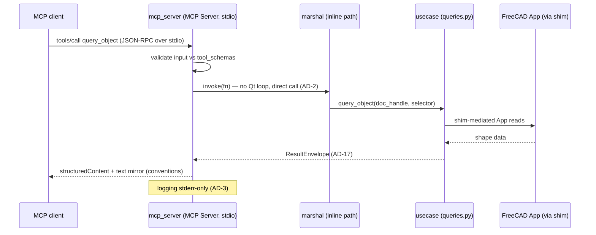
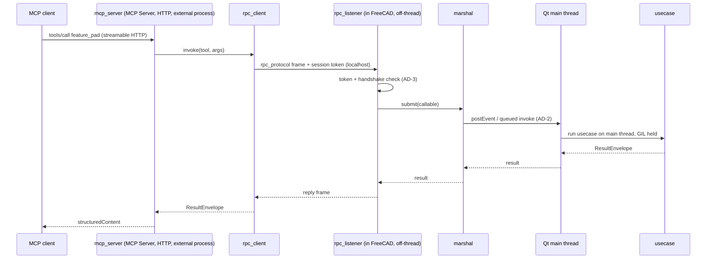
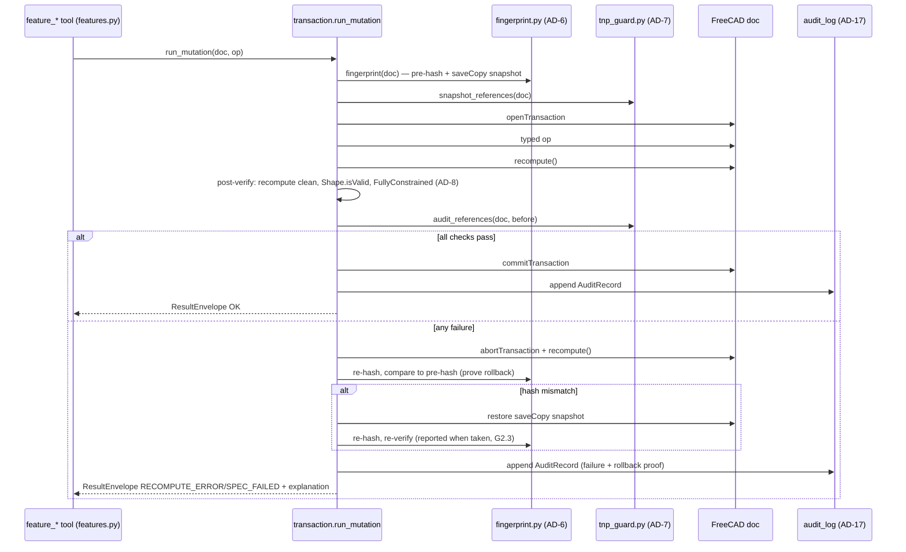

# Component Design — freecad-buddy

Per-ring component inventory, public interfaces, and interaction flows. Every component obeys the Clean Architecture dependency rule (AD-1): imports cross ring boundaries inward only. Phase column marks when the component first ships (per phase-gates.md); "P0→P2" = skeleton at Phase 0, full behavior at Phase 2.

## 1. Contracts ring — `src/freecad_buddy/contracts/` (stdlib only, AD-1)

Module layout and type shapes are owned by **data-contracts-design.md** (§1); inventory below maps responsibilities onto that layout:

| Component | Phase | Responsibility | Consumed by |
| --- | --- | --- | --- |
| `status.py`, `envelope.py`, `report.py`, `audit.py` | P0 | `ResultEnvelope`, `ValidationReport`, `AuditRecord`, closed status set (AD-17). Single owner — no surface defines variants | every ring |
| `rpc.py` | P0 | JSON-RPC frame types + `rpc_hello` versioned handshake for the bridge RPC channel; stdlib-encodable only (AD-2). Both sides import it; neither invents framing | `rpc_listener`, `rpc_client` |
| `jsonschema/` (generated) | P0 | Per-tool input/`outputSchema` composed by `$ref` from contract types (`query_`, `document_`, `export_`, `verify_`; `sketch_`/`feature_`/`preview_` added P2) | `mcp_server`, harness |
| `document.py` | P0 | `DocHandle` + sub-element selector objects: geometric query \| TNP mapped name; bare `Face6` resolved at call time, never stored (conventions table; AD-20) | usecases |
| `diff.py` + `report.py` | P0 | `GeometryDiff` (AD-10) and TNP audit report types incl. `UNSUPPORTED`, `ElementMapVersion` banner fields (AD-7) | `tnp_guard`, `preview`, reports |
| `fingerprint.py` | P0 | `FingerprintRecord`: serializer tag + per-object hashes + quantized mass-props; cross-tag comparison raises (AD-6) | `fingerprint` usecase, audit, diffs |
| `assertions.py` | P0 (vocab) → P3 (full set) | Assertion vocabulary (`count_cylindrical_holes`, `expect_bbox`, `hole_spacing`, …) + anchor-frame declaration types from the closed derivation set (AD-13) | harness, verify usecases |

## 2. Use-case ring — `src/freecad_buddy/usecases/` (imports contracts + FreeCAD App via shim; AD-1, AD-12: stdlib + FreeCAD only)

| Component | Phase | Responsibility | May import |
| --- | --- | --- | --- |
| `shim.py` | P0 | **Version shim** (AD-11): sole home of version-sensitive calls. Capability probes (never version strings): `element_map_available()`, shape-serializer probe (`exportBinary` else `exportBrep`), `AttachmentSupport`/`Support` accessor, `addObject` type-string table, VarSet/Spreadsheet driving-dimension façade | FreeCAD App |
| `fingerprint.py` | P0 | **The** single `fingerprint()` implementation (AD-6): SHA-256 over per-object shape bytes sorted by `Name` + quantized mass-property cross-oracle; tags serializer id | contracts, shim |
| `tnp_guard.py` | P0 (Layer 0) → P2 (Layers 1–2) | **TNP guard** (AD-7): `snapshot_references()` / `audit_references()`; Layer 0 validity sweep, Layer 1 mapped-name diff (`?`-markers, re-points, count drops), Layer 2 `getElementHistory` on ambiguity; gated by `shim.element_map_available()` → `UNSUPPORTED`, never clean | contracts, shim |
| `transaction.py` | P0 | Uniform mutation protocol (AD-5) — every mutation tool runs through `run_mutation()`; owns undo; emits `AuditRecord` to injected `AuditSink` port (AD-17) | contracts, shim, fingerprint, tnp_guard |
| `documents.py` | P0 | `document_*` lifecycle (AD-20): open/create/save/close, handle registry, per-document single-writer lock, TempDoc reserved-prefix creation/cleanup | contracts, shim, transaction |
| `queries.py` | P0 | `query_*` read tools: tree, object properties, shape metrics, recompute-error listing, summarized large-tree queries (G1.3) | contracts, shim |
| `verify.py` | P0 | `verify_shape` (volume/bbox/counts ±0.1 %, `isValid`), `verify_recompute` (recompute-clean), `verify_sketch` (P0 per mcp-tools catalog; load-bearing from G2.5) — PASS ⇔ `FullyConstrained == True` after `recompute()`; `solve()` codes logging only (AD-8) | contracts, shim |
| `exports.py` | P0 | `export_*`: STEP (AP214/AP242, `write.step.unit=MM` pinned per call), STL/3MF from the one tessellation source `MeshPart.meshFromShape` (linear + angular deflection) (AD-9). In-FreeCAD self-read leg of `verify_export_*` | contracts, shim |
| `sketches.py` | P2 | `sketch_*` typed mutations (geometry + constraints), 1-based solver-ID → `Constraints[id-1]` diagnostic mapping | contracts, shim, transaction |
| `features.py` | P2 | `feature_*` typed mutations (pad/pocket/hole/dress-up…), intent-bearing generated `Name`s | contracts, shim, transaction |
| `preview.py` | P2 | `preview_dry_run` on `copyObject` TempDoc (AD-10, AD-20): structured diff (Δvolume/area/bbox/COM, counts, validity, TNP pre-check); apply path re-runs op under AD-5 | contracts, shim, documents, transaction |
| `debug_exec.py` | P0 | Operator-only exec (AD-4): env-flag gated, unregistered when off, audit-logged, never enabled unattended | contracts, shim |

Key entry points:

```python
# transaction.py — AD-5; the only mutation path
def run_mutation(doc: DocHandle, op: Callable[[], None], *,
                 involves_sketches: bool, audit: AuditSink) -> ResultEnvelope: ...
    # geohash snapshot (+ saveCopy) → openTransaction → op() → recompute()
    # → post-verify (recompute clean, Shape.isValid, FullyConstrained where
    #   sketches involved, tnp_guard.audit_references)
    # → commit | abort → recompute → re-hash proof → saveCopy restore on mismatch

# fingerprint.py — AD-6
def fingerprint(doc: DocHandle) -> Fingerprint: ...

# tnp_guard.py — AD-7
def snapshot_references(doc: DocHandle) -> RefSnapshot: ...
def audit_references(doc: DocHandle, before: RefSnapshot) -> TnpAuditReport: ...

# shim.py — AD-11
def element_map_available() -> bool: ...
def shape_bytes(obj) -> tuple[bytes, str]:  # (payload, serializer_id)

# verify.py — AD-8
def verify_sketch(doc: DocHandle, sketch_name: str) -> ResultEnvelope: ...

# documents.py — AD-20
def open_document(path: str) -> DocHandle: ...
def make_temp_doc(source: DocHandle) -> DocHandle:  # reserved prefix, transient flag
```

## 3. Adapter ring — `src/freecad_buddy/adapters/` (imports usecases + contracts)

| Component | Phase | Responsibility | Notes |
| --- | --- | --- | --- |
| `mcp_server.py` | P0 | MCP low-level `Server` + tool registry; one server object, transport run-flag `stdio\|http`, SSE never (AD-3); stderr-only logging; registers only typed tools (AD-4); read-only registry filter for Phase 1 (G1.6); MCP elicitation for confirmations, headless fail-closed unless `autoApprove` (AD-10). Runs in external uv-managed process (AD-12) | third-party deps live here |
| `rpc_client.py` | P0 | External-process side of the bridge: encodes tool invocations as `rpc_protocol` frames, sends over localhost + per-session token (AD-3), maps replies to `ResultEnvelope` | used by `mcp_server` in GUI mode |
| `rpc_listener.py` | P0 | In-FreeCAD RPC listener (AD-2): accepts frames off-thread, validates token + handshake, hands work to `marshal`. **Stdlib + FreeCAD only** (AD-12); CI no-`Gui`-import check applies (AD-1) | runs inside FreeCAD GUI process |
| `marshal.py` | P0 | Main-thread marshal (AD-2): Mod/Web `postEvent` pattern — queue callable to Qt main thread, block for result. Headless degrade: direct inline call (no Qt loop). Holds **no Qt import** — the Qt event pump lives in `hosts/gui_addon/pump.py`, so this module needs no AD-1 exemption | research §2.3/§4.3 |
| `rpc_dispatch.py` | P0 | The single AD-17 error boundary: maps use-case exceptions onto the closed status set (`INVALID_INPUT`, `RECOMPUTE_ERROR`, `TIMEOUT`; unexpected → `RECOMPUTE_ERROR` + `detail.unexpected`), attaches machine detail (exception class, message, truncated traceback), gates `debug_exec` registration (AD-4) | integration §3.5 |
| `audit_log.py` | P0 | `AuditSink` implementation: append-only JSON-lines per job/session (AD-17, conventions) | injected into `transaction` |
| `export_oracle.py` + `export_verdict.py` | P0 | External-side orchestration of `verify_export_*` (AD-9): STEP re-import round-trip, trimesh primary + second oracle (admesh or Phase 0-gate fallback) for STL, lib3mf + trimesh + in-FreeCAD self-read (via RPC) for 3MF; oracle disagreement = fail; mesh tolerance derived from deflection | third-party oracles |
| `benchmarks/runner.py` + `benchmarks/harness/` | P0 | **Gate runner** core (AD-13, AD-14, AD-19): runs benchmarks/fault-injection suites via pytest, computes majority-of-R, Wilson CI, McNemar; emits contracts-owned `ValidationReport` with banner; verdict from report fields only. Thin CLI lives in `benchmarks/runner.py` (`gate` console alias) | external process only |
| `skills_loader.py` *(planned, Phase 1 — not yet built)* | P1 (router) / GS.E (forced-subset) | **Skills loader** (AD-15): one store, two modes — production metadata-first router (12 descriptions resident, 2–5 bodies routed, ≤~10K tokens, subset logged) and ablation forced explicit-subset injection with auto-activation disabled; CI shape check (4 sections, ≤1,500 words) — **checker unbuilt, Story 6.1** | `--skills <subset>` flag |
| `render_probe.py` | P0 | Capability-gated render probe serving `query_screenshot` (P0) and preview images (P2): GUI `saveImage` / offscreen-Xvfb / omit; ≤1920 px, `resource_link` preferred — the single adapter Qt carve-out (AD-1, AD-10) | optional payload only |

## 4. Host ring — `src/freecad_buddy/hosts/` (imports adapters)

| Component | Phase | Responsibility |
| --- | --- | --- |
| `gui_addon/InitGui.py` + `bootstrap.py` | P0 | GUI addon: waits for `FreeCAD.GuiUp`, defers via `QTimer.singleShot`, generates per-session RPC token, starts `rpc_listener`, then **auto-spawns the external MCP protocol server** as a child process (`serve --mode rpc --transport http`, `:8765`) so opening FreeCAD is the only step to reach the bridge. The addon never *imports* `mcp` — it only spawns the process in the project venv interpreter, auto-discovered from the addon's own install path (no env vars; AD-2, AD-3, AD-12). Qt/`FreeCADGui` legal here (AD-1) |
| `headless.py` | P0 | Headless entry: single process where FreeCAD is importable (conda env); runs `mcp_server` on stdio, use-cases called inline through the marshal's degrade path (AD-2). Also the `FreeCADCmd run_tests.py` CI entry |

## 5. Interaction flows

### 5a. Headless tool call — stdio → usecase → FreeCAD (AD-2, AD-3)



### 5b. GUI tool call — HTTP → RPC → marshal → main thread (AD-2, AD-3)



### 5c. Mutation with verify + rollback — AD-5 protocol as component interactions



## 6. Cross-cutting component placement

| Concern | Component | Ring | Rationale |
| --- | --- | --- | --- |
| Version shim | `usecases/shim.py` | usecases | Sole gateway from usecases to FreeCAD App (AD-11); capability probes, no version sniffing |
| Fingerprint | `usecases/fingerprint.py` | usecases | AD-6 mandates exactly one implementation; used by transaction, undo proof, revision diffs |
| TNP guard | `usecases/tnp_guard.py` | usecases | Invoked inside AD-5 post-verify; capability-gated via shim (AD-7) |
| Skills loader *(planned)* | `adapters/skills_loader.py` | adapters | Serves the MCP process/harness, never runs in FreeCAD (AD-12, AD-15) |
| Gate runner | `benchmarks/runner.py` + `benchmarks/harness/` | benchmarks (outside the src rings) | External process (pytest, stats deps); emits contracts-owned `ValidationReport` (AD-13, AD-14, AD-17, AD-19) |
| Audit log | `adapters/audit_log.py` (sink) / `contracts` (record type) | adapters/contracts | Append-only from Phase 0 (AD-17); usecases depend on the port, not the file format |

## 7. Phase availability summary

| Phase | Components first shipped |
| --- | --- |
| P0 (G0) | All contracts; shim, fingerprint, tnp_guard (Layer 0), transaction, documents, queries, verify (shape/document), exports, debug_exec; mcp_server, rpc_client, rpc_listener, marshal, audit_log, export_oracle, export_verdict; gui_addon/{InitGui,bootstrap,pump}.py, gui_external/entry.py, headless/entry.py, main.py, tool_catalog.py. Entry gate G0.E artifacts (fault suite, golden benchmark) precede implementation (AD-19) |
| P1 (G1) | skills_loader (router mode), read-only registry filter, large-tree summarized queries; skills `freecad-fundamentals`, `freecad-troubleshooting` |
| GS.E | skills_loader forced-subset ablation mode + CI shape check (`check_skill_shape.py`, Story 6.1) |
| P2 (G2) | sketches, features, preview, verify_sketch, render_probe, elicitation/confirm glue; tnp_guard Layers 1–2 + 5-scenario fault suite |
| Spec-to-part | assertion compiler + spec-benchmark runner extensions in harness (the loop is agent-side plan/execute over the mutation tools — no new ring component) |
| P5 (G5-robot) | robot-description export use cases (`export_urdf`/`export_sdf` + paired `verify_export_*`) over the Assembly kinematic tree + native inertials; part sourcing/import use cases; external-side URDF/SDF schema/parse oracle (mirrors export_oracle); skills `urdf-export`, `sdf-export`, `part-sourcing`. Depends on a Phase-5 Assemblies capability (AD-22/AD-23; detail at the G5-robot gate) |

## 8. Conflicts

No conflicts with the spine's ADs found. `adapters/marshal.py` holds **no Qt import at all** — it carries the queue and the wait, while the Qt event pump lives in `hosts/gui_addon/pump.py` where Qt is legal without an exemption (AD-1, §3). That makes `render_probe.py` the single adapters Qt carve-out. The `check_imports.py` exemption list still names `adapters/marshal.py`; that entry is dead and is tracked for removal.
