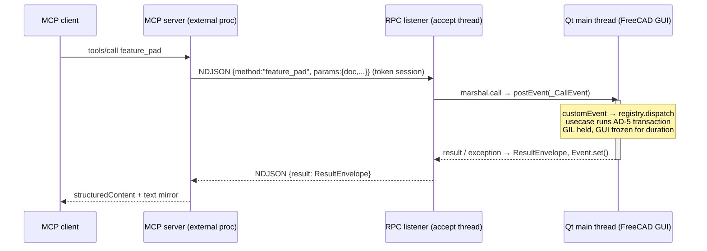

# Integration Design: MCP <-> FreeCAD

How the external MCP server reaches FreeCAD in both run modes, per **AD-2** (topology + main-thread marshaling), **AD-3** (transport + auth), **AD-11** (version shim), **AD-12** (stdlib-only in-FreeCAD). Governing rule (research, high confidence): *I/O may live on any thread; every call that reads or mutates FreeCAD state executes on the Qt main thread under the GIL.*

## 1. Topology

| Mode | Processes | FreeCAD call path |
| --- | --- | --- |
| **GUI** | External MCP process + FreeCAD GUI process (addon-hosted RPC listener) | RPC → listener accept thread → marshal → Qt main thread |
| **Headless H1** (canonical, AD-2) | Front MCP process (stdio) + worker child process (same interpreter, `import FreeCAD` as module, conda env) | RPC → worker listener, inline dispatch on the worker main thread |
| **Headless H2** (fallback, not built) | H1 topology with `FreeCADCmd` as the worker interpreter | as H1 |

H1 is the GUI topology minus Qt: the front plays the proxy, the worker plays FreeCAD. The process boundary is what makes a call budget real — FreeCAD never releases the GIL during a C++ operation, so no thread inside the FreeCAD process can time it out (AD-2). H2 is the same topology for an interpreter that cannot `import FreeCAD` (AppImage, interpreter mismatch): the worker runs under `FreeCADCmd`. Same use-case implementations in all modes (AD-2).

Per **AD-12**, everything that runs inside the FreeCAD process — `contracts/rpc.py`, `adapters/rpc_listener.py`, `adapters/marshal.py`, `usecases/*`, `hosts/gui_addon/*`, `hosts/headless/worker.py` — imports **stdlib + FreeCAD API only** (Qt via FreeCAD's bundled PySide, confined to `hosts/` per AD-1). `mcp`, trimesh, etc. exist only in the external uv-managed process.

## 2. RPC Wire Contract (`contracts/rpc.py`, per AD-2)

Both sides import this module; neither invents framing. Stdlib-encodable throughout (`json`, `dataclasses`).

### 2.1 Framing

- **NDJSON over TCP, localhost**: one JSON-RPC 2.0 object per line, UTF-8, `\n`-terminated. `json.dumps` emits no raw newlines, so framing is unambiguous. Max frame 16 MiB (guards against runaway base64; render payloads use file paths / `resource_link` instead, AD-10 spirit).
- Requests are processed **strictly sequentially per server** (single in-flight call globally). This implements AD-20 single-writer serialization at the transport layer for Phase 0; per-document queues are a later optimization behind the same contract.

### 2.2 Handshake (versioned, per AD-2; token, per AD-3)

First frame on every connection MUST be `rpc_hello`; anything else → error `-32002`, connection closed.

```json
// client → server
{"jsonrpc":"2.0","id":0,"method":"rpc_hello",
 "params":{"contract_version":"1","token":"<per-session token>"}}
// server → client
{"jsonrpc":"2.0","id":0,"result":{
  "contract_version":"1","server":"freecad-buddy-listener",
  "freecad_version":"1.1.1","python_version":"3.12.4",
  "capabilities":{"gui":true,"qt_loop":true,"render":"gui_constructed",
                   "element_map":true,"varset":true,"exec_enabled":false}}}
```

- Token: `secrets.token_urlsafe(32)`, generated once per listener start (session = host lifetime), compared with `hmac.compare_digest`. Mismatch → `-32000`, close. (AD-3)
- `contract_version` mismatch → `-32004` with server's supported versions in `error.data`; client refuses to proceed. Bump the version on any frame/field semantic change.
- `capabilities` drive tool registration on the MCP side: e.g. `render:"none"` → screenshot tools report unavailable rather than failing at call time; `element_map:false` → TNP audit returns `UNSUPPORTED` (AD-7 via AD-11 probe); `exec_enabled` reflects AD-4 registration (`script_exec` is unregistered when false).

### 2.3 Requests, responses, errors

- **Method names mirror the use-case surface** (spine naming convention): `query_*`, `document_*`, `sketch_*`, `feature_*`, `export_*`, `preview_*`, `verify_*` (in-FreeCAD legs only, e.g. the AD-9 self-read), `script_exec` (gated), plus `rpc_hello`, `rpc_ping`, `rpc_capabilities`.
- `params` is the tool's parameter object; every document-touching method carries an explicit document handle (**AD-20** — no implicit `ActiveDocument`).
- **`result` is always a `ResultEnvelope`** (contracts-owned, AD-17 closed status set). Domain failures — recompute errors, invalid input, verify failures, marshal timeout — are envelopes, never JSON-RPC errors.
- **JSON-RPC `error` is protocol-layer only:**

| Code | Meaning |
| --- | --- |
| -32700 / -32600 / -32601 / -32602 | parse / invalid request / method not found / invalid params |
| -32000 | auth failed (bad/missing token) |
| -32002 | handshake required (first frame not `rpc_hello`) |
| -32003 | server shutting down |
| -32004 | contract version unsupported |

### 2.4 Timeouts (single source: method registry)

| Budget | Default | Notes |
| --- | --- | --- |
| TCP connect | 2 s | client side |
| `rpc_hello` | 5 s | |
| Call (read) timeout, client | method `timeout_s` + 5 s margin | |
| Call (read) timeout, H1 front | method `timeout_s` | the bound; the worker's inline marshal never times out |
| Marshal timeout, server | method `timeout_s` (default 30 s; mutation/recompute methods 120 s; render 60 s) | per-`RpcMethod` override |

Marshal timeout returns an envelope `status:"TIMEOUT"` with `detail:{"marshal_timeout":true,"maybe_still_running":true}` — see §7.

**H1 bound and quarantine (AD-27).** In H1 the worker's marshal is inline and never times out; the bound is the front's read timeout, set per call to the method `timeout_s`. After a timeout the front quarantines the session: every call is refused at once, without dispatch, with `TIMEOUT` and `detail.data.quarantined:true`. When the abandoned body has run its `timeout_s` again past the timeout (2× budget), refusals become `WORKER_CRASHED` with a message to restart the headless host. The quarantine lifts when the worker answers again; its serve loop is single-threaded, so an answer proves the body returned. The front never kills the worker on escalation, so no open document is lost.

### 2.5 Method registry (`adapters/rpc_dispatch.py`)

```python
@dataclass(frozen=True)
class RpcMethod:
    name: str                                  # "feature_pad"
    handler: Callable[..., ResultEnvelope]     # usecase entry
    timeout_s: float = 30.0
    needs_main_thread: bool = True             # False only for pure listener-side ops (rpc_ping)

class MethodRegistry:
    def register(self, method: RpcMethod) -> None: ...
    def dispatch(self, name: str, params: dict) -> ResultEnvelope: ...
```

`dispatch` is the single error boundary: it maps use-case exceptions onto the AD-17 closed set (`INVALID_INPUT` for validation errors, `RECOMPUTE_ERROR` for FreeCAD/recompute failures, `TIMEOUT` for marshal expiry; anything unexpected → `RECOMPUTE_ERROR` with `detail.unexpected=true`) and always attaches machine detail: exception class, message, truncated traceback. Tracebacks also go to stderr (AD-3 logging rule). `script_exec` is registered unless the operator turns it off — `FREECAD_BUDDY_SCRIPT_EXEC`, or in GUI mode the **Allow script_exec** preference with the variable unset — or the run is marked unattended without opt-in (AD-4), and every invocation is appended to the audit log (AD-17).

### 2.6 Discovery (connection file)

The listener writes `<FreeCAD user app data>/freecad-buddy/rpc-<pid>.json` (mode `0600`):

```json
{"schema":1,"pid":12345,"host":"127.0.0.1","port":43717,
 "token":"...","freecad_version":"1.1.1","started":"2026-07-21T09:00:00Z"}
```

Port: `FREECAD_BUDDY_RPC_PORT` env if set, else ephemeral (`bind(0)`, actual port written to the file). Bind is `127.0.0.1` only; remote bind is explicit operator opt-in (AD-3). External server discovers by reading the newest file whose `pid` is alive; stale files are deleted by the listener on clean shutdown and skipped by clients on liveness failure.

## 3. GUI Mode

### 3.1 Addon lifecycle (`hosts/gui_addon/InitGui.py`)

Race documented in research §4.4 (community addon crash: bridge started before `FreeCAD.GuiUp`): start is **deferred and gated**.

```python
# InitGui.py — executed by FreeCAD at GUI startup
class FreeCADBuddyWorkbench(Gui.Workbench):
    MenuText = "FreeCAD Buddy"
    def Initialize(self):  # commands/panel registration only; no listener work here
        ...
Gui.addWorkbench(FreeCADBuddyWorkbench())

def _deferred_start():
    if not FreeCAD.GuiUp:
        QtCore.QTimer.singleShot(500, _deferred_start)   # re-poll until GUI is up
        return
    from freecad_buddy.hosts.gui_addon.bootstrap import start_bridge
    start_bridge()                                        # builds pump, marshal, registry, listener

QtCore.QTimer.singleShot(0, _deferred_start)
```

`InitGui.py` also registers `PreferencesPage` from `hosts/gui_addon/preferences.py` with `Gui.addPreferencePage`. Tool calls read its `RoundToDisplay` value on every call, so a change applies without a restart. The page also holds the operator settings, stored under `User parameter:BaseApp/Preferences/Mod/FreeCADBuddy`:

| Field | Key | Default | Variable that overrides it |
| --- | --- | --- | --- |
| Auto-approve mutations | `AutoApprove` | on | `FREECAD_BUDDY_AUTO_APPROVE` |
| Allow script_exec | `ScriptExec` | on | `FREECAD_BUDDY_SCRIPT_EXEC` |
| Start the MCP server with FreeCAD | `AutoStartMcp` | on | `FREECAD_BUDDY_NO_AUTO_MCP` (off writes `1`) |
| MCP command | `McpCommand` | empty | `FREECAD_BUDDY_MCP_CMD` |
| uv path | `UvPath` | empty (`uv` on `PATH`) | none |
| Audit log file | `AuditLogPath` | empty | `FREECAD_BUDDY_AUDIT_LOG` |

`start_bridge` reads them once, right after it configures logging. `usecases/operator_settings.resolve_env_overlay` applies the precedence: a variable that is set wins, else the preference, else the default. The result goes into `os.environ` before the temp sweep and the capability read, so every reader and the proxy child see one effective value. When nothing sets them, the audit log is `<FreeCAD user app data>/freecad-buddy/audit.jsonl` and the workdir `<FreeCAD user app data>/freecad-buddy/workdir`, so the GUI host never depends on its working directory. `addon.log` records the effective values in one `operator settings:` line. A change needs a FreeCAD restart.

`start_bridge()` (idempotent): create `QtMainThreadExecutor` (§3.3) on the main thread → build `MethodRegistry` from usecases → generate session token → start `RpcListener` accept thread → write connection file → **auto-spawn the external MCP HTTP proxy** (`freecad-buddy serve --mode rpc --transport http`, port 8765) as a child process so opening FreeCAD is the only step to reach the bridge over MCP. The proxy runs in an **external venv** interpreter (it imports `mcp`, forbidden in-FreeCAD per AD-12). The launch command resolves in this order, with no env vars needed:

1. `FREECAD_BUDDY_MCP_CMD` (or the **MCP command** preference) — a verbatim override.
2. The repo `.venv`/`venv` python, **auto-discovered from the addon's own install path** — walk from the package `__file__` to the repo root (a built copy finds the venv through the `repo-root.txt` marker written by `build_addon.py`) and run its serve module directly. This is the dev install.
3. `FREECAD_BUDDY_REPO`/`FREECAD_BUDDY_SRC` + `uv` — a legacy fallback.
4. The **managed venv** `<FreeCAD user app data>/FreeCADBuddy/venv`, when its `freecad-buddy-wheel.sha256` marker equals the SHA-256 of the wheel in `<addon>/wheels/`. This is the release install.
5. A release install with `uv` found (the **uv path** preference, else `PATH`) and no current managed venv: `hosts/gui_addon/managed_venv.provision` builds it on a daemon thread (`uv venv --clear --python >=3.11`, then `uv pip install` the bundled wheel; marker written last), then the thread spawns the proxy. A lock file `FreeCADBuddy/venv.lock` lets one FreeCAD instance provision while another skips; a lock older than 10 min is taken over. `uv` output goes to `freecad-buddy/provision.log`. The thread never touches Qt; `stop_bridge` sets its cancel event and joins it before it terminates the proxy. A changed wheel (an upgrade) fails the marker check and provisions again.
6. Else one log line says why; with a bundled wheel but no `uv`, it names the **uv path** preference.

A failed spawn or provisioning is logged and leaves the RPC listener up. Skipped when `FREECAD_BUDDY_NO_AUTO_MCP` is set (or the **Start the MCP server with FreeCAD** preference is off) or `:8765` is already served. The addon never imports `mcp`; it only spawns the process (consistent with AD-2 — the addon starts the listener, the MCP protocol server is external). Shutdown hook (workbench deactivate / app quit): terminate the proxy child, stop listener, delete connection file.

### 3.2 RPC listener (`adapters/rpc_listener.py`, stdlib only)

`socket` + `threading`; no Qt imports (AD-1/AD-12 — Qt lives in the host-provided executor).

```python
class RpcListener:
    def __init__(self, registry: MethodRegistry, marshal: Marshal,
                 token: str, host: str = "127.0.0.1", port: int = 0): ...
    def start_threaded(self) -> tuple[str, int]:
        """GUI mode: accept loop on a daemon thread; returns (host, bound_port)."""
    def serve_forever_inline(self) -> None:
        """Headless worker: blocking single-threaded serve loop on the calling (main) thread."""
    def stop(self) -> None: ...
```

Per connection: enforce handshake → read NDJSON frames → for each request, `marshal.call(lambda: registry.dispatch(name, params), timeout_s)` → write response frame. One request in flight at a time (§2.1).

### 3.3 Main-thread marshal (`adapters/marshal.py` + host pump)

Split so the queue/blocking logic stays stdlib (adapters) and Qt stays in `hosts/` (AD-1). Pattern mirrors FreeCAD's own `Mod/Web` server (`QTcpServer` + `postEvent` → `customEvent` on main thread) and `MainThreadSignalConfig::invoke` — we reuse the proven mechanism, not invent one.

```python
# adapters/marshal.py — stdlib only
class Executor(Protocol):
    def submit(self, fn: Callable[[], None]) -> None:
        """Schedule fn on the FreeCAD execution thread. Thread-safe."""

class InlineExecutor:
    def submit(self, fn): fn()          # headless: no Qt loop, already on main thread

class MarshalTimeout(Exception): ...

class Marshal:
    def __init__(self, executor: Executor): ...
    def call(self, fn: Callable[[], T], timeout_s: float) -> T:
        """Wrap fn to capture result/exception + set a threading.Event; executor.submit;
        wait(timeout_s). On timeout raise MarshalTimeout — fn MAY still execute later;
        the wrapper marks the session 'document-suspect' when it eventually runs."""
```

```python
# hosts/gui_addon/pump.py — Qt allowed here (AD-1)
_CALL = QtCore.QEvent.Type(QtCore.QEvent.registerEventType())

class _CallEvent(QtCore.QEvent):
    def __init__(self, fn): super().__init__(_CALL); self.fn = fn

class QtMainThreadExecutor(QtCore.QObject):     # constructed ON the main thread
    def submit(self, fn):                        # called from listener thread
        QtCore.QCoreApplication.postEvent(self, _CallEvent(fn))  # thread-safe
    def customEvent(self, ev):                   # runs on Qt main thread
        ev.fn()
```

**Blocking semantics & GIL.** The listener thread blocks on the event; the marshaled callable runs on the Qt main thread where the GIL is implicitly held for pure-Python use-case code (no explicit `PyGILState` needed on this path — that is a C++-side concern). Consequences, accepted and documented:

- While a call runs, the Qt event loop is blocked → the GUI freezes for the op's duration. Tools must stay atomic/short; long recomputes are an accepted freeze (research §3), surfaced to the user by the addon panel.
- Use cases must **never** call `QApplication.processEvents()` (re-entrancy: a second RPC frame could interleave mid-transaction, violating AD-5/AD-20).
- v26.3-dev async-recompute worker threads change nothing here: all tools default to main-thread execution; worker-side reads are out of scope until a `canRecomputeOnWorker()` capability probe justifies them.

### 3.4 GUI call path



### 3.5 Error propagation

Three layers, strictly separated: (1) use-case/domain outcome → `ResultEnvelope` status + detail (AD-17), produced at the `dispatch` boundary on the main thread, serialized back verbatim; (2) marshal timeout → envelope `TIMEOUT` built listener-side; (3) transport/protocol → JSON-RPC error codes (§2.3). The external MCP server maps envelopes 1:1 into MCP tool results — it never re-interprets or upgrades a status.

## 4. Headless Mode

### 4.1 H1 — front process + FreeCAD worker (canonical, AD-2)

Two processes, one interpreter: the conda-env Python matching the FreeCAD leg (`freecad` conda package; verify `import FreeCAD` — the feedstock `PYTHONPATH`/`.pth` wrinkle is a Phase 0 spike item). Transport to the MCP client: stdio (AD-3), stderr-only logging in both processes.

- **Front** (`hosts/headless/entry.py`): serves MCP over stdio and never imports FreeCAD. It spawns the worker with `sys.executable`, generates the session token and hands it to the worker directly, not through the discovery file, which belongs to GUI mode. It is the worker's only client (AD-26), and it forwards each tool call over RPC with the method `timeout_s` as its read timeout. It holds the quarantine and document-suspect state (§2.4), because only it observes a timeout. Mesh-verify oracle legs run here, as in the GUI proxy (AD-9).
- **Worker** (`hosts/headless/worker.py`, stdlib + FreeCAD only, AD-12, although `mcp` is installed in the same interpreter): builds the registry → `Marshal(InlineExecutor())` → `RpcListener(...).serve_forever_inline()` — a blocking single-threaded loop on its main thread, so inline dispatch *is* main-thread execution and the offscreen render rig keeps its `QGuiApplication` on that thread. Its listener gets no audit sink: the front writes the adapter audit pairs, including the audited `script_exec`-off denial, the non-string `doc` refusal and the document-suspect refusal. The worker writes only the records that the mutation bracket and the camera fit write themselves (`confirm.set_approval_sink`, `view_fit.set_audit_sink`). Both processes resolve the same audit file and append to it one call at a time, so each call's records stay in order. It writes no discovery file. Capability flags report `gui:false, qt_loop:false`.
- **Lifecycle:** when the front ends (stdin EOF), it waits at most 5 s for the worker to exit, then ends it, logs once at ERROR and exits with code 1. When the worker exits on its own, every next call returns `WORKER_CRASHED` and the front does not restart it.

### 4.2 H2 — `FreeCADCmd` worker (not built)

```
FreeCADCmd worker.py            # or: xvfb-run -a FreeCADCmd worker.py (render leg)
```

The H1 topology with `FreeCADCmd` as the worker interpreter, for an interpreter that cannot `import FreeCAD`. No Qt loop exists in `FreeCADCmd` (research §4.1), so `MainThreadSignalConfig::isMainThread()` is trivially true on the serve loop.

### 4.3 Capability flags (handshake `capabilities`, also `rpc_capabilities` method)

| Flag | Probe (never version strings — AD-11) |
| --- | --- |
| `gui` | `FreeCAD.GuiUp` |
| `qt_loop` | `QCoreApplication.instance() is not None` (probed by host, reported to listener) |
| `render` | detection ladder result §6: `"gui_constructed" \| "offscreen" \| "none"` |
| `element_map` | `shim.element_map_available()` |
| `varset` | `shim` VarSet probe (façade reports `varset` vs `spreadsheet` backend) |
| `exec_enabled` | `FREECAD_BUDDY_SCRIPT_EXEC` env; in GUI mode the **Allow script_exec** preference fills it when unset; off in a run marked `FREECAD_BUDDY_UNATTENDED=1` unless `FREECAD_BUDDY_SCRIPT_EXEC_UNATTENDED=1` (AD-4) |

## 5. Version Shim (`usecases/shim.py`, AD-11)

One module owns every version-sensitive call; capability probes cached per process (`functools.lru_cache`). All version findings for the supported FreeCAD 1.1.x build (the `Support`→`AttachmentSupport` rename PR #12714 predates 1.1; VarSet limited exposure issue #12531) reduce to:

```python
def get_attachment(obj) -> list:
    """Read attachment refs; probes hasattr(obj, 'AttachmentSupport').
    Raises ShimUnsupported if it does not exist."""

def set_attachment(obj, refs: list, map_mode: str = "FlatFace") -> None: ...

@lru_cache(maxsize=1)
def element_map_available() -> bool:
    """True iff Part.TopoShape has getElementHistory AND a probe shape yields a
    non-empty ElementMap. Hard-gates the TNP audit (AD-7): False → UNSUPPORTED,
    never a clean verdict."""

def element_map_version(shape) -> str | None:
    """shape.ElementMapVersion if present; recorded in every report banner."""

def type_string(kind: str) -> str:
    """Closed table: 'pad' → 'PartDesign::Pad', 'sketch' → 'Sketcher::SketchObject',
    'varset' → 'App::VarSet', 'lcs' → 'App::LocalCoordinateSystem', ...
    KeyError = programming error, not a runtime probe."""

def driving_dimensions(doc, name: str) -> DrivingDims:
    """Façade over App::VarSet (preferred; probed by attempting addObject) with
    Spreadsheet fallback. DrivingDims: .set(name, value, unit) / .get(name) /
    .names() / .backend -> 'varset' | 'spreadsheet'."""

def capability_banner() -> dict:
    """{'freecad_version', 'element_map', 'element_map_version', 'varset_backend', ...}
    — embedded in every ValidationReport banner (spine conventions)."""
```

## 6. Screenshot / Render Integration

Render code runs where FreeCAD lives. The **capability probe** sits in `adapters/render_probe.py` (the AD-1 carve-out, whitelisted by exact path in `scripts/check_imports.py`); the two implementations live in `hosts/` behind a `RenderPort` protocol injected into the registry at host startup, keeping `usecases/` free of Gui imports.

**Detection ladder** (run once per process, result cached → `render` capability flag):

1. `FreeCAD.GuiUp` → **`gui_constructed`**: the constructed-scene renderer (below) runs on the main thread using the GUI process's existing GL context. Whole-viewport `saveImage` remains available as a `mode:"viewport"` variant (captures exactly what the user sees), but the constructed scene is the default — it honors view control without touching the user's viewport.
2. Else lazy `import FreeCADGui` succeeds → **immediately** call `FreeCADGui.setupWithoutGUI()` (mandatory ordering; issue #16407 class of crashes) → ensure `QtGui.QGuiApplication` exists (needed for the GL context) → attempt an 8×8 probe render of a `coin.SoSeparator`. Success → **`offscreen`** (same constructed-scene renderer).
3. Import failure, no GL context, or probe render failure → **`none`**: screenshot tools report unavailable; `preview_dry_run` omits its optional image (AD-10 structured diff remains the mandatory payload).

**Constructed-scene view control** (serves `query_screenshot.view` — mcp-tools-design §3.9). The scene is assembled per call, so include/exclude/transparency/focus never mutate document state, `Visibility` properties, or the live viewport:

- **Include/exclude:** only listed (or all-visible-minus-excluded) objects get `subgraphFromObject(obj)` — hiding is simply not adding the subgraph. The default (no `include`) set additionally excludes container and datum types — `PartDesign::Body`, `App::Origin`/`App::Line`/`App::Plane`/`App::Point` — whose view-provider subgraph faults in a headless renderer (an Access violation that also corrupts the Coin library for every later object, so it cannot be caught and recovered); the default renders the shape-bearing leaf features instead. An explicit `include` naming such an object overrides the skip.
- **Style overrides:** each styled object's subgraph is wrapped in its own `SoSeparator` with a prepended `coin.SoMaterial` (transparency 0–1, optional diffuse color); highlight = a distinct accent material on the resolved target's subgraph.
- **Focus framing:** resolve the focus selector to a sub-shape (same selector resolution as tool inputs), take its `BoundBox` grown by ~20 % margin, and aim the camera with `camera.pointAt`/orientation preset then `viewAll` against a proxy bbox cube — instead of `viewAll` on the whole scene root.
- **Camera presets:** iso/front/top/… map to fixed `SbRotation`s (iso = the `make_snapshot.py` axonometric quaternion); `custom` takes a quaternion.
- GUI mode runs this on the main thread via the marshal (Coin is GUI-thread-affine); headless runs it inline.

**Offscreen path** (`adapters/render_probe.py` — the AD-1 Qt carve-out; adapted from FreeCAD's first-party `src/Tools/make_snapshot.py`):

```python
def render_offscreen(doc, out_path: str, width: int = 1920, height: int = 1920,
                     orientation: str = "iso") -> RenderResult:
    # FreeCADGui.setupWithoutGUI() already done by probe
    root = coin.SoSeparator()
    root.addChild(camera); add_lighting(root, orientation)   # see "Lighting rig" below
    for obj in visible_objects(doc):                        # leaf shapes only — never a Body/datum
        root.addChild(FreeCADGui.subgraphFromObject(obj))   # transient view provider
    camera.viewAll(root, coin.SbViewportRegion(width, height))
    off = FreeCADGui.SoQtOffscreenRenderer(width, height)    # NEVER raw pivy SoOffscreenRenderer (#13356)
    off.setNumPasses(configured_msaa_samples())              # anti-aliasing from FreeCAD's own pref
    off.render(root); off.writeToImage(out_path)             # QImage saver → PNG
```

**Lighting rig (AD-34 — every camera must render a visible face).** The invariant is two-sided: a face must render neither black nor white, but at a tone separable from the background. The rig is **one** `SoDirectionalLight` aimed **off** the pure view axis, plus a `SoEnvironment` ambient term:

```python
offset = coin.SbVec3f(0.55, 0.38, -1.0); offset.normalize()   # NOT (0, 0, -1)
light = coin.SoDirectionalLight()
light.direction.setValue(coin.SbRotation(*orientation).multVec(offset))
light.intensity.setValue(0.80)
env = coin.SoEnvironment(); env.ambientIntensity.setValue(0.70)
root.addChild(env); root.addChild(light)
```

- **Why off-axis:** aimed exactly along the view axis, an axis-aligned camera's visible face has a normal anti-parallel to the light, the diffuse term degenerates, and ambient alone saturates the near-white default material to pure white — a PNG carrying no shape information beyond its outline. FreeCAD's own viewport headlight is not exactly camera-parallel, which is why the live viewport shades these views correctly.
- **Exactly one light.** Measured under `SoQtOffscreenRenderer` (FreeCAD 1.1.1): a second `SoDirectionalLight` — any direction, intensity, or child order — returns every axis-aligned camera to pure white. An on-axis key plus an angled fill is therefore **not** a usable variant of this rig.
- **The offset has a cliff, not a falloff:** `(0.25, 0.18)` still renders `front` white; `(0.30, 0.20)` lights it. The shipped value sits well past that threshold.
- **Ambient and headlight intensity are set by the band ceiling, not by viewport match.** The ceiling comes from the brightest default material: FreeCAD's stock diffuse `(0.8, 0.8, 0.9)` (`App/Material.cpp`), which every fresh profile and CI renders with. An axis-aligned view takes most of its tone from the headlight and `iso` much less, so dimming the headlight to 0.80 pulls the brightest views down about twice as fast as `iso`. Measured on llvmpipe, FreeCAD 1.1.3: the brightest camera (`right`) reads 205.3 and `iso` reads `rgb(127,127,136)`. The MCP render is a constructed scene; its face shading is not required to match the live viewport.
- **Acceptance is two-sided** (`tests/infc/test_screenshot.py::CameraToneTest`), across all named cameras plus `custom`: mean interior tone differs from the background by **≥ 24/255 on at least one channel** *and* lies within **`[20, 235]` on every channel**, over **≥ 500 interior samples** (non-background pixels inside the middle 80 % of each axis). A one-sided "not black" test passes the white-face defect; a one-sided "not white" test re-admits the black-face defect.

**Anti-aliasing (config-driven, not hard-coded):** the offscreen render uses the same multisample count the user configured for the live 3D viewport, read from FreeCAD's own preference — group `User parameter:BaseApp/Preferences/View`, key `AntiAliasing` — and applied via `SoQtOffscreenRenderer.setNumPasses` (which sets the FBO and GL-context sample count, `Gui/SoFCOffscreenRenderer.cpp`). The stored value is the `Gui::AntiAliasing` **enum value, which is NOT sequential** — from `Gui/Multisample.h`: `None=0, MSAA1x=1, MSAA2x=2, MSAA4x=3, MSAA6x=5, MSAA8x=4` — so it maps to samples `{0:0, 1:1, 2:2, 3:4, 4:8, 5:6}`, never by array index. A build without `setNumPasses`, or an enum value of 0/1, falls back to a single sample. This mapping was confirmed against the FreeCAD source under `docs/references/FreeCAD`, not assumed — see the source-verify standard.

CI render leg: `xvfb-run -a -s "-screen 0 1024x768x24"` + `LIBGL_ALWAYS_SOFTWARE=1` + `MESA_LOADER_DRIVER_OVERRIDE=llvmpipe` (FreeCAD's own CI recipe); a separate CI job that blocks merges (spine environments). One `SoQtOffscreenRenderer` + one `QGuiApplication` reused per process (leaking-singleton note in `SoFCOffscreenRenderer.h`). `QT_QPA_PLATFORM=offscreen` is secondary, validated per-image — historically no usable GL context.

## 7. Failure Modes

| Failure | Detection | Behavior |
| --- | --- | --- |
| Listener down / not started | TCP connect refused, or connection file absent/stale (`pid` dead) | MCP tool returns envelope `WORKER_CRASHED` + detail `{"rpc":"unreachable"}`; client guidance: start/restart the addon. No auto-retry beyond one reconnect attempt. |
| Stale connection file | `pid` liveness check fails | Skip file; report as listener-down. Listener deletes own file on clean stop. |
| Auth token mismatch | `rpc_hello` compare fails | JSON-RPC `-32000`, connection closed, attempt logged to stderr. |
| Contract version mismatch | handshake check | `-32004` + supported list; external server refuses session, surfaces upgrade instruction. |
| FreeCAD busy (long recompute / modal dialog / prior call running) | serialized dispatch: new frames queue behind in-flight call | Call waits its turn; if total wait exceeds method `timeout_s` → `TIMEOUT` envelope. No preemption. |
| Worker process exits (H1) | front's RPC connection drops or the worker process has ended | Envelope `WORKER_CRASHED`; the front does not restart the worker; the operator restarts the headless host. |
| Call while a timed-out body runs (H1) | front holds an abandoned call | Refused at once without dispatch: `TIMEOUT`, `quarantined:true` (AD-27, §2.4). Lifts when the worker answers again. |
| Abandoned body past 2× budget (H1) | front quarantine clock | Refusals become `WORKER_CRASHED` with a message to restart the headless host; the worker is not killed. |
| Marshal timeout | `Event.wait(timeout_s)` expires | Envelope `TIMEOUT`, `maybe_still_running:true`; session marked **document-suspect** — next mutation on that document is refused until a `query_*` fingerprint check (AD-6) confirms state. Never blind-retry a mutation. |
| Use-case exception | dispatch boundary | Mapped to AD-17 closed set + traceback detail; AD-5 transaction protocol has already aborted + verified rollback before the envelope is built. |
| `GuiUp` never true / addon start race | `_deferred_start` re-poll loop | Listener simply never starts before GUI is up; poll continues (bounded: give up + stderr warning after 60 s). |
| Version probe fails (`element_map_available()` false) | shim probe at startup | Capability `element_map:false`; TNP audit reports `UNSUPPORTED`, never clean (AD-7/AD-11); mutation tools still function. |
| Render unavailable (no `FreeCADGui` import / no GL) | detection ladder §6 | Capability `render:"none"`; screenshot tool unregistered/unavailable-reporting; previews ship structured diff only (AD-10). |
| stdout pollution (stdio transport) | CI lint: no `print()` in server code | All logging stderr-only (AD-3). |

## 8. Open Items (Phase 0 spikes, aligned with spine Deferred table)

- Conda `FreeCADCmd` / `import FreeCAD` path edge (feedstock issue #21) — decides H1 vs H2 default on CI.
- VarSet runtime exposure on the 1.1 leg (issue #12531) — decides `driving_dimensions` default backend.
- `QT_QPA_PLATFORM=offscreen` GL viability per CI image vs Xvfb — ladder step 2 probe validates empirically.
- NDJSON-over-TCP vs `QLocalServer`/UDS benchmark (research §7, low priority) — contract shape is transport-agnostic; only the discovery file changes.
