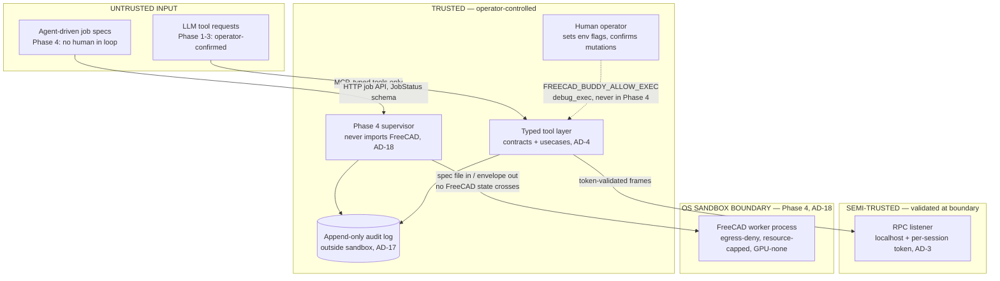

# Security and Phase 4 Service Design

Two altitudes in one document, deliberately. **Phase 0+ security** (§1–§4) is implementation-ready now: `debug_exec` gating (AD-4), RPC bind/token posture (AD-3), stderr-only logging (AD-3), and the phase threat model. **Phase 4 service architecture** (§5–§7) fixes the posture and shapes (AD-18, AD-17) at direction level; concrete sandbox profiles and pool tuning are deferred to the Phase 4 gate per the spine's Deferred table — every deferred item is marked **[DEFERRED-DETAIL]**.

Security stance (from the sandbox-policy research, adopted by AD-4/AD-18): the only security boundaries are **architectural** (typed tools are the sole AI mutation path) and **OS-level** (process + jail around the Phase 4 worker). In-process Python restriction is never a boundary (§8).

## 1. debug_exec Gating (AD-4) — implementation-ready

`debug_exec` is a trusted-operator bring-up tool, never an AI capability. Four enforcement layers, all Phase 0:

**1. Env-flag gate.** Enabled only when the human operator sets `FREECAD_BUDDY_ALLOW_EXEC=1` in the *server process* environment before start. The flag is read once at server startup into an immutable capability record; no tool, RPC call, or config-reload path can set or change it at runtime. Any value other than exactly `"1"` is off (fail-closed).

**2. Conditional tool registration — not runtime rejection.** When the flag is off, `debug_exec` is **not registered** with the FastMCP server at all: it never appears in `tools/list`, so a model cannot discover, request, or be prompt-injected toward it. Registration logic in `adapters/mcp_server`:

```python
def register_tools(server, caps: Capabilities):
    for tool in TYPED_TOOLS:                      # query_*, document_*, sketch_*, ...
        server.add_tool(tool)
    if caps.allow_exec and not caps.service_mode:  # service_mode: Phase 4 host, AD-4
        server.add_tool(debug_exec)
        log_stderr("SECURITY: debug_exec ENABLED by operator flag")
```

`service_mode` is set unconditionally by the Phase 4 supervisor host entry — `debug_exec` is **permanently disabled in the Phase 4 service** even if the env flag is present (AD-4: "disabled permanently in the Phase 4 service"). Belt-and-suspenders: the tool body also re-checks the capability record and returns `INVALID_INPUT` if reached while off (defense against registration-logic bugs; not the boundary).

**3. Append-only audit log.** Every `debug_exec` call — and every mutation tool call (AD-17 requires this from Phase 0) — appends one JSON line to the per-session audit log before execution and one after completion:

```json
{"ts": "...", "session": "<id>", "event": "exec_call", "tool": "debug_exec",
 "code_sha256": "...", "code": "<full source>", "caller": "<mcp client id>"}
{"ts": "...", "session": "<id>", "event": "exec_result", "status": "OK", "detail": {...}}
```

Records reuse the AD-17 contracts-owned audit-record type. The log file is opened append-only (`"a"`, plus `O_APPEND` semantics); the bridge exposes no tool that reads, truncates, or rotates it. Location: alongside the session workdir, operator-configurable.

**4. Namespace reduction (hardening only, not a boundary).** `debug_exec` runs code with globals limited to FreeCAD App modules + a result channel. Per research Finding 1c this is bypassable and is documented as blast-radius reduction only (§8).

CI check: a test asserts `tools/list` excludes `debug_exec` when the env flag is unset, includes it when set, and always excludes it when `service_mode` is set.

## 2. RPC Bind and Per-Session Token (AD-3) — implementation-ready

The GUI-mode RPC channel (external MCP server ⇄ in-FreeCAD listener, AD-2) is a localhost trust seam: any local process could otherwise drive FreeCAD through it.

- **Bind:** listener binds `127.0.0.1` on an ephemeral or configured port. Same for the streamable-HTTP MCP endpoint. Remote bind requires an explicit operator flag (`FREECAD_BUDDY_BIND=<addr>`) and logs a stderr security warning at startup; no silent `0.0.0.0`.
- **Token generation:** at addon start, the listener generates `secrets.token_urlsafe(32)` (stdlib only — AD-12) and writes it with the port to the discovery file `<FreeCAD user app data>/freecad-buddy/rpc-<pid>.json` (authoritative shape: integration-mcp-freecad.md §2.6) created with owner-only permissions (`0o600`; on Windows, default user-profile ACLs suffice). New token per session; file deleted on clean shutdown; stale files (dead PID) are ignored.
- **Validation:** every RPC frame carries the token; the versioned handshake (AD-2 wire contract in `contracts/`) validates it before any dispatch. Comparison via `hmac.compare_digest`. Invalid/missing token → connection closed, one audit-log line, no error detail leaked to the peer.
- **Not in scope:** TLS on loopback, multi-user hosts hardening. Single-operator desktop is the Phase 0–3 trust model (§4).

## 3. stderr-Only Logging Enforcement (AD-3) — implementation-ready

On the stdio transport, stdout **is** the MCP protocol; one stray `print()` corrupts framing.

- All server-side logging goes through one `logging` config writing to `sys.stderr`; `print()` is banned in `contracts/`, `usecases/`, `adapters/`, and `hosts/` server code.
- Enforcement: CI lint gate (ruff `T201`/`T203` — no `print`/`pp`) over `src/freecad_buddy/`, plus a startup guard in the stdio host that rebinds `sys.stdout` for non-protocol code paths to a wrapper that raises in dev / redirects to stderr in production.
- Third-party libraries that print (trimesh etc.) live only in the external process (AD-12) and are wrapped with stdout redirection at call sites in the harness/oracle glue.
- The audit log (§1) is a separate append-only file, never stdout/stderr.

## 4. Threat Model by Phase — what is protected, against what

| Phase | Untrusted input | Primary controls | Explicitly NOT defended |
| --- | --- | --- | --- |
| 0 (bridge/harness) | None — operator + our own CI scripts | `debug_exec` off-by-default + unregistered (AD-4); localhost bind + token (AD-3); audit log (AD-17) | Malicious local processes with the operator's own privileges; malicious operator |
| 1 (read-only assistant) | LLM output (hallucination, prompt injection) | Zero mutation tools registered (AD-4); read-only `query_*` only; no exec in tool list | Model reading data it's shown; local-process threats as above |
| 2–3 (copilot/designer) | LLM-driven mutation requests | Typed tools only mutation path (AD-4); AD-5 transaction + verify per mutation; AD-10 confirmation; audit log; token'd RPC | OS-level containment — the bridge runs with the operator's privileges inside their FreeCAD; acceptable because the operator confirms mutations |
| 4 (headless service) | Agent-to-agent requests = fully untrusted input, even over typed tools | Everything above **plus** OS-level sandbox per job, egress deny, resource caps, whole-tree kill, supervisor re-checks (AD-17, AD-18); `debug_exec` permanently off | Determined multi-tenant attacker (single-tenant/local-first scope); gVisor/microVM documented as escalation path, not built |

Threats defended across phases: LLM free-form exec as mutation path (AD-4); silent bad-part success (AD-17 re-executed checks); stdout protocol corruption (AD-3); rogue local RPC caller (token); Phase 4 adds: resource exhaustion, exfiltration/egress, host FS tamper, crash/hang cascade (AD-18).

## 5. Trust Boundary Diagram



Key reading: untrusted input never touches an unvalidated surface. Phase 1–3 requests pass through the typed-tool schemas plus operator confirmation; Phase 4 specs pass through `contracts/` schema validation (`INVALID_INPUT` on failure, AD-17) and execute only inside the OS sandbox. The supervisor and audit log sit outside the sandbox; the worker holds nothing trusted.

## 6. Phase 4 Service Architecture (AD-18, AD-17) — direction level

Posture is fixed now; profiles/tuning land at the Phase 4 gate.

### 6.1 Supervisor (`hosts/phase4`)

- Single long-lived process. **Never imports FreeCAD** — its own RSS is flat by construction (AD-18).
- Pool: `concurrent.futures.ProcessPoolExecutor`, `mp_context=spawn` on both OSes (never `fork` — Qt/OCCT thread hazard, no Windows support), `max_tasks_per_child=1` default: each worker imports FreeCAD App modules once (warm), runs exactly one job, exits; OS reclaims all memory (OCCT free-lists, leaked Python wrappers). Background refill keeps K workers warm. **[DEFERRED-DETAIL]** K (likely 2–4) and any recycle N>1 are set empirically by the G4 soak test; N=1 ships as the safe default (spine Deferred table).
- **Bounded job queue** with backpressure — submission beyond the bound returns a queue-full status rather than exhausting host memory. A dead worker resolves its job's Future to `WORKER_CRASHED`; nothing hangs.
- Job lifecycle: validate spec against `contracts/` schema (`INVALID_INPUT` fail-fast) → enqueue → bind to warm worker inside sandbox (§6.2) with wall-clock deadline + iteration cap → collect envelope → **re-execute verification** (§6.4) → stamp AD-17 `JobStatus` → clean `jobs/<id>/` per retention policy.
- Documents inside the worker go only through `document_*` use cases (AD-20); one job = one worker = single writer, satisfying mutation serialization structurally.

### 6.2 Per-Job Sandbox Wrapper

One internal API keeps the supervisor OS-agnostic:

```python
def run_job_in_sandbox(spec: JobSpec, mem_limit: int, cpu_time_limit: int,
                       wall_deadline: float) -> ResultEnvelope: ...
```

Two backends behind it (posture per AD-18; all concrete numbers/profiles **[DEFERRED-DETAIL]** at the Phase 4 gate):

**Linux (primary):** worker wrapped in an unprivileged jail — **nsjail or bubblewrap** (or hardened `--network none` OCI container for CI/reproducibility). Profile shape: user+net(empty)+mount+pid+ipc+uts+cgroup namespaces; read-only bind of FreeCAD/OCCT/Python install; single read-write `jobs/<id>/` scratch; cgroups v2 `memory.max` + `memory.oom.group`, CPU quota, `pids_max`; `setrlimit` (AS/CPU/FSIZE/NOFILE) as per-process backstop; seccomp allowlist adapted from Docker's default; all capabilities dropped; unprivileged UID. **[DEFERRED-DETAIL]** nsjail-vs-bwrap pick, exact seccomp allowlist, cgroup numbers, offscreen-render syscall additions.

**Windows:** **WSL2-preferred** — run the identical Linux stack inside WSL2 with Hyper-V Firewall outbound deny; one hardening profile for both OSes. Native alternative: **AppContainer with zero capabilities** (no `internetClient` → no network) + **Job Object** (`KILL_ON_JOB_CLOSE`, `ActiveProcessLimit`, `ProcessMemoryLimit`, per-job CPU time) + restricted token/Low IL + process mitigations. Restricted-token-only is documented as a non-production fallback (network not reliably blocked). **[DEFERRED-DETAIL]** WSL2-vs-native decision criteria and AppContainer packaging.

**Whole-tree kill (both OSes, posture fixed now):** deadline breach or cap breach kills the entire worker tree — Windows: close the Job Object handle (atomic tree kill); Linux: signal the process group / kill the cgroup (`SIGTERM` → grace → `SIGKILL`). Never top-PID-only kill; orphaned OCCT helpers wedge the pool. Kills map to `TIMEOUT` / `OOM_KILLED` (AD-17), never silence.

**Egress deny-by-default — rationale:** the worker needs no network at all. Spec intake, MCP/LLM transport, and result delivery live in the supervisor; the worker reads a spec file and writes artifacts to its scratch dir. Empty netns / `--network none` / zero-capability AppContainer therefore costs zero functionality and neutralizes the exfiltration and phone-home threat class in one move — the highest-value single control in the research. Workers are also **GPU-none** (software GL / FreeCAD offscreen path only).

### 6.3 Data Plane — `jobs/<id>/` layout

Control plane carries small JSON (spec descriptor in, `ResultEnvelope` out — AD-17 types, paths not blobs). No FreeCAD/OCCT object ever crosses the process boundary. Filesystem data plane, the only writable mount in the sandbox:

```text
jobs/<job_id>/
  spec.json           # input, written by supervisor before worker start (read-only to worker if backend allows)
  exports/            # part.step, part.stl, part.3mf
  renders/            # optional thumbnails (offscreen, GPU-none)
  validation.json     # ValidationReport (AD-17 type) — supervisor re-executed, not worker claims
  audit.log           # per-job append-only JSON-lines op stream (worker-written, supervisor-aggregated)
  worker.stderr.log   # captured worker stderr (AD-3: logging never on stdout)
```

The supervisor owns creation and cleanup; the worker sees exactly this directory and nothing else writable.

### 6.4 Supervisor Re-Executed Checks (AD-17)

The "HTTP 200 for a bad part" self-deception hole: a worker (agent-driven) may return a well-formed report for wrong geometry, or crash after writing partial artifacts. Therefore:

- Every `validation.json` field the job API reports is backed by checks the **supervisor re-runs** against the artifacts in `jobs/<id>/` — export re-import oracles (trimesh + second oracle, per AD-9, already living in the external process) and spec assertions via the AD-13 deterministic verifiers. Worker claims are hints, never results.
- Re-check machinery is the same `verify_*` code path the harness uses — no Phase 4-only validator variant (AD-17: no surface defines its own).
- A worker that crashed, timed out, or was OOM-killed can never surface as `OK`; terminal status comes only from the closed AD-17 set with machine-readable detail.

## 7. Validation Plan Pointer — Gate G4.E

Soak/fault validation is a gate artifact, not this document. Per AD-19, Phase 4 implementation may not begin until its Validation Design Gate lands. The G4.E suite (defined in `_bmad-output/specs/spec-freecad-buddy/phase-gates.md`) must cover, per the process-isolation research §8:

1. Leak-baseline experiment (single long-lived interpreter, M iterations) — evidence record for N=1 vs N>1.
2. 50-job soak through the job API: RSS growth <20%, zero unhandled exits; built against a stub first, failing honestly.
3. Fault injection ≥ the four canonical faults: infinite loop → `TIMEOUT` + tree-kill verified; unbounded allocation → `OOM_KILLED` by the sandbox (not host OOM killer); OCCT segfault → `WORKER_CRASHED` + pool refill; wrong-part-with-clean-report → supervisor re-check flags `SPEC_FAILED`. AD-13 sensitivity bar applies (≥95% / ≤5% false alarm).
4. Both OS legs run the same suite with identical structured-error taxonomy.

## 8. Explicitly Rejected Mechanisms (AD-4)

Never described, configured, or relied upon as a security boundary. Permitted only as monitoring/hardening, and only when labeled as such.

| Mechanism | Why rejected as boundary | Permitted use |
| --- | --- | --- |
| `sys.addaudithook` (PEP 578) | CPython maintainers: "not suitable for implementing a sandbox"; in-process code can unregister/bypass | Monitoring/intrusion-detection signal feeding the audit log |
| RestrictedPython | Self-described "not a sandbox system"; ongoing bypass CVEs (e.g. CVE-2024-47532) prove open-ended attack surface | None planned; would be hardening-only if ever adopted |
| Import/builtin blacklists | Trivially bypassed via `().__class__.__bases__[0].__subclasses__()` class-tree walk | Not used; `debug_exec` namespace reduction is blast-radius hygiene, documented as bypassable (§1.4) |
| Namespace-restricted `exec` globals | Same class-tree escape; reduces accidents, not adversaries | `debug_exec` hardening layer only (§1.4) |
| String/AST filtering of submitted code | Denylist arms race; dynamic introspection routes around it | Nowhere |
| Long-lived shared FreeCAD worker ("clean up between jobs") | FreeCAD `closeDocument` only invalidates the Python wrapper; OCCT allocator retains freed blocks; community workaround is process restart | Rejected by AD-18; process is the reclamation unit |

The real boundaries, restated: **typed tools as the only AI mutation path (AD-4)** and **the OS-level jail around the Phase 4 worker process (AD-18)**. Everything else is depth.
