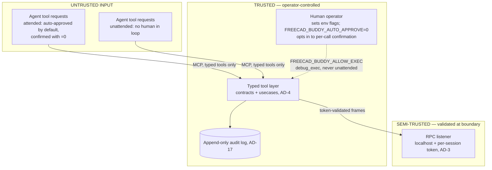

# Security Design

Implementation-ready security design: `debug_exec` gating (AD-4), RPC bind/token posture (AD-3), stderr-only logging (AD-3), the phase threat model, the trust boundary, and the mechanisms explicitly rejected as boundaries.

Security stance (from the sandbox-policy research, adopted by AD-4/AD-35): the only security boundary this repository ships is **architectural** — typed tools are the sole AI mutation path, reached only over MCP. Process and OS isolation are the operator's environment to provide; this repository ships none of its own. In-process Python restriction is never a boundary (§6).

## 1. debug_exec Gating (AD-4) — implementation-ready

`debug_exec` is a trusted-operator bring-up tool, never an AI capability. Four enforcement layers, all Phase 0:

**1. Env-flag gate.** Enabled only when the human operator sets `FREECAD_BUDDY_ALLOW_EXEC=1` in the *server process* environment before start. The flag is read once at server startup into an immutable capability record; no tool, RPC call, or config-reload path can set or change it at runtime. Any value other than exactly `"1"` is off (fail-closed).

**2. Conditional tool registration — not runtime rejection.** When the flag is off, `debug_exec` is **not registered** with the MCP server at all: it never appears in `tools/list`, so a model cannot discover, request, or be prompt-injected toward it. Registration logic in `adapters/mcp_server`:

```python
def register_tools(server, caps: Capabilities):
    for tool in TYPED_TOOLS:                      # query_*, document_*, sketch_*, ...
        server.add_tool(tool)
    if caps.allow_exec and not caps.unattended:  # unattended: no human present, AD-4
        server.add_tool(debug_exec)
        log_stderr("SECURITY: debug_exec ENABLED by operator flag")
```

`unattended` marks a run with no human present — `debug_exec` is **never enabled there** even if the env flag is set, because the flag is a human act and no agent may perform it (AD-4). Belt-and-suspenders: the tool body also re-checks the capability record and returns `INVALID_INPUT` if reached while off (defense against registration-logic bugs; not the boundary).

**3. Append-only audit log.** Every `debug_exec` call — and every mutation tool call (AD-17 requires this from Phase 0) — appends one `before` line and one `after` line to the per-session audit log:

- `debug_exec` writes its `before` line, carrying the full source, ahead of execution, so the line survives a call that never returns.
- A bracketed mutation writes its pair from inside `run_mutation`: the `before` line ahead of the op, the `after` line once the commit or the proven rollback is done. Both carry the full-parameter digest and the real fingerprints, so they join the call's approval line.
- A mutating call refused before the bracket gets its pair from the adapter after dispatch.

```json
{"ts": "...", "session": "<id>", "event": "exec_call", "tool": "debug_exec",
 "code_sha256": "...", "code": "<full source>", "caller": "<mcp client id>"}
{"ts": "...", "session": "<id>", "event": "exec_result", "status": "OK", "detail": {...}}
```

Records reuse the AD-17 contracts-owned audit-record type. The log file is opened append-only (`"a"`, plus `O_APPEND` semantics); the bridge exposes no tool that reads, truncates, or rotates it. Location: alongside the session workdir, operator-configurable.

**4. Namespace reduction (hardening only, not a boundary).** `debug_exec` runs code with globals limited to FreeCAD App modules + a result channel. Per research Finding 1c this is bypassable and is documented as blast-radius reduction only (§1 item 4).

CI check: a test asserts `tools/list` excludes `debug_exec` when the env flag is unset, includes it when set, and always excludes it when `unattended` is set.

## 2. RPC Bind and Per-Session Token (AD-3) — implementation-ready

The GUI-mode RPC channel (external MCP server ⇄ in-FreeCAD listener, AD-2) is a localhost trust seam: any local process could otherwise drive FreeCAD through it.

- **Bind:** listener binds `127.0.0.1` on an ephemeral or configured port. Same for the streamable-HTTP MCP endpoint. Remote bind requires an explicit operator flag (`FREECAD_BUDDY_BIND=<addr>`) and logs a stderr security warning at startup; no silent `0.0.0.0`.
- **Token generation:** at addon start, the listener generates `secrets.token_urlsafe(32)` (stdlib only — AD-12) and writes it with the port to the discovery file `<FreeCAD user app data>/freecad-buddy/rpc-<pid>.json` (authoritative shape: integration-mcp-freecad.md §2.6) created with owner-only permissions (`0o600`; on Windows, default user-profile ACLs suffice). New token per session; file deleted on clean shutdown; stale files (dead PID) are ignored.
- **Validation:** every RPC frame carries the token; the versioned handshake (AD-2 wire contract in `contracts/`) validates it before any dispatch. Comparison via `hmac.compare_digest`. Invalid/missing token → connection closed, one audit-log line, no error detail leaked to the peer.
- **Not in scope:** TLS on loopback, multi-user hosts hardening. Single-operator desktop is the attended trust model (§4).

## 3. stderr-Only Logging Enforcement (AD-3) — implementation-ready

On the stdio transport, stdout **is** the MCP protocol; one stray `print()` corrupts framing.

- All server-side logging goes through one `logging` config writing to `sys.stderr`; `print()` is banned in `contracts/`, `usecases/`, `adapters/`, and `hosts/` server code.
- Enforcement: CI lint gate (ruff `T201`/`T203` — no `print`/`pp`) over `src/freecad_buddy/`, plus a startup guard in the stdio host that rebinds `sys.stdout` for non-protocol code paths to a wrapper that raises in dev / redirects to stderr in production.
- Third-party libraries that print (trimesh etc.) live only in the external process (AD-12) and are wrapped with stdout redirection at call sites in the harness/oracle glue.
- The audit log (§1) is a separate append-only file, never stdout/stderr.

## 4. Threat Model by Phase — what is protected, against what

| Phase | Untrusted input | Primary controls | Explicitly NOT defended |
| --- | --- | --- | --- |
| 0 (bridge/harness) | None — operator + our own CI scripts | `debug_exec` off-by-default + unregistered (AD-4); localhost bind + token (AD-3); audit log (AD-17) | Malicious local processes with the operator's own privileges; malicious operator |
| 1 (read-only assistant) | LLM output (hallucination, prompt injection) | Zero mutation tools registered (AD-4); read-only `query_*` only; no exec in tool list | Model reading data it's shown; local-process threats as above |
| 2 (copilot) | LLM-driven mutation requests | Typed tools only mutation path (AD-4); AD-5 transaction + verify + proven rollback per mutation; audit log with one `approval` line per mutation; AD-10 auto-approve on by default, `FREECAD_BUDDY_AUTO_APPROVE=0` as the opt-in confirm gate; a sent `preview_id` is checked in every posture; token'd RPC | OS-level containment — the bridge runs with the operator's privileges inside their FreeCAD; acceptable because every mutation is typed, verified, rolled back on failure and audited, and an operator who wants per-call consent sets `=0` |
| Unattended | Agent requests = fully untrusted input, even over typed tools | Everything above; every reported field is a re-executed check (AD-17); `debug_exec` never enabled; the audit log makes the run reconstructable after the fact | This repository ships no process boundary — the operator's environment provides isolation, and a determined attacker on that host is out of scope |

Threats defended across phases: LLM free-form exec as mutation path (AD-4); silent bad-part success (AD-17 re-executed checks); stdout protocol corruption (AD-3); rogue local RPC caller (token); An unattended run adds: resource exhaustion, exfiltration/egress, host FS tamper, and crash cascade — all bounded by the operator's environment rather than by anything this repository ships.

## 5. Trust Boundary Diagram



Key reading: untrusted input never touches an unvalidated surface, and there is only one way in — the typed MCP tool layer, for every caller (AD-35). Attended requests pass through the typed-tool schemas and the AD-5 bracket; auto-approve is on by default, so per-call operator confirmation applies only when the operator sets `FREECAD_BUDDY_AUTO_APPROVE=0`, and a `preview_id` an agent sends is checked in every posture. Every approved mutation writes an `approval` audit line naming its mode. Unattended requests pass through the same schemas with `contracts/` validation (`INVALID_INPUT` on failure, AD-17) and the audit log as the after-the-fact record. **This repository ships no process or sandbox boundary of its own** — the operator's environment is the isolation boundary, which is why `debug_exec` is default-off and never enabled unattended.

## 6. Explicitly Rejected Mechanisms (AD-4)

Never described, configured, or relied upon as a security boundary. Permitted only as monitoring/hardening, and only when labeled as such.

| Mechanism | Why rejected as boundary | Permitted use |
| --- | --- | --- |
| `sys.addaudithook` (PEP 578) | CPython maintainers: "not suitable for implementing a sandbox"; in-process code can unregister/bypass | Monitoring/intrusion-detection signal feeding the audit log |
| RestrictedPython | Self-described "not a sandbox system"; ongoing bypass CVEs (e.g. CVE-2024-47532) prove open-ended attack surface | None planned; would be hardening-only if ever adopted |
| Import/builtin blacklists | Trivially bypassed via `().__class__.__bases__[0].__subclasses__()` class-tree walk | Not used; `debug_exec` namespace reduction is blast-radius hygiene, documented as bypassable (§1 item 4) |
| Namespace-restricted `exec` globals | Same class-tree escape; reduces accidents, not adversaries | `debug_exec` hardening layer only (§1 item 4) |
| String/AST filtering of submitted code | Denylist arms race; dynamic introspection routes around it | Nowhere |

The real boundary, restated: **typed tools as the only AI mutation path, reached only over MCP (AD-4, AD-35)**. Everything else is depth, and process isolation is the operator's environment to provide.
