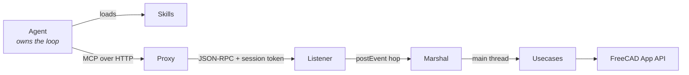
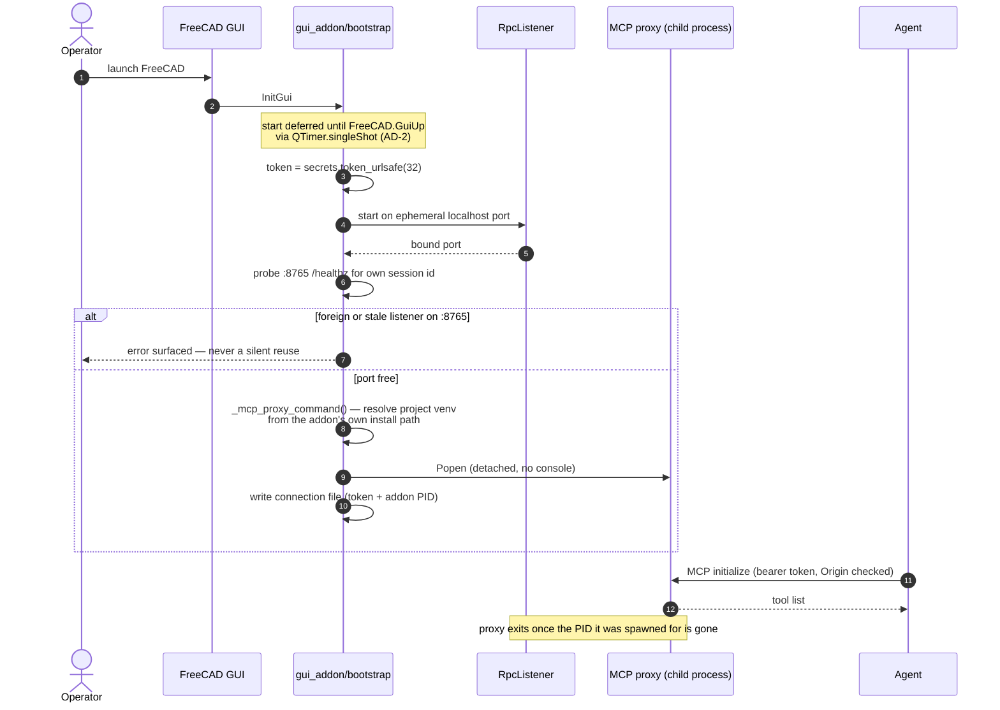
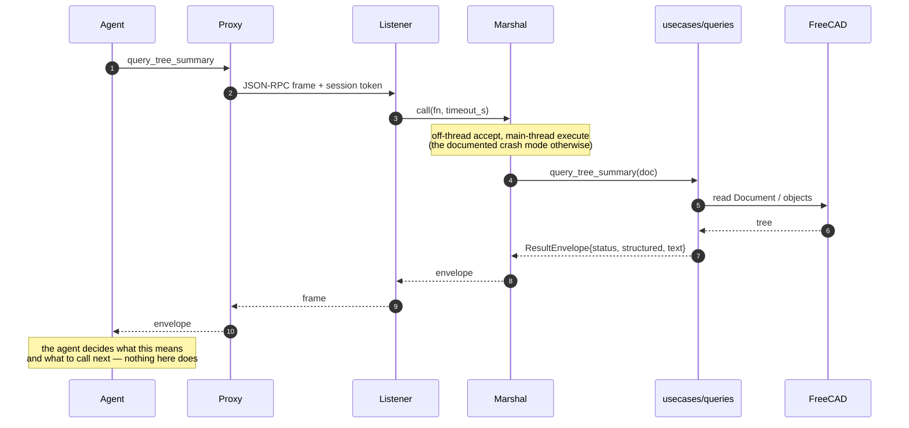
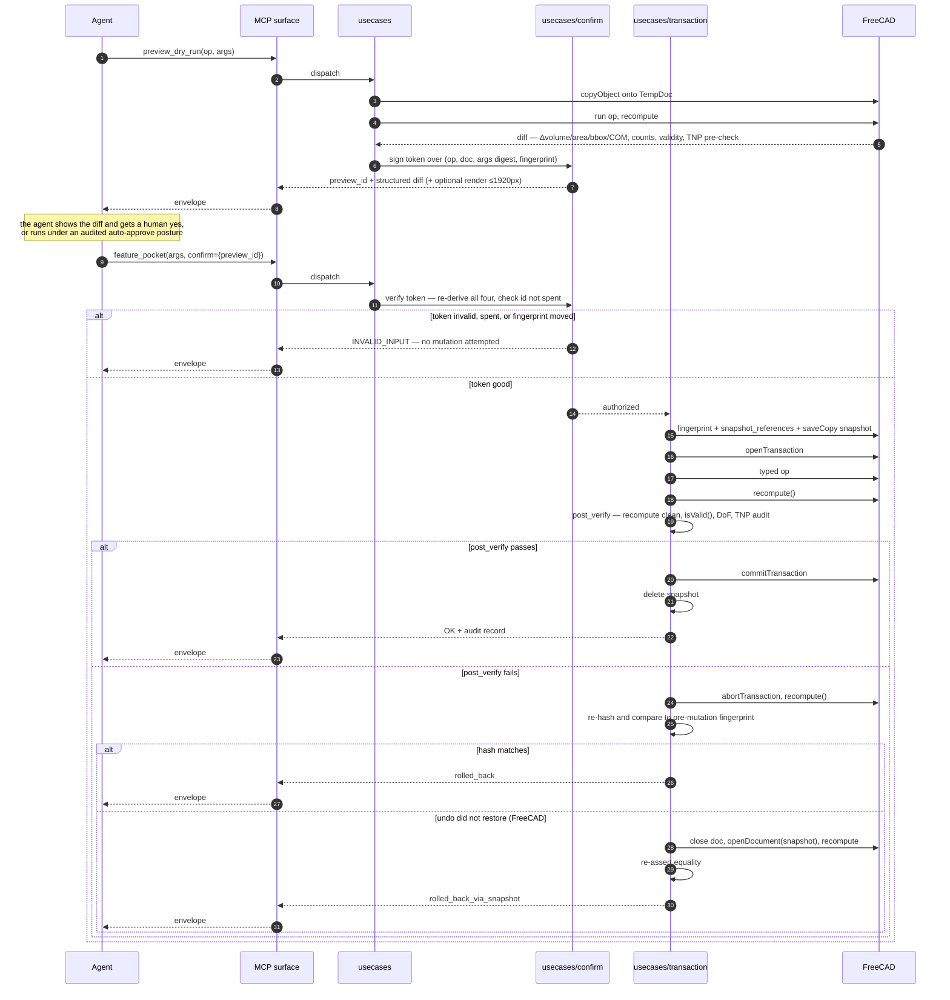
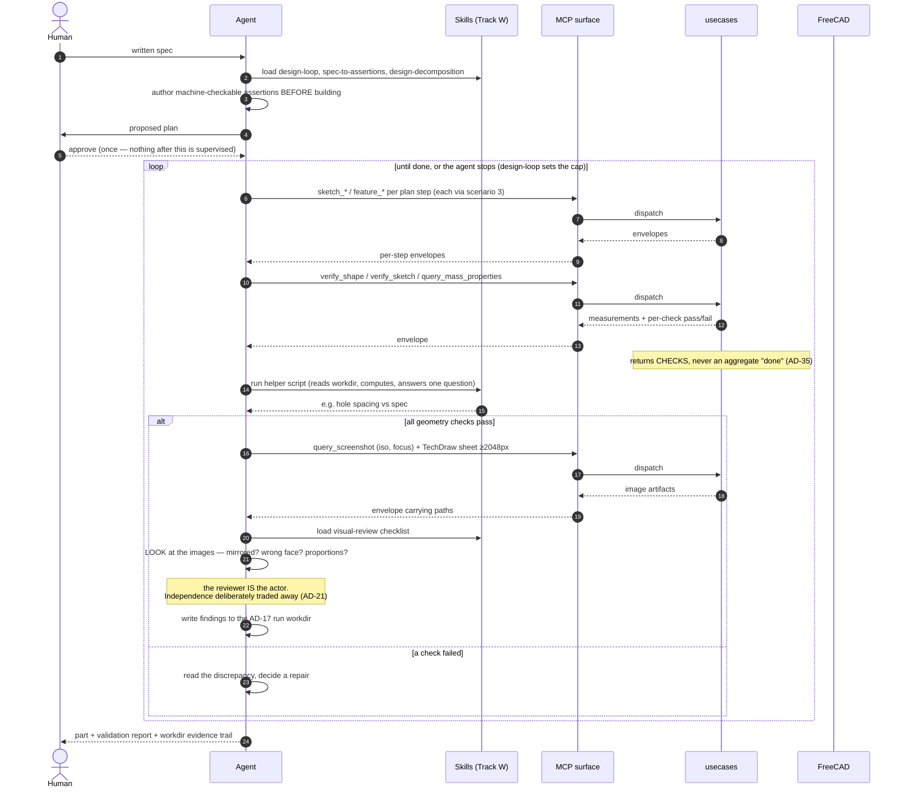
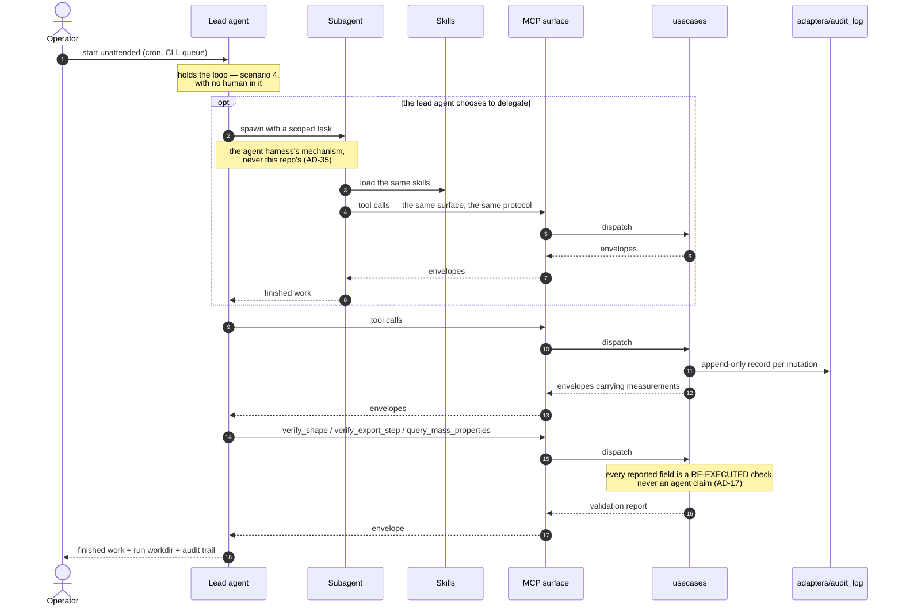
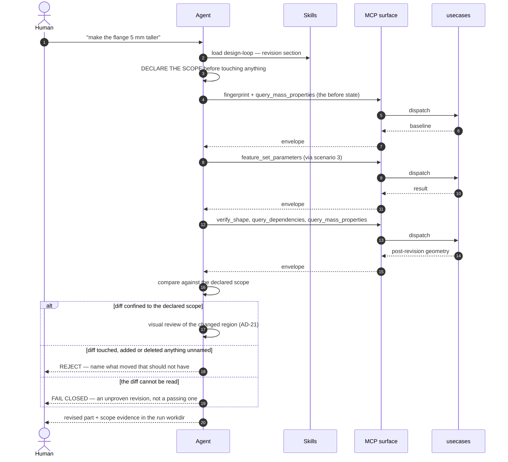
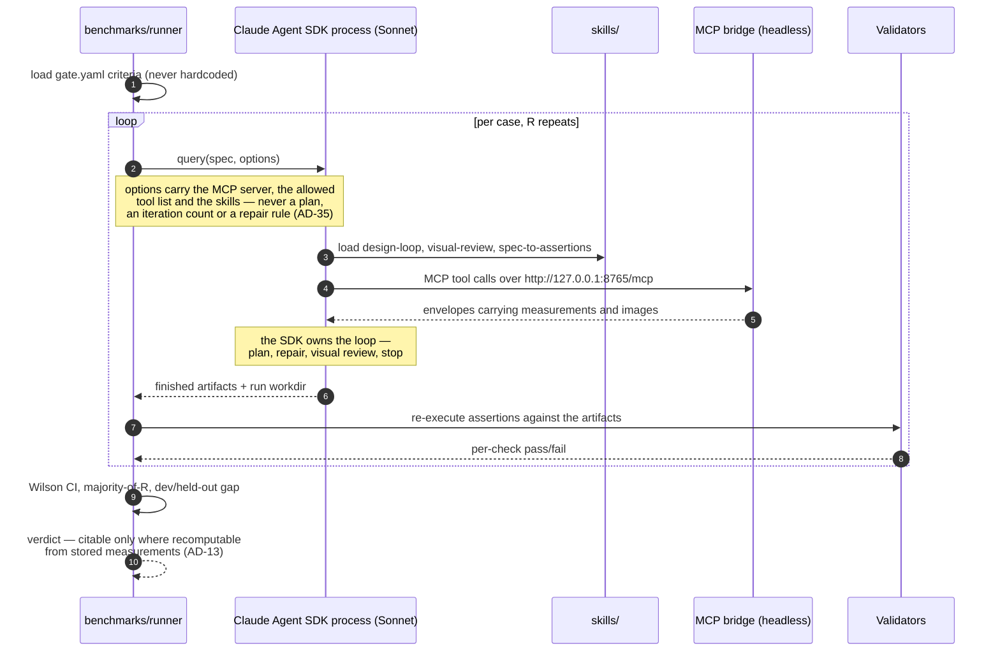
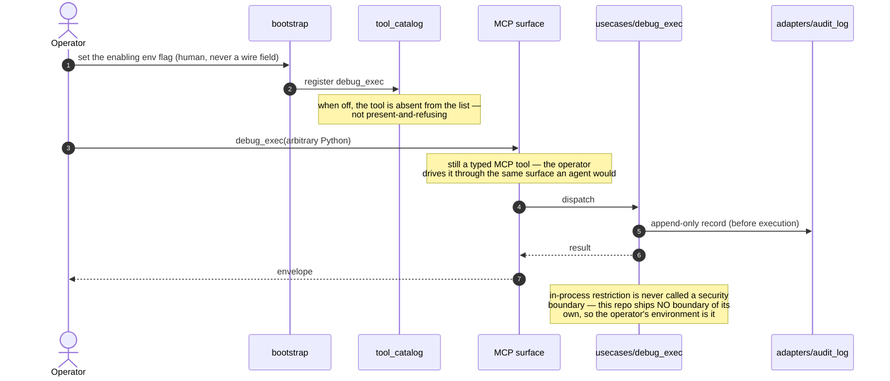

# Scenario Sequence Diagrams

Runtime call paths for every scenario FreeCAD Buddy supports. Each diagram is drawn from the
shipped code, and every message name is a real tool, function or wire frame.

**The boundary AD-35 draws is the reason these diagrams exist.** Read them for one thing above all:
which participant holds the loop. In every scenario the answer is the **driving agent**, never a
box inside this repo. A diagram that showed `src/` deciding what to do next would be a design
defect, not a drawing choice.

**The agent never calls a use case directly. Every call crosses the MCP protocol.** There is no
in-process path from an agent to `usecases/`, no Python import, no direct function call — the MCP
surface is the *only* way in, for every caller: the interactive agent, a spawned subagent, a
benchmark actor, and the operator driving `debug_exec`. Scenario 2 draws that crossing in full
(Proxy → Listener → Marshal → use case); the later diagrams collapse it to one **MCP surface**
participant so the scenario's own logic stays readable, but the hop is always there. An arrow drawn
from an agent straight to a use case would misstate the architecture — the protocol boundary is
what makes the bridge agent-agnostic, and it is where authentication (AD-3), the typed-tool
restriction (AD-4), and the envelope contract (AD-17) are enforced.

## Participants, and what each one may do

| Participant | Is | May never |
| --- | --- | --- |
| **Agent** | The driving AI (Claude Code, opencode, any MCP client). Holds the plan, the repair decision, the visual verdict, the stop condition | — |
| **Skills** | `skills/` — knowledge + Track W workflow + read-only helper scripts the agent's own shell runs | Call a model; mutate a document; decide the next action |
| **MCP surface** | The protocol boundary, collapsed for readability: Proxy → Listener → Marshal in GUI mode, one in-process hop when headless. **Every** agent call crosses it | Be bypassed — there is no other way into `usecases/` |
| **Proxy** | The external MCP protocol server (`adapters/mcp_server.py`), auto-spawned by the addon | Import FreeCAD |
| **Listener** | The in-FreeCAD RPC listener (`adapters/rpc_listener.py`), stdlib only | Touch FreeCAD off the main thread |
| **Marshal** | `adapters/marshal.py` — hops every call onto the Qt main thread | Import Qt (the pump lives in `hosts/gui_addon/pump.py`) |
| **Usecases** | `usecases/` — tool implementations, the AD-5 mutation protocol, verification | Import Qt; hold a plan, an iteration count, or a done-predicate |
| **FreeCAD** | The App-layer kernel | — |

---

## 1. Bridge start — opening FreeCAD is the only operator step

`hosts/gui_addon/bootstrap.py:82 start_bridge`. The addon starts the listener **and** spawns the
proxy; nothing is launched by hand (AD-2).

**Why the PID is in the connection file:** a fast FreeCAD restart otherwise leaves an orphan proxy
owning the port and wired to a dead listener — which the client experiences as a hang rather than
a status (AD-2).

---

## 2. Read-only query — the Phase 1 shape

No mutation, no transaction. The marshal hop is the only thing that distinguishes GUI mode from
headless.

Headless (`FreeCADCmd`) is the same diagram with Proxy, Listener and Marshal collapsed: one
process, `InlineExecutor`, use cases called inline. Same `usecases/` code on every path.

---

## 3. Confirmed mutation — preview, confirm, apply, prove rollback

The AD-5 protocol in full. This is the scenario the repo is built around.

**Rollback success is measured, never assumed** — that re-hash is the whole point of AD-5. The
snapshot path exists because FreeCAD's undo can fail to restore the pre-`openTransaction`
boundary.

**A token authorizes one mutation.** The fingerprint comparison proves the document is still in the
state the preview measured; it does not prove the token is unused, because a property written its
existing value commits without moving the fingerprint. Hence the spent-id set
(`usecases/confirm.py:7-12`).

---

## 4. Spec to part — the loop, held by the agent

The loop is the agent following `design-loop`; the repo supplies measurements and images and
decides nothing.

**Both legs are required for done** — geometry assertions *and* a performed visual review. Nothing
at runtime enforces the conjunction: `derive_verdict` reads checks alone and no code may produce a
visual verdict. A run whose workdir carries no visual evidence is an **incomplete run**, caught
after the fact by AD-19's ≥20 % human spot-audit. Detectability is therefore after the fact rather
than at runtime — the accepted cost of AD-35.

---

## 5. Unattended operation, and delegation

There is **no job API, no supervisor and no worker pool**. Unattended
means an operator starts an agent and walks away — the same agent, the same MCP surface, the same
skills as scenario 4, with no human in the loop. **Delegation is the agent's own mechanism:** an
agent that wants to parallelize spawns a **subagent**, which operates the same MCP surface with the
same skills.

**What the repo still owes an unattended run**, with no service to provide it: the append-only
audit log and `run_id` traceability (AD-17), artifact retention in the session workdir (AD-25), and
verification whose every field is re-executed rather than echoed. None of that needs a worker.

**There is no crash containment of our own.** A segfault in the geometry kernel takes down whatever
process the agent is driving. This repository offers no boundary — the operator's environment is the
boundary, which is why the audit log matters: it is what makes such a failure legible afterwards.

---

## 6. Revision — change one thing, prove nothing else moved

**Without a declared scope there is nothing to be out of**, and "confined to the requested change"
would reduce to whatever the result happened to touch — a check that can never fail. That reasoning
lives in the `design-loop` skill, and its deterministic half — comparing two fingerprints and
reporting what moved — belongs in `usecases/verify_*` where any caller can re-run it.

---

## 7. Gate run — spawning the actor with the Claude Agent SDK

**Open question:** whether gates keep scoring end-to-end production at all is recorded in the
spine's Deferred table.

**The runner spawns the actor as a Claude Agent SDK process** (`claude-agent-sdk` /
`@anthropic-ai/claude-agent-sdk`). That SDK *is* the Claude Code harness packaged as a library: it
supplies the agent loop, context management, subagents, and built-in tools, and the caller supplies
only a prompt and options. The runner therefore holds **no loop of its own** — it hands over a spec
and waits, which is what keeps it on the right side of AD-35's `benchmarks/` scope.

**The bridge is already an MCP server, so no glue is needed.** `.mcp.json` declares it as a plain
HTTP entry (`http://127.0.0.1:8765/mcp`); the Agent SDK attaches it the same way any MCP client
does. The runner's job reduces to: start the process, point it at that endpoint, collect what it
wrote.

**The benchmark actor runs on Sonnet**, and the gate's `actor.model` names the exact model id used.
Two reasons it is the right default here rather than a cost compromise: a gate is run at R≥10 across
27 cases, so the actor is the dominant spend in the harness; and the gate measures **the bridge and
the skills**, not the frontier of model capability — a weaker actor that still passes is stronger
evidence that the tool surface and `design-loop` carry the work. The floor this sets is a floor, not
a ceiling: an operator driving the same bridge on a larger model should do at least as well.

Two constraints travel with that choice. **A cited rate is only valid for the actor that produced
it** — AD-14's banner already carries the model, and a Sonnet-measured pass rate may not be quoted
for an Opus-driven run or the reverse. And **a gate failure now has two candidate causes**: the
bridge or skills are inadequate, or the actor was. Distinguishing them needs a re-run on a stronger
actor, which is a diagnostic step, not a new gate result.

**Three properties this shape must preserve**, each of which a hand-rolled runner tends to lose:

| Property | Why the SDK gives it for free |
| --- | --- |
| The runner holds no loop | The harness lives in the SDK process, not in `benchmarks/` |
| The actor is a real agent, not a simulation | Same harness a human operator drives — the gate measures what ships |
| No model client in this repo | The SDK carries its own credential; `benchmarks/` never imports a model SDK |

**The actor identity in `gate.yaml` must name the real thing.** Today it reads
`model: claude-mcp-client`, a placeholder. Under this shape it names the exact Sonnet model id the
SDK ran, because AD-13's independence guard compares that descriptor against the grader — a
placeholder makes the guard vacuous. **G3's independence is unaffected by the Sonnet choice**: its
`grader` is `deterministic-geometry-assertions` (`harness/assertions.py`), deterministic code rather
than a model, so no actor model can collide with it. The guard still matters for any gate whose
grader *is* a model — G1's `deterministic-expected-findings` is likewise code, but AD-21's visual
reviewer is now the actor by design, which is the trade AD-21 records rather than a collision to
resolve.

**What may not be cited:** any figure whose value depends on a judgement the producing agent made.
"Mean repairs to convergence" is not citable — convergence is where the agent decided to stop.
"Count of parts whose assertions passed" over the same runs is. A derived statistic inherits the
status of its least-citable input.

---

## 8. Operator escape hatch — `debug_exec`

Off by default, unregistered from the tool list when off, and never enabled in an unattended run —
the flag is a human act, and no agent may set it (AD-4).

---

## What no diagram shows, deliberately

Three shapes are absent because AD-35 forbids them. Their absence is the design.

| Absent shape | Why |
| --- | --- |
| A `src/` box deciding the next action | The loop is the agent's. Any arrow returning "do this next" from inside the repo is a violation |
| A judge participant with a model API | The reviewer is the agent. No model client, no credential, no verdict-producing code |
| A service endpoint that takes a spec and returns a part | That is the loop in the code wearing a service's clothes. Scenario 5 submits *FreeCAD work*, not a design task |
